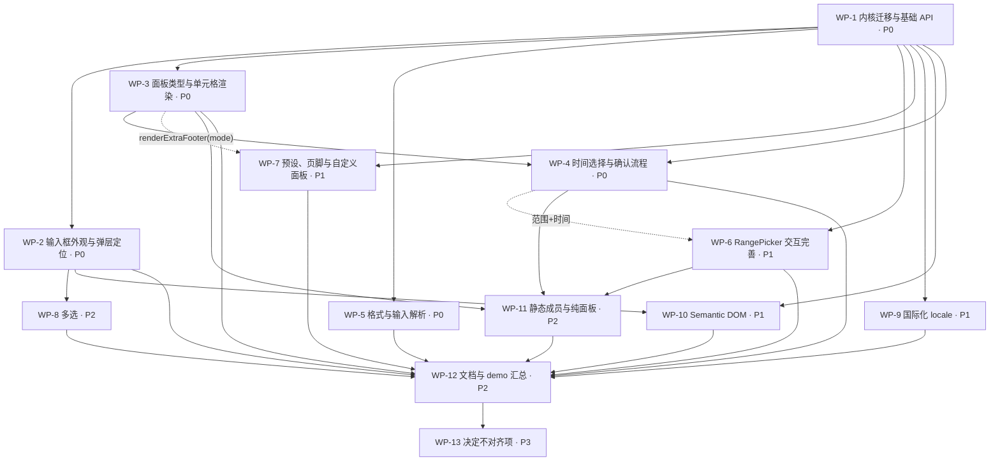

# base-ui DatePicker ↔ antd DatePicker 对齐差距清单

> 范围：`src/base-ui/DatePicker`（`DatePicker.tsx` / `DateRangePicker.tsx` / `CalendarPanel.tsx` / `PickerShell.tsx` / `calendar.ts` / `type.ts` / `style.ts` / `index.ts` / `index.mdx` / `demos/index.tsx` / `demos/range.tsx` / `__tests__/*`）
> 对照基准：antd `master` @ `5a102fe28abc8624eb27c5e1365cdbb0a4dead73`（2026-10-13）— `components/date-picker/index.zh-CN.md`（API 章节、代码演示列表、Semantic DOM、FAQ）、`generatePicker/interface.ts`、`generatePicker/index.tsx`、`index.tsx`、`locale/example.json`、`demo/*.tsx`（33 个文件）；以及 antd 6.6.5 依赖的 `@rc-component/picker@1.12.2`（`lib/interface.d.ts`、`PickerInput/SinglePicker.d.ts`、`PickerInput/RangePicker.d.ts`）。
> 本文为 T-762 调研结论，仅描述差距与计划，不修改任何源码。

状态说明：**已支持** = 类型与行为都与 antd 一致（允许实现差异）；**部分** = 有该字段 / 等价字段，但类型、命名或行为不完整；**缺失** = 无该字段 / 能力。状态列只使用这三个值；决定不对齐的项状态记为「缺失」，备注写明理由并归入 WP-13。

工作包编号（WP-x）定义见第 5 节。每一条「部分 / 缺失」都在备注列中标注所属工作包。

---

## 0. 现状概要

- 规模：源码约 940 行（不含测试 275 行）。自实现，无 `@rc-component/picker`；弹层基于 `base-ui/Popover`（`PickerShell`），外观复用 `base-ui/Input` 的 `rootVariants` 与 `ClearButton`。
- 值类型：原生 `Date`（antd 为 `Dayjs`）；内部计算用 `dayjs`，但对外不暴露 `Dayjs`。
- 组件：`DatePicker`（`mode: 'date' | 'month' | 'year'`，语义相当于 antd 的 `picker`）与独立的 `DateRangePicker`（只支持日期、双月联动面板）。没有 `DatePicker.RangePicker` 等静态成员。
- 触发器是 `<button>`，**没有可输入的 input**：不支持键入/解析日期、mask、`inputReadOnly`、`preserveInvalidOnBlur`。
- 面板：日 / 月 / 年三级（年视图是 12 年一页，非 antd 的 decade / century 结构），只有「上一月 / 下一月」导航，点标题逐级上钻。日网格固定 6 周，周起始日与周名跟随 dayjs locale。键盘：方向键、PageUp/PageDown、Home/End，跳过禁用日。
- 已有字段：`allowClear`(boolean) / `className` / `style` / `disabled`(boolean) / `disabledDate(Date)` / `format`(string | fn，仅展示) / `min` / `max` / `size`(small/middle/large) / `variant`(filled/outlined/borderless) / `shadow`(lobe 独有) / `placeholder` / `value` / `defaultValue` / `onChange(value)` / `footer`(仅单选) / `mode`。
- 缺失大块：时间选择、week/quarter 面板、presets、multiple、needConfirm、受控 `open` / `pickerValue` / `mode`、`cellRender` / `panelRender` / `components`、`locale` prop、`status`、`prefix` / `suffixIcon` / `separator` / 导航图标、`placement` / `getPopupContainer`、Semantic DOM、ref 方法。
- 文档：`index.mdx` 仅 2 个 demo（`index.tsx`、`range.tsx`）+ 「Migrating from antd DatePicker」小节；antd 文档共 33 个 demo 文件（32 个「代码演示」+ Semantic DOM 章节的 `_semantic`）。
- 测试：`DatePicker.test.tsx`（11 例）、`DateRangePicker.test.tsx`（3 例）、`calendar.test.ts`（8 例）。
- 仓库内无其它消费方（`src/DatePicker` 是 antd 包装的经典组件，与本目录无关），改动 API 只影响 `@lobehub/ui/base-ui` 公共导出。

---

## 1. API 对照表

### 1.1 共同的 API（antd 文档「共同的 API」全部字段，DatePicker 与 RangePicker 共享）

| 字段                  | antd 类型                                                                                         | 当前状态 | 备注 / 工作包                                                                                                                                                                                                                                                                                                                |
| --------------------- | ------------------------------------------------------------------------------------------------- | -------- | ---------------------------------------------------------------------------------------------------------------------------------------------------------------------------------------------------------------------------------------------------------------------------------------------------------------------------- |
| allowClear            | `boolean \| { clearIcon?: ReactNode }`，默认 `true`                                               | 部分     | 只支持 boolean；对象形式 `clearIcon` 缺失。WP-2                                                                                                                                                                                                                                                                              |
| ~~bordered~~          | `boolean`（deprecated → `variant`）                                                               | 缺失     | 作为 deprecated 别名映射到 `variant="borderless"`。WP-2                                                                                                                                                                                                                                                                      |
| className             | `string`                                                                                          | 已支持   | 挂在根节点。                                                                                                                                                                                                                                                                                                                 |
| classNames            | `Record<SemanticDOM, string> \| (info: { props }) => …`                                           | 缺失     | 见 1.10。WP-10                                                                                                                                                                                                                                                                                                               |
| dateRender            | `(currentDate: dayjs, today: dayjs) => ReactNode`（< 5.4.0，deprecated）                          | 缺失     | 作为 `cellRender` 的兼容别名。WP-3                                                                                                                                                                                                                                                                                           |
| cellRender            | `(current, info: { originNode, today, range?, type: PanelMode, locale?, subType? }) => ReactNode` | 缺失     | 需覆盖 date/week/month/quarter/year/decade/time 各面板单元格。WP-3（time 的 `subType` 在 WP-4）                                                                                                                                                                                                                              |
| components            | `Record<Panel \| 'input', ComponentType>`（5.14.0）                                               | 缺失     | 自定义面板（`date`/`week`/`month`/`quarter`/`year`/`decade`/`time`）与 `input`、`button`。WP-7                                                                                                                                                                                                                               |
| defaultOpen           | `boolean`                                                                                         | 已支持   | 开关状态目前完全内部。WP-1 **T-765 已完成**：rc-picker 原生，`defaultOpen` 测试覆盖。                                                                                                                                                                                                                                        |
| disabled              | `boolean`（RangePicker 另支持 `[boolean, boolean]`）                                              | 部分     | 单选已支持；范围的元组形式见 1.5。WP-6                                                                                                                                                                                                                                                                                       |
| disabledDate          | `(currentDate: dayjs, info: { from?: dayjs, type: Picker }) => boolean`                           | 部分     | 现为 `(date: Date) => boolean`：参数类型不同、无 `info.from` / `info.type`；且只作用于日网格，月/年 tile 不调用它。WP-1（签名与月/年面板）、WP-6（`info.from`） **T-765 部分完成**：签名改为 `(current: Dayjs, info: { type, from? })`，date / month 面板调用并禁用（测试覆盖 `info.type`）；范围 `info.from` 留 WP-6 验证。 |
| ~~dropdownClassName~~ | `string`（deprecated → `classNames.popup.root`）                                                  | 缺失     | deprecated 别名。WP-10                                                                                                                                                                                                                                                                                                       |
| format                | `FormatType`（string \| fn \| 数组 \| `{ format, type: 'mask' }`）                                | 部分     | 仅 string \| `(Date) => string` 用于展示；数组多格式解析、mask、输入解析缺失。见 1.6。WP-5                                                                                                                                                                                                                                   |
| order                 | `boolean`，默认 `true`（多选、范围自动排序）                                                      | 部分     | 范围始终排序（`orderRange`），不可关闭；多选不存在。WP-6（范围）、WP-8（多选）                                                                                                                                                                                                                                               |
| preserveInvalidOnBlur | `boolean`，默认 `false`                                                                           | 已支持   | 依赖可输入 input。WP-1 **T-765 已完成**：输入框可键入，`preserveInvalidOnBlur` 保留非法文本，默认失焦恢复（测试覆盖）。                                                                                                                                                                                                      |
| ~~popupClassName~~    | `string`（deprecated → `classNames.popup.root`）                                                  | 缺失     | deprecated 别名。WP-10                                                                                                                                                                                                                                                                                                       |
| getPopupContainer     | `(trigger) => HTMLElement`                                                                        | 缺失     | 当前固定 Portal 到 body。WP-2                                                                                                                                                                                                                                                                                                |
| inputReadOnly         | `boolean`，默认 `false`                                                                           | 已支持   | 当前触发器是 button，等价「永远只读」，无法关闭。WP-1 **T-765 已完成**：透传到 `<input readonly>`（测试覆盖）。                                                                                                                                                                                                              |
| locale                | `PickerLocale`（`lang` + `timePickerLocale`）                                                     | 缺失     | 文案只能经全局 `@lobehub/ui/i18n`；单组件 locale、格式类 locale 字段缺失。见 1.9。WP-9                                                                                                                                                                                                                                       |
| minDate               | `dayjs`（5.14.0，同时限制面板切换范围）                                                           | 已支持   | 有 lobe 字段 `min: Date`：禁用日/月/年，但导航按钮不受限。需新增 `minDate` 并把 `min` 作为 deprecated 别名。WP-1 **T-765 已完成**：`minDate` 禁用单元格并禁用越界导航按钮，`min` 为 deprecated 别名（测试 + `date-range` demo）。                                                                                            |
| maxDate               | `dayjs`（5.14.0）                                                                                 | 已支持   | 同上，对应 lobe `max`。WP-1 **T-765 已完成**：同 `minDate`，`max` 为别名。                                                                                                                                                                                                                                                   |
| mode                  | `'time' \| 'date' \| 'month' \| 'year' \| 'decade'`（受控面板状态）                               | 已支持   | **语义冲突**：lobe `mode` 表示选择器类型（≈ antd `picker`）。需改为 antd 语义（受控面板），选择器类型迁到 `picker`。WP-1 **T-765 已完成**：`mode` 改为 antd 语义的受控面板模式，选择器类型迁到 `picker`（测试 + `mode` demo）。                                                                                              |
| needConfirm           | `boolean`（5.14.0，`multiple` 时默认 `false`，`showTime` 时默认 `true`）                          | 缺失     | 当前点选即提交。WP-4                                                                                                                                                                                                                                                                                                         |
| nextIcon              | `ReactNode`                                                                                       | 缺失     | 固定 `ChevronRight`。WP-2                                                                                                                                                                                                                                                                                                    |
| open                  | `boolean`                                                                                         | 已支持   | 开关不可受控（`start-end`、`external-panel` demo 依赖）。WP-1 **T-765 已完成**：受控 `open`（测试 + `start-end` / `controlled` demo）。                                                                                                                                                                                      |
| panelRender           | `(panelNode) => ReactNode`                                                                        | 缺失     | WP-7                                                                                                                                                                                                                                                                                                                         |
| picker                | `'date' \| 'week' \| 'month' \| 'quarter' \| 'year'`，默认 `date`                                 | 部分     | 由 lobe `mode` 提供 date/month/year；`week` / `quarter` 缺失，且字段名不同。WP-1（字段）、WP-3（week/quarter） **T-765 部分完成**：新增 `picker` 字段，date / month / year 已支持（测试 + `basic` demo）；week / quarter 样式与测试留 WP-3。                                                                                 |
| placeholder           | `string \| [string, string]`                                                                      | 已支持   | 单选 string、范围元组；默认文案来自 i18n。按 picker 区分的默认 placeholder（week/quarter）随 WP-3 / WP-9 补齐。                                                                                                                                                                                                              |
| placement             | `'bottomLeft' \| 'bottomRight' \| 'topLeft' \| 'topRight'`，默认 `bottomLeft`                     | 缺失     | `PickerShell` 写死 `bottomLeft`。WP-2                                                                                                                                                                                                                                                                                        |
| ~~popupStyle~~        | `CSSProperties`（deprecated → `styles.popup.root`）                                               | 缺失     | deprecated 别名。WP-10                                                                                                                                                                                                                                                                                                       |
| prefix                | `ReactNode`（5.22.0）                                                                             | 缺失     | WP-2                                                                                                                                                                                                                                                                                                                         |
| prevIcon              | `ReactNode`                                                                                       | 缺失     | 固定 `ChevronLeft`。WP-2                                                                                                                                                                                                                                                                                                     |
| previewValue          | `false \| 'hover'`，默认 `hover`（6.0.0）                                                         | 缺失     | 悬停单元格时输入框临时显示该值；范围触发器只显示 draft，不显示 hover。WP-4                                                                                                                                                                                                                                                   |
| presets               | `{ label: ReactNode, value: Dayjs \| (() => Dayjs) }[]`（范围为元组）                             | 缺失     | WP-7                                                                                                                                                                                                                                                                                                                         |
| size                  | `'large' \| 'medium' \| 'small'`                                                                  | 部分     | 现为 `small \| middle \| large`（`base-ui/Input` 的 `InputSize`）；缺 `medium`（保留 `middle` 为别名）。WP-2                                                                                                                                                                                                                 |
| status                | `'error' \| 'warning'`                                                                            | 缺失     | `base-ui/Input` 亦无 status 样式，需在 DatePicker 内实现（或先给 Input 的 `rootVariants` 增加 status）。WP-2                                                                                                                                                                                                                 |
| style                 | `CSSProperties`                                                                                   | 已支持   | 挂在根节点。                                                                                                                                                                                                                                                                                                                 |
| styles                | `Record<SemanticDOM, CSSProperties> \| (info) => …`                                               | 缺失     | 见 1.10。WP-10                                                                                                                                                                                                                                                                                                               |
| suffixIcon            | `ReactNode`                                                                                       | 缺失     | 固定 `CalendarIcon`（time picker 应为时钟图标）。WP-2                                                                                                                                                                                                                                                                        |
| superNextIcon         | `ReactNode`                                                                                       | 缺失     | 当前面板没有 `>>`（跨年 / 跨十年）按钮。WP-2（随 WP-1 的面板头结构）                                                                                                                                                                                                                                                         |
| superPrevIcon         | `ReactNode`                                                                                       | 缺失     | 同上 `<<`。WP-2                                                                                                                                                                                                                                                                                                              |
| clearIcon             | `ReactNode`（仅全局配置，6.4.0）                                                                  | 缺失     | 组件级以 `allowClear.clearIcon` 提供（WP-2）；全局配置决定不对齐，见 1.12。WP-13                                                                                                                                                                                                                                             |
| variant               | `'outlined' \| 'borderless' \| 'filled' \| 'underlined'`，默认 `outlined`                         | 部分     | 缺 `underlined`；且暗色模式默认 `filled`（与 antd 不同，保留并写入迁移说明）。WP-2                                                                                                                                                                                                                                           |
| onClear               | `() => void`（6.5.0）                                                                             | 缺失     | 清除时只触发 `onChange(null)`。WP-2                                                                                                                                                                                                                                                                                          |
| onOpenChange          | `(open: boolean) => void`                                                                         | 已支持   | WP-1 **T-765 已完成**：测试覆盖打开 / 选择后关闭 / Esc 关闭。                                                                                                                                                                                                                                                                |
| onPanelChange         | `(value, mode) => void`                                                                           | 已支持   | 面板切换（翻月 / 上钻）不对外通知。WP-1 **T-765 已完成**：`onPanelChange(value, mode)`（测试 + `mode` demo）。                                                                                                                                                                                                               |
| ~~onSelect~~          | `(value) => void`（deprecated → `onCalendarChange`）                                              | 已支持   | 作为 `onCalendarChange` 的兼容别名。WP-1 **T-765 已完成**：`onSelect` 作为 `onCalendarChange` 的 deprecated 别名（测试覆盖）。                                                                                                                                                                                               |

### 1.2 共同的方法（ref）

| 成员          | antd 类型                                                                                              | 当前状态 | 备注 / 工作包                                                                                                                                                                                             |
| ------------- | ------------------------------------------------------------------------------------------------------ | -------- | --------------------------------------------------------------------------------------------------------------------------------------------------------------------------------------------------------- |
| focus()       | `PickerRef.focus(options?: FocusOptions)`；RangePicker 为 `focus(index? \| FocusOptions & { index? })` | 部分     | 组件未转发 ref（`memo` 且未接 `ref`）。WP-1（范围的 `index` 参数在 WP-6） **T-765 部分完成**：组件接收 React 19 `ref` 并转发 rc `PickerRef`，单选与范围 `focus()` 测试覆盖；范围 `focus(index)` 留 WP-6。 |
| blur()        | `() => void`                                                                                           | 已支持   | WP-1 **T-765 已完成**：测试覆盖（单选 + 范围）。                                                                                                                                                          |
| nativeElement | `HTMLDivElement`（rc-picker `PickerRef`）                                                              | 已支持   | 任务要求的 ref 字段，antd 文档未列出但类型中存在。WP-1 **T-765 已完成**：`ref.nativeElement` 为 `.lobe-picker` 根节点（测试覆盖）。                                                                       |

### 1.3 DatePicker（antd 文档「DatePicker」章节）

| 字段                      | antd 类型                                                                                 | 当前状态 | 备注 / 工作包                                                                                                                             |
| ------------------------- | ----------------------------------------------------------------------------------------- | -------- | ----------------------------------------------------------------------------------------------------------------------------------------- |
| defaultPickerValue        | `dayjs`（5.14.0，每次打开重置到该日期）                                                   | 已支持   | 打开时固定定位到 `value ?? today`。WP-1 **T-765 已完成**：测试覆盖。                                                                      |
| defaultValue              | `dayjs`                                                                                   | 已支持   | 类型为 `Date \| null`。WP-1（值类型） **T-765 已完成**：`Dayjs \| null`。                                                                 |
| disabledTime              | `(date) => { disabledHours?, disabledMinutes?, disabledSeconds?, disabledMilliseconds? }` | 缺失     | 依赖时间面板。WP-4                                                                                                                        |
| format                    | `FormatType`，默认 `YYYY-MM-DD`                                                           | 部分     | 默认 `MMM D, YYYY`（lobe 风格），需改为 antd 默认或 locale 的 `fieldDateFormat`。WP-5                                                     |
| multiple                  | `boolean`（5.14.0，不支持 `showTime`）                                                    | 缺失     | WP-8                                                                                                                                      |
| pickerValue               | `dayjs`（5.14.0，受控面板日期，配合 `onPanelChange`）                                     | 已支持   | 当前 `month` 为内部 state。WP-1 **T-765 已完成**：受控面板日期 + `onPickerValueChange`（测试 + `controlled` demo）。                      |
| renderExtraFooter         | `(mode) => ReactNode`                                                                     | 部分     | lobe `footer: ReactNode`（静态、不接收 mode）。新增 `renderExtraFooter`，`footer` 作为 deprecated 别名。WP-7                              |
| showNow                   | `boolean`（4.4.0）                                                                        | 缺失     | 当前无「今天 / 此刻」按钮。WP-4（Now）、WP-7（Today 底栏）                                                                                |
| showTime                  | `boolean \| SharedTimeProps`                                                              | 缺失     | 见 1.7。WP-4                                                                                                                              |
| ~~showTime.defaultValue~~ | `dayjs`（deprecated → `defaultOpenValue`）                                                | 缺失     | 兼容别名。WP-4                                                                                                                            |
| showTime.defaultOpenValue | `dayjs`，默认 `dayjs()`                                                                   | 缺失     | WP-4                                                                                                                                      |
| showWeek                  | `boolean`（5.14.0，日面板显示周数列）                                                     | 缺失     | WP-3                                                                                                                                      |
| value                     | `dayjs`                                                                                   | 已支持   | 类型为 `Date \| null`。WP-1 **T-765 已完成**：`Dayjs \| null`。                                                                           |
| onChange                  | `(date: dayjs \| null, dateString: string \| null) => void`                               | 已支持   | 只有一个 `Date \| null` 参数，缺 `dateString`。WP-1 **T-765 已完成**：`onChange(date, dateString)`，清除时为 `(null, null)`（测试覆盖）。 |
| onOk                      | `() => void`（实现为 `(value) => void`）                                                  | 缺失     | 依赖确认按钮。WP-4                                                                                                                        |
| onPanelChange             | `(value, mode) => void`                                                                   | 已支持   | 同 1.1。WP-1 **T-765 已完成**：同 1.1。                                                                                                   |

### 1.4 DatePicker[picker=year / quarter / month / week]

| picker  | 字段              | antd 类型 / 默认                                           | 当前状态 | 备注 / 工作包                                                                                   |
| ------- | ----------------- | ---------------------------------------------------------- | -------- | ----------------------------------------------------------------------------------------------- |
| year    | （面板）          | 年面板，decade 上钻                                        | 部分     | lobe `mode="year"`：12 年一页、无 decade/century 层。WP-3                                       |
| year    | defaultValue      | `dayjs`                                                    | 已支持   | `Date`。WP-1 **T-765 已完成**：`Dayjs`。                                                        |
| year    | format            | 默认 `YYYY`                                                | 部分     | 默认值一致，但无数组 / mask / 解析。WP-5                                                        |
| year    | multiple          | `boolean`                                                  | 缺失     | WP-8                                                                                            |
| year    | renderExtraFooter | `() => ReactNode`                                          | 部分     | 仅 `footer` 节点。WP-7                                                                          |
| year    | tagRender         | `(props) => ReactNode`（6.4.0，multiple 下）               | 缺失     | WP-8                                                                                            |
| year    | value             | `dayjs`                                                    | 已支持   | `Date`。WP-1 **T-765 已完成**：`Dayjs`。                                                        |
| year    | onChange          | `(date, dateString)`                                       | 已支持   | 缺 `dateString`。WP-1 **T-765 已完成**：`(date, dateString)`，测试覆盖 `"2028"` / `"2026-11"`。 |
| quarter | （面板）          | 季度面板 Q1–Q4                                             | 缺失     | WP-3                                                                                            |
| quarter | defaultValue      | `dayjs`                                                    | 缺失     | WP-3                                                                                            |
| quarter | format            | 默认 `YYYY-\QQ`                                            | 缺失     | WP-3（默认格式）、WP-5                                                                          |
| quarter | multiple          | `boolean`                                                  | 缺失     | WP-8                                                                                            |
| quarter | renderExtraFooter | `() => ReactNode`                                          | 缺失     | WP-7                                                                                            |
| quarter | tagRender         | `(props) => ReactNode`                                     | 缺失     | WP-8                                                                                            |
| quarter | value             | `dayjs`                                                    | 缺失     | WP-3                                                                                            |
| quarter | onChange          | `(date, dateString)`                                       | 缺失     | WP-3                                                                                            |
| month   | （面板）          | 月面板                                                     | 部分     | lobe `mode="month"` 已有月 tile；导航与 disabledDate 不完整。WP-3                               |
| month   | defaultValue      | `dayjs`                                                    | 已支持   | `Date`。WP-1 **T-765 已完成**：`Dayjs`。                                                        |
| month   | format            | 默认 `YYYY-MM`                                             | 部分     | 默认 `MMMM YYYY`。WP-5                                                                          |
| month   | multiple          | `boolean`                                                  | 缺失     | WP-8                                                                                            |
| month   | renderExtraFooter | `() => ReactNode`                                          | 部分     | 仅 `footer` 节点。WP-7                                                                          |
| month   | tagRender         | `(props) => ReactNode`                                     | 缺失     | WP-8                                                                                            |
| month   | value             | `dayjs`                                                    | 已支持   | `Date`。WP-1 **T-765 已完成**：`Dayjs`。                                                        |
| month   | onChange          | `(date, dateString)`                                       | 已支持   | 缺 `dateString`。WP-1 **T-765 已完成**：`(date, dateString)`，测试覆盖 `"2028"` / `"2026-11"`。 |
| week    | （面板）          | 周面板（整行选中）                                         | 缺失     | WP-3                                                                                            |
| week    | defaultValue      | `dayjs`                                                    | 缺失     | WP-3                                                                                            |
| week    | format            | 默认 `YYYY-wo`（需 dayjs `weekOfYear` / `advancedFormat`） | 缺失     | WP-3、WP-5                                                                                      |
| week    | multiple          | `boolean`                                                  | 缺失     | WP-8                                                                                            |
| week    | renderExtraFooter | `(mode) => ReactNode`                                      | 缺失     | WP-7                                                                                            |
| week    | tagRender         | `(props) => ReactNode`                                     | 缺失     | WP-8                                                                                            |
| week    | value             | `dayjs`                                                    | 缺失     | WP-3                                                                                            |
| week    | onChange          | `(date, dateString)`                                       | 缺失     | WP-3                                                                                            |
| week    | showWeek          | `boolean`，默认 `true`                                     | 缺失     | WP-3                                                                                            |

### 1.5 RangePicker（antd 文档「RangePicker」章节；当前对应 `DateRangePicker`）

| 字段                      | antd 类型                                                                        | 当前状态 | 备注 / 工作包                                                                                                                                                      |
| ------------------------- | -------------------------------------------------------------------------------- | -------- | ------------------------------------------------------------------------------------------------------------------------------------------------------------------ |
| （组件入口）              | `DatePicker.RangePicker`                                                         | 部分     | 仅独立导出 `DateRangePicker`；需挂 `DatePicker.RangePicker`，`DateRangePicker` 保留为别名。WP-11                                                                   |
| picker（范围）            | `date \| week \| month \| quarter \| year`                                       | 缺失     | 只有日期范围。WP-3                                                                                                                                                 |
| allowEmpty                | `[boolean, boolean]`，默认 `[false, false]`                                      | 缺失     | 必须选满两端才提交。WP-6                                                                                                                                           |
| cellRender                | 同 1.1（`info.range: 'start' \| 'end'`）                                         | 缺失     | WP-3                                                                                                                                                               |
| dateRender                | deprecated                                                                       | 缺失     | WP-3                                                                                                                                                               |
| defaultPickerValue        | `[dayjs, dayjs]`                                                                 | 已支持   | WP-1 **T-765 已完成**：单值或元组（测试覆盖）。                                                                                                                    |
| defaultValue              | `[dayjs, dayjs]`                                                                 | 已支持   | `[Date \| null, Date \| null]`。WP-1 **T-765 已完成**：`[Dayjs, Dayjs]`（测试覆盖）。                                                                              |
| disabled                  | `[boolean, boolean]`（单独禁用一端）                                             | 部分     | 只有 boolean。WP-6                                                                                                                                                 |
| disabledTime              | `(date, partial: 'start' \| 'end', info: { from? }) => DisabledTimes`            | 缺失     | WP-4                                                                                                                                                               |
| format                    | `FormatType`，默认随 picker / showTime                                           | 部分     | 同 1.1。WP-5                                                                                                                                                       |
| id                        | `{ start?: string, end?: string }`                                               | 缺失     | 依赖两个真实 input。WP-6                                                                                                                                           |
| pickerValue               | `[dayjs, dayjs]`                                                                 | 已支持   | WP-1 **T-765 已完成**：受控元组 + `onPickerValueChange`（测试覆盖）。                                                                                              |
| presets                   | `{ label, value: [Dayjs \| () => Dayjs, Dayjs \| () => Dayjs] }[]`               | 缺失     | WP-7                                                                                                                                                               |
| renderExtraFooter         | `() => ReactNode`                                                                | 缺失     | 范围连 `footer` 都没有。WP-7                                                                                                                                       |
| separator                 | `ReactNode`，默认 `<SwapRightOutlined />`                                        | 缺失     | 固定 `ArrowRight`。WP-2                                                                                                                                            |
| showTime                  | `boolean \| RangeTimeProps`                                                      | 缺失     | WP-4                                                                                                                                                               |
| ~~showTime.defaultValue~~ | `[dayjs, dayjs]`（deprecated）                                                   | 缺失     | WP-4                                                                                                                                                               |
| showTime.defaultOpenValue | `[dayjs, dayjs]`                                                                 | 缺失     | WP-4                                                                                                                                                               |
| value                     | `[dayjs, dayjs]`                                                                 | 已支持   | `[Date \| null, Date \| null]`。WP-1 **T-765 已完成**：`[Dayjs, Dayjs] \| null`（测试覆盖）。                                                                      |
| onCalendarChange          | `(dates, dateStrings, info: { range: 'start' \| 'end' }) => void`                | 缺失     | 当前 draft 状态不对外暴露。WP-6                                                                                                                                    |
| onChange                  | `(dates: [dayjs, dayjs] \| null, dateStrings: [string, string] \| null) => void` | 已支持   | 只传 `[Date, Date]`；清除时传 `[null, null]` 而不是 `null`；缺 `dateStrings`。WP-1 **T-765 已完成**：`(dates, dateStrings)`，清除时为 `(null, null)`（测试覆盖）。 |
| onFocus                   | `(event, { range: 'start' \| 'end' }) => void`                                   | 缺失     | WP-6（单选 `onFocus` / `onBlur` 在 WP-1）                                                                                                                          |
| onBlur                    | `(event, { range }) => void`                                                     | 缺失     | WP-6                                                                                                                                                               |
| mode（范围）              | `[PanelMode, PanelMode]`                                                         | 已支持   | `mode` demo 用到。WP-1 **T-765 已完成**：受控 `[PanelMode, PanelMode]`（测试 + `mode` demo）。                                                                     |
| onPanelChange（范围）     | `(values, modes: [PanelMode, PanelMode]) => void`                                | 已支持   | WP-1 **T-765 已完成**：`onPanelChange(values, modes)`（测试覆盖）。                                                                                                |
| onOk（范围）              | `(values) => void`                                                               | 缺失     | WP-4                                                                                                                                                               |

### 1.6 formatType

| 形式                                | 说明                          | 当前状态 | 备注 / 工作包                                                                                                           |
| ----------------------------------- | ----------------------------- | -------- | ----------------------------------------------------------------------------------------------------------------------- |
| `string`                            | dayjs 格式串                  | 部分     | 仅展示，不用于解析输入。WP-5                                                                                            |
| `(value: Dayjs) => string`          | 自定义展示函数                | 部分     | 参数是 `Date` 而非 `Dayjs`。WP-1（类型）、WP-5 **T-765 部分完成**：类型已改为 `Dayjs`；函数 / 数组 / mask 行为留 WP-5。 |
| `Array<string \| fn>`               | 多格式匹配输入，展示取第一个  | 缺失     | WP-5                                                                                                                    |
| `{ format: string; type?: 'mask' }` | 格式对齐（mask 输入，5.14.0） | 缺失     | WP-5                                                                                                                    |

### 1.7 showTime（`SharedTimeProps` / TimePicker Options）

| 字段                                                                                 | antd 类型                              | 当前状态 | 备注 / 工作包 |
| ------------------------------------------------------------------------------------ | -------------------------------------- | -------- | ------------- |
| format                                                                               | `string`（如 `HH:mm`，决定显示哪些列） | 缺失     | WP-4          |
| showHour / showMinute / showSecond / showMillisecond                                 | `boolean`                              | 缺失     | WP-4          |
| use12Hours                                                                           | `boolean`                              | 缺失     | WP-4          |
| hourStep / minuteStep / secondStep / millisecondStep                                 | `number`                               | 缺失     | WP-4          |
| hideDisabledOptions                                                                  | `boolean`                              | 缺失     | WP-4          |
| defaultOpenValue / ~~defaultValue~~                                                  | `dayjs`                                | 缺失     | WP-4          |
| disabledHours / disabledMinutes / disabledSeconds（deprecated，推荐 `disabledTime`） | `() => number[]` 等                    | 缺失     | WP-4          |
| changeOnScroll                                                                       | `boolean`                              | 缺失     | WP-4          |
| showNow                                                                              | `boolean`                              | 缺失     | WP-4          |

### 1.8 disabledDate / disabledTime 细节

| 项                                  | antd                                                              | 当前状态 | 备注 / 工作包                                                                                                                                                                                                            |
| ----------------------------------- | ----------------------------------------------------------------- | -------- | ------------------------------------------------------------------------------------------------------------------------------------------------------------------------------------------------------------------------ |
| disabledDate 作用于所有面板         | 月/年/季度/周/decade 单元格调用 `disabledDate(current, { type })` | 部分     | 月/年 tile 只看 `min`/`max`，不调用 `disabledDate`。WP-1（date/month/year）、WP-3（其余） **T-765 部分完成**：date / month / year 面板调用 `disabledDate(current, { type })`（测试覆盖 date / month）；其余面板留 WP-3。 |
| disabledDate `info.from`            | 范围选择中已选一端时传入，用于「最多选 N 天」                     | 缺失     | WP-6                                                                                                                                                                                                                     |
| minDate / maxDate 限制面板切换      | 导航按钮在越界时禁用                                              | 已支持   | WP-1 **T-765 已完成**：越界时 `-prev-btn-disabled` / `-super-prev-btn-disabled`（测试 + 浏览器 `date-range` demo）。                                                                                                     |
| 键盘跳过禁用项                      | —                                                                 | 已支持   | 日网格方向键跳过禁用日（`handleDayKey`），迁移内核时需保持。                                                                                                                                                             |
| disabledTime（单选 / 范围 partial） | 见 1.3 / 1.5                                                      | 缺失     | WP-4                                                                                                                                                                                                                     |

### 1.9 locale（`PickerLocale`，`locale/example.json`）

| 字段组                                                                                                                                                                                                                                                                                                | 当前状态 | 备注 / 工作包                                                                                                |
| ----------------------------------------------------------------------------------------------------------------------------------------------------------------------------------------------------------------------------------------------------------------------------------------------------- | -------- | ------------------------------------------------------------------------------------------------------------ |
| `lang.placeholder` / `rangePlaceholder`                                                                                                                                                                                                                                                               | 部分     | i18n 资源有 `datePicker.placeholder` / `startPlaceholder` / `endPlaceholder`，但不能通过组件 prop 覆盖。WP-9 |
| `yearPlaceholder` / `monthPlaceholder` / `quarterPlaceholder` / `weekPlaceholder` 及对应 `range*Placeholder`                                                                                                                                                                                          | 部分     | 仅有 year / month 两个。WP-9                                                                                 |
| `today` / `now` / `ok` / `clear` / `backToToday`                                                                                                                                                                                                                                                      | 缺失     | 依赖底栏按钮（WP-4 / WP-7），文案在 WP-9                                                                     |
| `month` / `year` / `week` / `timeSelect` / `dateSelect` / `monthSelect` / `yearSelect` / `decadeSelect` / `weekSelect`                                                                                                                                                                                | 缺失     | WP-9                                                                                                         |
| `previousMonth` / `nextMonth` / `previousYear` / `nextYear` / `previousDecade` / `nextDecade` / `previousCentury` / `nextCentury`                                                                                                                                                                     | 部分     | 只有 `datePicker.previous` / `next` 两个 aria 文案。WP-9                                                     |
| `fieldDateFormat` / `fieldDateTimeFormat` / `fieldTimeFormat` / `fieldWeekFormat` / `fieldMonthFormat` / `fieldQuarterFormat` / `fieldYearFormat` / `yearFormat` / `monthFormat` / `cellDateFormat` / `cellYearFormat` / `cellQuarterFormat` / `cellMeridiemFormat` / `dayFormat` / `monthBeforeYear` | 缺失     | 格式写死在 `DEFAULT_FORMAT` 与面板代码里；`buddhist-era` demo 依赖。WP-9                                     |
| `shortWeekDays` / `shortMonths`                                                                                                                                                                                                                                                                       | 部分     | 取自 dayjs locale（`format('dd')` / `'MMM'`），不能被 prop 覆盖。WP-9                                        |
| `timePickerLocale.placeholder`                                                                                                                                                                                                                                                                        | 缺失     | WP-9                                                                                                         |
| 周起始日跟随 dayjs locale                                                                                                                                                                                                                                                                             | 已支持   | `getWeekStart()` 读 `dayjs.Ls[locale].weekStart`。                                                           |

### 1.10 Semantic DOM（`classNames` / `styles`，DatePicker 5.25.0 / antd 6 嵌套 popup）

| 语义键                            | 说明              | 当前状态 | 备注 / 工作包                       |
| --------------------------------- | ----------------- | -------- | ----------------------------------- |
| root                              | 根节点            | 缺失     | 只能用 `className` / `style`。WP-10 |
| prefix                            | 前缀              | 缺失     | 依赖 `prefix`（WP-2）。WP-10        |
| input                             | 输入框            | 缺失     | WP-10                               |
| suffix                            | 后缀              | 缺失     | WP-10                               |
| popup.root（或 `popup: string`）  | 弹出层根节点      | 缺失     | WP-10                               |
| popup.container                   | 弹出层容器        | 缺失     | WP-10                               |
| popup.header                      | 面板头            | 缺失     | WP-10                               |
| popup.body                        | 面板主体          | 缺失     | WP-10                               |
| popup.content                     | 面板内容（table） | 缺失     | WP-10                               |
| popup.item                        | 单元格            | 缺失     | WP-10                               |
| popup.footer                      | 面板页脚          | 缺失     | WP-10                               |
| 函数形式 `(info: { props }) => …` | —                 | 缺失     | WP-10                               |
| rootClassName                     | `string`          | 缺失     | WP-10                               |

### 1.11 类型中存在但文档未列出的字段（rc-picker 透传 / antd 类型）

| 字段                                            | 来源 / 类型                                                   | 当前状态 | 备注 / 工作包                                                                                                              |
| ----------------------------------------------- | ------------------------------------------------------------- | -------- | -------------------------------------------------------------------------------------------------------------------------- |
| onCalendarChange（单选）                        | `(date, dateString, info) => void`                            | 已支持   | WP-1 **T-765 已完成**：`(date, dateString, info)`，测试覆盖。                                                              |
| onPickerValueChange                             | `(date, { source, mode }) => void`                            | 已支持   | WP-1 **T-765 已完成**：`(date, { source, mode })`，测试覆盖。                                                              |
| onFocus / onBlur（单选）                        | `(event, info) => void`                                       | 已支持   | WP-1 **T-765 已完成**：`onFocus` / `onBlur` 透传（测试覆盖）。                                                             |
| onKeyDown                                       | `(event, preventDefault) => void`                             | 已支持   | WP-1 **T-765 已完成**：`onKeyDown(event, preventDefault)` 透传（测试覆盖）。                                               |
| autoFocus / name / tabIndex / aria-* / id       | 透传 input                                                    | 已支持   | WP-1 **T-765 已完成**：`id` / `name` / `aria-*` 透传到 input（测试覆盖）；`autoFocus` / `tabIndex` 由 rc-picker 原生处理。 |
| maxTagCount / removeIcon                        | `number \| 'responsive'` / `ReactNode`（multiple，demo 用到） | 缺失     | WP-8                                                                                                                       |
| defaultOpenValue（顶层）                        | `dayjs`                                                       | 缺失     | WP-4                                                                                                                       |
| changeOnBlur                                    | `boolean`                                                     | 缺失     | WP-4                                                                                                                       |
| inputRender                                     | `(props) => ReactNode`                                        | 缺失     | WP-7                                                                                                                       |
| monthCellRender（deprecated）                   | `(date, locale) => ReactNode`                                 | 缺失     | WP-3                                                                                                                       |
| showToday（deprecated → showNow）               | `boolean`                                                     | 缺失     | WP-7                                                                                                                       |
| popupAlign / builtinPlacements / transitionName | rc-trigger 定位                                               | 缺失     | 只暴露 `placement`（WP-2）；底层定位参数决定不对齐。WP-13                                                                  |
| direction（RTL）                                | `'ltr' \| 'rtl'`                                              | 缺失     | WP-2（随 ConfigProvider direction 或 prop）                                                                                |

#### 静态成员

| 成员                                                                                          | antd                          | 当前状态 | 备注 / 工作包                                               |
| --------------------------------------------------------------------------------------------- | ----------------------------- | -------- | ----------------------------------------------------------- |
| `DatePicker.RangePicker`                                                                      | 组件                          | 缺失     | 现为独立 `DateRangePicker`。WP-11                           |
| `DatePicker.WeekPicker` / `MonthPicker` / `YearPicker` / `QuarterPicker`                      | 预设 picker 的组件            | 缺失     | WP-11                                                       |
| `DatePicker.TimePicker`                                                                       | 组件（generatePicker 产物）   | 缺失     | 兼作 `switchable` demo 中 antd `TimePicker` 的替代件。WP-11 |
| `_InternalPanelDoNotUseOrYouWillBeFired` / `_InternalRangePanelDoNotUseOrYouWillBeFired`      | 纯面板（`render-panel` demo） | 缺失     | WP-11                                                       |
| `generatePicker(generateConfig)`（`antd/es/date-picker/generatePicker`，FAQ「自定义日期库」） | 工厂函数                      | 缺失     | WP-11（P3，可选）                                           |

### 1.12 全局配置 / 主题

| 项                                                                                                                                          | 当前状态 | 备注 / 工作包                                                                                                |
| ------------------------------------------------------------------------------------------------------------------------------------------- | -------- | ------------------------------------------------------------------------------------------------------------ |
| ConfigProvider `datePicker` / `rangePicker` 组件配置（className/classNames/style/styles/variant/allowClear/clearIcon/suffixIcon/separator） | 缺失     | 决定不对齐：base-ui 组件不读 antd ConfigProvider；替代为组件级 prop。WP-13                                   |
| ConfigProvider `locale.DatePicker`                                                                                                          | 缺失     | 以 `@lobehub/ui/i18n` + 组件 `locale` prop 替代。WP-9（组件 locale）/ WP-13（不读 antd ConfigProvider）      |
| Design Token（`ComponentTokenTable component="DatePicker"`）                                                                                | 缺失     | 决定不对齐：样式走 antd-style 全局 token，不提供 DatePicker 组件级 token；`component-token` demo 省略。WP-13 |
| prefixCls                                                                                                                                   | 缺失     | 决定不对齐：使用固定 `lobe-picker-*` 类名 + Semantic DOM。WP-13                                              |

### 1.13 lobe 独有 / 需迁移的现有字段

| 字段                  | 现状                           | 处理                                                                                                                                                                      |
| --------------------- | ------------------------------ | ------------------------------------------------------------------------------------------------------------------------------------------------------------------------- |
| shadow                | 输入框阴影（`rootVariants`）   | 保留为 lobe 扩展。WP-2                                                                                                                                                    |
| min / max             | `Date`                         | 保留为 `minDate` / `maxDate` 的 deprecated 别名。WP-1 **T-765 已完成**：已作为 deprecated 别名实现。                                                                      |
| footer                | `ReactNode`                    | 保留为 `renderExtraFooter` 的 deprecated 别名。WP-7                                                                                                                       |
| mode（选择器类型）    | `'date' \| 'month' \| 'year'`  | 改为 antd 语义；选择器类型用 `picker`。破坏性变更，写入迁移说明。WP-1 **T-765 已完成**：已改为 antd 语义，迁移说明写入 `index.mdx`。                                      |
| `Date` 值类型         | `Date \| null`                 | 改为 `Dayjs`（与 antd 一致），迁移说明给出 `dayjs(date)` / `.toDate()` 写法。WP-1 **T-765 已完成**：已改为 `Dayjs`，迁移说明写入 `index.mdx`。                            |
| `DateRangeValue` 类型 | `[Date \| null, Date \| null]` | 改为 `[Dayjs \| null, Dayjs \| null] \| null`，旧类型名保留别名。WP-1 **T-765 已完成**：已改为 `[Dayjs \| null, Dayjs \| null]`，`onChange` 清除时为 `null`；类型名保留。 |

---

## 2. 能力对照表

| 能力                          | antd                                                                                                                            | 当前                                                                                                                                                                                                         | 状态   | 工作包                                 |
| ----------------------------- | ------------------------------------------------------------------------------------------------------------------------------- | ------------------------------------------------------------------------------------------------------------------------------------------------------------------------------------------------------------ | ------ | -------------------------------------- |
| 面板类型：date                | 日网格 + 头部 `<< < 月 年 > >>` + 今天底栏                                                                                      | rc-picker 日网格 + `<< < 月 年 > >>`（lucide 图标）+ Today 底栏（T-765）                                                                                                                                     | 已支持 | WP-1、WP-2、WP-7                       |
| 面板类型：week                | 周行高亮选中，周数列                                                                                                            | 无                                                                                                                                                                                                           | 缺失   | WP-3                                   |
| 面板类型：month               | 3×4 月 tile                                                                                                                     | 3×4 月 tile                                                                                                                                                                                                  | 部分   | WP-3（disabledDate / cellRender）      |
| 面板类型：quarter             | Q1–Q4                                                                                                                           | 无                                                                                                                                                                                                           | 缺失   | WP-3                                   |
| 面板类型：year / decade       | 年面板（10 年 + 首尾溢出）+ decade 面板（世纪内 10 个十年）                                                                     | 年面板 12 年一页，无 decade 层                                                                                                                                                                               | 部分   | WP-3                                   |
| 面板类型：time                | 时 / 分 / 秒 / 毫秒 / meridiem 滚动列                                                                                           | 无                                                                                                                                                                                                           | 缺失   | WP-4                                   |
| 面板层级切换规则              | 选年后直接回日面板（FAQ）；`mode` 受控时不自动切换                                                                              | rc-picker 原生：选年回到 `picker` 面板；`mode` 受控时不自动切换（T-765，测试覆盖）                                                                                                                           | 已支持 | WP-1                                   |
| 日期 + 时间组合               | `showTime` 左日右时，`needConfirm` 默认开启，`Now` / `OK`                                                                       | 无                                                                                                                                                                                                           | 缺失   | WP-4                                   |
| 范围选择：双面板联动          | 两个相邻面板（date 为相邻月，month 为相邻年…）                                                                                  | 两个相邻月面板，第一个隐藏导航                                                                                                                                                                               | 部分   | WP-3（非 date picker）、WP-6           |
| 范围选择：hover 预览          | 选中起点后 hover 显示区间带，`previewValue` 回填输入框                                                                          | 区间带（`band`）已有；输入框不回填 hover 值                                                                                                                                                                  | 部分   | WP-4                                   |
| 范围选择：活动端切换          | 点击起 / 止输入框分别激活，`activeIndex` 指示条，可先选结束端                                                                   | 只能按顺序点两次；激活端仅以下划线提示                                                                                                                                                                       | 部分   | WP-6                                   |
| 范围选择：部分为空            | `allowEmpty` 允许开区间                                                                                                         | 无                                                                                                                                                                                                           | 缺失   | WP-6                                   |
| 范围选择：端独立禁用          | `disabled: [boolean, boolean]`                                                                                                  | 无                                                                                                                                                                                                           | 缺失   | WP-6                                   |
| 范围选择：联动限制            | `disabledDate` 的 `info.from`；结束早于开始时自动纠正 / 交换                                                                    | 仅自动排序                                                                                                                                                                                                   | 部分   | WP-6                                   |
| 范围 + 时间                   | 两端分别选时间，`disabledTime(partial)`                                                                                         | 无                                                                                                                                                                                                           | 缺失   | WP-4、WP-6                             |
| 多选                          | `multiple`，tag 展示，`maxTagCount` / `tagRender`                                                                               | 无                                                                                                                                                                                                           | 缺失   | WP-8                                   |
| 预设                          | `presets` 侧栏（值可为函数）                                                                                                    | 无                                                                                                                                                                                                           | 缺失   | WP-7                                   |
| 确认模式                      | `needConfirm` + `onOk`；失焦即提交（`needConfirm=false`）                                                                       | 点选立即提交、关闭                                                                                                                                                                                           | 部分   | WP-4                                   |
| 输入框键入与解析              | 可直接输入，按 `format`（含数组）解析，非法值失焦恢复 / 保留（`preserveInvalidOnBlur`）                                         | 可输入 input，按 `format` 解析，Enter 提交，非法值失焦恢复 / `preserveInvalidOnBlur` 保留（T-765，测试覆盖）；`format` 数组 / mask 留 WP-5                                                                   | 部分   | WP-1、WP-5                             |
| mask 输入                     | `format.type='mask'` 自动补位、按段编辑                                                                                         | 无                                                                                                                                                                                                           | 缺失   | WP-5                                   |
| 键盘：输入框                  | Enter 提交、Esc 关闭、Tab 在两端切换、上下键打开                                                                                | Enter 提交 / 打开、Esc 关闭（T-765，测试覆盖）；范围 Tab 切端留 WP-6 验证                                                                                                                                    | 部分   | WP-1、WP-6                             |
| 键盘：面板                    | 方向键 / PageUp/PageDown（±月，Ctrl/Shift 时 ±年）/ Home/End，月年面板同样可导航                                                | 与 antd 实际行为一致：rc-picker 面板 cell 不可聚焦、无网格方向键导航（ADR §3 第 8 行实测；antd 列的描述与 antd 6.6 实际行为不符）。未实现 ADR §8 第 6 步可选增强层，`index.mdx`「Keyboard」一节写明（T-765） | 已支持 | WP-1、WP-3                             |
| 受控 / 非受控：value          | `value` / `defaultValue`                                                                                                        | `Dayjs` + `dateString`（T-765）                                                                                                                                                                              | 已支持 | WP-1（类型改 Dayjs、`dateString`）     |
| 受控 / 非受控：open           | `open` / `defaultOpen` / `onOpenChange`                                                                                         | 受控 / 非受控（T-765）                                                                                                                                                                                       | 已支持 | WP-1                                   |
| 受控 / 非受控：面板日期       | `pickerValue` / `defaultPickerValue` / `onPickerValueChange`                                                                    | 受控 / 非受控（T-765）                                                                                                                                                                                       | 已支持 | WP-1                                   |
| 受控 / 非受控：面板模式       | `mode` / `onPanelChange`                                                                                                        | 受控 / 非受控（T-765）                                                                                                                                                                                       | 已支持 | WP-1                                   |
| 日期库                        | 默认 Dayjs；`generatePicker` 支持 moment / date-fns / Luxon                                                                     | 对外 `Dayjs`（T-765）；`generatePicker` 留 WP-11                                                                                                                                                             | 部分   | WP-1（Dayjs）、WP-11（generatePicker） |
| dayjs 插件依赖                | weekday / localeData / weekOfYear / weekYear / advancedFormat / customParseFormat（rc-picker dayjs generateConfig 内部 extend） | `@rc-component/picker/generate/dayjs` 内部 extend（`generateConfig.ts`，T-765）                                                                                                                              | 已支持 | WP-1                                   |
| 国际化                        | `locale` prop / ConfigProvider；周起始日跟随语言包                                                                              | 全局 i18n 文案；周起始日跟随 dayjs locale                                                                                                                                                                    | 部分   | WP-9                                   |
| 佛历等自定义显示格式          | 通过 locale 格式字段（`BBBB`）                                                                                                  | 无                                                                                                                                                                                                           | 缺失   | WP-9                                   |
| 外观：size / variant / status | 3 档尺寸、4 种变体、error / warning                                                                                             | 3 档（`middle` 命名）、3 种变体、无 status                                                                                                                                                                   | 部分   | WP-2                                   |
| 外观：前后缀 / 分隔符 / 图标  | `prefix` / `suffixIcon` / `separator` / 4 个导航图标 / 自定义清除图标                                                           | 固定图标                                                                                                                                                                                                     | 缺失   | WP-2                                   |
| 弹层定位                      | `placement` 4 向 + 自动翻转、`getPopupContainer`                                                                                | 固定 `bottomLeft`（base-ui Positioner 自带翻转），Portal 到 body                                                                                                                                             | 部分   | WP-2                                   |
| 自定义渲染                    | `cellRender` / `panelRender` / `components` / `renderExtraFooter(mode)` / `inputRender`                                         | 仅静态 `footer`                                                                                                                                                                                              | 缺失   | WP-3、WP-7                             |
| Semantic DOM                  | 4 个根级键 + 7 个 popup 键，对象 / 函数                                                                                         | 无                                                                                                                                                                                                           | 缺失   | WP-10                                  |
| ref 方法                      | `focus` / `blur` / `nativeElement`                                                                                              | `focus` / `blur` / `nativeElement`（T-765，测试覆盖）                                                                                                                                                        | 已支持 | WP-1                                   |
| 无障碍                        | input + 面板 table                                                                                                              | input（`aria-*` 透传）+ rc-picker 面板 table，与 antd 相同（T-765）                                                                                                                                          | 已支持 | WP-1（迁移时保留 aria，补 input 语义） |
| 今天标记 / 溢出日             | today 高亮、上下月日期可点                                                                                                      | 已支持（`data-today` / `data-outside`）                                                                                                                                                                      | 已支持 | —                                      |
| 暗色主题                      | token 驱动                                                                                                                      | antd-style token，暗色默认 `filled`                                                                                                                                                                          | 已支持 | —                                      |
| 纯面板 / 外部面板             | `_InternalPanel…`；`open` + 隐藏 root 嵌入 Dropdown                                                                             | 无                                                                                                                                                                                                           | 缺失   | WP-1（`open`）、WP-11                  |

---

## 3. Demo 对照表

antd 文档「代码演示」共 32 个 `<code>` + Semantic DOM 章节 1 个（`_semantic.tsx`）= 33 个 demo 文件（与 `demo/` 目录一致）。计划文件均放在 `src/base-ui/DatePicker/demos/`，现有 `index.tsx` 并入 `basic.tsx`，`range.tsx` 并入 `range-picker.tsx`。

| #   | antd demo（标题）                                             | 计划 demo 文件               | 依赖能力 / 字段                                                                                       | 依赖的其他 antd 组件 → base-ui / lobe 替代                                                                                                                                                                 | 可做？ / 省略原因                                                                                                      |
| --- | ------------------------------------------------------------- | ---------------------------- | ----------------------------------------------------------------------------------------------------- | ---------------------------------------------------------------------------------------------------------------------------------------------------------------------------------------------------------- | ---------------------------------------------------------------------------------------------------------------------- |
| 1   | basic 基本                                                    | `demos/basic.tsx`            | `picker` = date/week/month/quarter/year，`onChange(date, dateString)`                                 | `Flex` → `Flexbox`（`@lobehub/ui`）                                                                                                                                                                        | 可做（WP-1、WP-3） **T-765**：已落地 date / month / year 部分（`basic.tsx`）；week / quarter 留 WP-3。                 |
| 2   | range-picker 范围选择器                                       | `demos/range-picker.tsx`     | `RangePicker`、`showTime`、`picker` week/month/quarter/year、`id`、`onFocus`/`onBlur` `info.range`    | `Space` → `Flexbox`                                                                                                                                                                                        | 可做（WP-3、WP-4、WP-6、WP-11）                                                                                        |
| 3   | multiple 多选                                                 | `demos/multiple.tsx`         | `multiple`、`maxTagCount="responsive"`、`size`                                                        | `Flex` → `Flexbox`                                                                                                                                                                                         | 可做（WP-8）                                                                                                           |
| 4   | multiple-debug 多选 Debug（debug）                            | `demos/multiple-debug.tsx`   | `multiple` 多 tag 换行、`placeholder`、`size`                                                         | `Flex` → `Flexbox`                                                                                                                                                                                         | 可做（WP-8）                                                                                                           |
| 5   | needConfirm 选择确认                                          | `demos/needConfirm.tsx`      | `needConfirm`、OK 按钮                                                                                | 无（内部 OK 按钮 → `base-ui/Button`）                                                                                                                                                                      | 可做（WP-4）                                                                                                           |
| 6   | switchable 切换不同的选择器                                   | `demos/switchable.tsx`       | 动态 `picker`（含 time）                                                                              | `Select` → `base-ui/Select`；`TimePicker` → `DatePicker.TimePicker` / `picker="time"`（WP-11）；`Space` → `Flexbox`                                                                                        | 可做（WP-3、WP-4、WP-11）                                                                                              |
| 7   | format 日期格式                                               | `demos/format.tsx`           | `format` string / 数组 / 函数，`customParseFormat`，week 自定义格式                                   | `Space` → `Flexbox`                                                                                                                                                                                        | 可做（WP-5、WP-3）                                                                                                     |
| 8   | time 日期时间选择                                             | `demos/time.tsx`             | `showTime`（含 `{ format: 'HH:mm' }`）、`onOk`、范围 + 时间                                           | `Space` → `Flexbox`                                                                                                                                                                                        | 可做（WP-4、WP-6）                                                                                                     |
| 9   | mask 格式对齐                                                 | `demos/mask.tsx`             | `format: { format, type: 'mask' }`（含时间）                                                          | `Space` → `Flexbox`                                                                                                                                                                                        | 可做（WP-5、WP-4）                                                                                                     |
| 10  | date-range 日期限定范围                                       | `demos/date-range.tsx`       | `minDate` / `maxDate`（限制面板切换）                                                                 | 无                                                                                                                                                                                                         | 可做（WP-1） **T-765**：已落地（`date-range.tsx`）。                                                                   |
| 11  | disabled 禁用                                                 | `demos/disabled.tsx`         | `disabled`、范围 `disabled: [false, true]`、`minDate`/`maxDate`、多种 picker                          | `Space` → `Flexbox`                                                                                                                                                                                        | 可做（WP-1、WP-3、WP-6）                                                                                               |
| 12  | disabled-date 不可选择日期和时间                              | `demos/disabled-date.tsx`    | `disabledDate`、`disabledTime`（单选 / 范围 partial）、`showTime.defaultOpenValue`、month/year picker | `Space` → `Flexbox`                                                                                                                                                                                        | 可做（WP-4、WP-3）                                                                                                     |
| 13  | allow-empty 允许留空                                          | `demos/allow-empty.tsx`      | `allowEmpty: [false, true]`                                                                           | 无                                                                                                                                                                                                         | 可做（WP-6）                                                                                                           |
| 14  | select-in-range 选择不超过一定的范围                          | `demos/select-in-range.tsx`  | `disabledDate(current, { from, type })`、range month picker                                           | `Typography.Title` → `base-ui/Text`（或 lobe `Text`）；`Space` → `Flexbox`                                                                                                                                 | 可做（WP-6、WP-3）                                                                                                     |
| 15  | preset-ranges 预设范围                                        | `demos/preset-ranges.tsx`    | `presets`（单选 / 范围 / 函数值）、范围 + `showTime`                                                  | `Space` → `Flexbox`                                                                                                                                                                                        | 可做（WP-7、WP-4）                                                                                                     |
| 16  | extra-footer 额外的页脚                                       | `demos/extra-footer.tsx`     | `renderExtraFooter`、范围 + `showTime`、month picker                                                  | `Space` → `Flexbox`                                                                                                                                                                                        | 可做（WP-7）                                                                                                           |
| 17  | size 三种大小                                                 | `demos/size.tsx`             | `size` large/medium/small 作用于所有 picker / 范围                                                    | `Radio.Group` / `Radio.Button` → `base-ui/Segmented`（或 `base-ui/Radio`）；`Space` → `Flexbox`                                                                                                            | 可做（WP-2）                                                                                                           |
| 18  | cell-render 定制单元格                                        | `demos/cell-render.tsx`      | `cellRender`（`info.type` / `originNode` / `range`）                                                  | `theme.useToken` → antd-style `useTheme` / `createStyles`；`Space` → `Flexbox`                                                                                                                             | 可做（WP-3）                                                                                                           |
| 19  | components 定制面板                                           | `demos/components.tsx`       | `components.date` 自定义面板（`onSelect` / `onHover`）、`showNow={false}`                             | `Slider` → `base-ui/Slider`；`Button` → `base-ui/Button`；`Typography.Title` → `base-ui/Text`；`Flex`/`Space` → `Flexbox`                                                                                  | 可做（WP-7）                                                                                                           |
| 20  | external-panel 外部使用面板                                   | `demos/external-panel.tsx`   | 受控 `open`、`styles.root` 隐藏输入框、单选 + 范围                                                    | `Dropdown`（`menu.items`）→ `base-ui/DropdownMenu`；`DownOutlined` → lucide `ChevronDown` + `Icon`；`Space` → `Flexbox`                                                                                    | 可做（WP-1、WP-10）                                                                                                    |
| 21  | buddhist-era 佛历格式                                         | `demos/buddhist-era.tsx`     | `locale.lang.fieldDateFormat` 等格式字段、`showTime`、dayjs `buddhistEra` 插件                        | `ConfigProvider locale` → 组件 `locale` prop（全局层用 lobe `ConfigProvider` / i18n 示意）；`Typography.Title` → `base-ui/Text`；`antd/es/date-picker/locale/en_US` → base-ui DatePicker 导出的默认 locale | 可做（WP-9、WP-4）；「By ConfigProvider」一节改为 lobe 全局 i18n 写法                                                  |
| 22  | status 自定义状态                                             | `demos/status.tsx`           | `status` error / warning（单选 / 范围）                                                               | `Space` → `Flexbox`                                                                                                                                                                                        | 可做（WP-2）                                                                                                           |
| 23  | variant 形态变体                                              | `demos/variant.tsx`          | `variant` outlined / filled / borderless / underlined                                                 | `Flex` → `Flexbox`                                                                                                                                                                                         | 可做（WP-2）                                                                                                           |
| 24  | style-class 自定义语义结构的样式和类                          | `demos/style-class.tsx`      | `classNames` / `styles`（对象与函数、popup 嵌套）                                                     | `createStyles`（antd-style，已是依赖）；`Flex` → `Flexbox`                                                                                                                                                 | 可做（WP-10）                                                                                                          |
| 25  | filled-debug Filled Debug（debug）                            | `demos/filled-debug.tsx`     | `variant="filled"` × `disabled` / `status` / `previewValue`、多种 picker                              | `Space` → `Flexbox`                                                                                                                                                                                        | 可做（WP-2、WP-4）                                                                                                     |
| 26  | placement 弹出位置                                            | `demos/placement.tsx`        | `placement` 4 向                                                                                      | `Radio.Group` → `base-ui/Segmented` / `base-ui/Radio`                                                                                                                                                      | 可做（WP-2）                                                                                                           |
| 27  | mode 受控面板（debug）                                        | `demos/mode.tsx`             | 受控 `mode`（含 `time`）、`onPanelChange`、范围 `mode` 元组、`onOpenChange`                           | `Space` → `Flexbox`                                                                                                                                                                                        | 可做（WP-1、WP-4） **T-765**：已落地非 time 部分（`mode.tsx`：单选受控 `mode` + 范围 `mode` 元组）；time 部分留 WP-4。 |
| 28  | start-end 自定义日期范围选择（debug）                         | `demos/start-end.tsx`        | 两个单选联动、受控 `open` / `onOpenChange`、`showTime`、`disabledDate`                                | `Space` → `Flexbox`                                                                                                                                                                                        | 可做（WP-1、WP-4） **T-765**：已落地非 time 部分（`start-end.tsx`）；`showTime` 留 WP-4。                              |
| 29  | suffix 前后缀                                                 | `demos/suffix.tsx`           | `prefix` / `suffixIcon`（单选 / 范围 / 多种 picker）                                                  | `SmileOutlined` → lucide `Smile` + `Icon`；`Space` → `Flexbox`                                                                                                                                             | 可做（WP-2）                                                                                                           |
| 30  | render-panel \_InternalPanelDoNotUseOrYouWillBeFired（debug） | `demos/render-panel.tsx`     | `DatePicker._InternalPanelDoNotUseOrYouWillBeFired`                                                   | 无                                                                                                                                                                                                         | 可做（WP-11）                                                                                                          |
| 31  | component-token 组件 Token（debug）                           | —                            | ConfigProvider `theme.components.DatePicker` token、`presets`、`TimePicker`                           | `ConfigProvider`、`Divider`、`TimePicker`                                                                                                                                                                  | **省略**（WP-13）：不提供 DatePicker 组件级 Design Token；样式定制用 `classNames` / `styles`（`style-class` demo）     |
| 32  | suffixIcon-debug suffixIcon（debug）                          | `demos/suffixIcon-debug.tsx` | `suffixIcon` 自定义 / `null`                                                                          | `Space` → `Flexbox`                                                                                                                                                                                        | 可做（WP-2）                                                                                                           |
| 33  | \_semantic（Semantic DOM 章节）                               | `demos/_semantic.tsx`        | 全部语义键高亮预览                                                                                    | `.dumi` 的 `SemanticPreview` / `useLocale` → 自写简易预览（hover 列表 + `classNames` 高亮）；`Segmented` → `base-ui/Segmented`；`SmileOutlined` → lucide `Smile`                                           | 可做（WP-10）                                                                                                          |

> 注：#1–#32 与 antd「代码演示」顺序一一对应，#33 为 Semantic DOM 章节 demo；32 个可做，1 个（#31 component-token）省略。标注「debug」的项在 antd 文档中默认隐藏，lobe 文档同样以 `debug` 标注或放在文末。

---

## 4. antd 组件 → 替代件对照（DatePicker 内部 + demo）

| antd 组件 / 依赖                                                                | 用途                                     | 替代件（只用 base-ui / lobe 自有）                                                                  |
| ------------------------------------------------------------------------------- | ---------------------------------------- | --------------------------------------------------------------------------------------------------- |
| `@rc-component/picker`                                                          | 选择器内核（面板、输入解析、范围、多选） | **允许引入**（任务许可）；版本与 antd 6.6.5 对齐 `~1.12.2`，构建时外部化。见关键决策 D-1            |
| `@rc-component/trigger`（rc-picker 内部）                                       | 弹层定位                                 | 随 rc-picker 引入（非 antd 组件）；或经 `components` / `panelRender` 接入 `base-ui/Popover`，见 D-3 |
| antd `PickerButton`（`Button` small primary）                                   | 面板底部 OK 按钮                         | `base-ui/Button`（经 rc-picker `components.button` 注入）                                           |
| `CloseCircleFilled`                                                             | 清除图标                                 | `base-ui/Input/ClearButton`                                                                         |
| `CalendarOutlined` / `ClockCircleOutlined`                                      | 后缀图标                                 | lucide `CalendarIcon` / `Clock` + `Icon`                                                            |
| `SwapRightOutlined`                                                             | 范围分隔符                               | lucide `ArrowRight`（现有）                                                                         |
| `LeftOutlined` / `RightOutlined` / `DoubleLeftOutlined` / `DoubleRightOutlined` | 面板导航                                 | lucide `ChevronLeft` / `ChevronRight` / `ChevronsLeft` / `ChevronsRight`                            |
| antd `Tag`（multiple 由 rc-picker 自绘）                                        | 多选 tag                                 | rc-picker 自绘 + antd-style；如需一致外观可用 `tagRender` 渲染 `base-ui/Tag`                        |
| antd Form `FormItemInputContext`（status 继承）                                 | 表单状态                                 | `base-ui/Form` 目前无 status 上下文，仅支持显式 `status` prop（WP-2）                               |
| `Flex` / `Space`                                                                | demo 布局                                | `Flexbox`（`@lobehub/ui`）                                                                          |
| `Button`                                                                        | demo                                     | `base-ui/Button`                                                                                    |
| `Slider`                                                                        | demo（components）                       | `base-ui/Slider`                                                                                    |
| `Typography` / `Typography.Title`                                               | demo 标题                                | `base-ui/Text`（或 `@lobehub/ui` `Text`）                                                           |
| `Radio.Group` / `Radio.Button`                                                  | demo（size / placement）                 | `base-ui/Segmented`（或 `base-ui/Radio`）                                                           |
| `Segmented`                                                                     | demo（_semantic）                        | `base-ui/Segmented`                                                                                 |
| `Select`                                                                        | demo（switchable）                       | `base-ui/Select`                                                                                    |
| `Dropdown`                                                                      | demo（external-panel）                   | `base-ui/DropdownMenu`                                                                              |
| `Divider`                                                                       | demo（component-token，已省略）          | `base-ui/Divider`                                                                                   |
| `TimePicker`                                                                    | demo（switchable、component-token）      | `DatePicker.TimePicker`（WP-11，基于 rc-picker `picker="time"`）                                    |
| `ConfigProvider`（locale / theme token）                                        | demo（buddhist-era、component-token）    | 组件 `locale` prop + `@lobehub/ui/i18n`；token 部分省略（WP-13）                                    |
| `theme.useToken`                                                                | demo（cell-render）                      | antd-style `useTheme` / `createStyles`                                                              |
| `@ant-design/icons`（`SmileOutlined`、`DownOutlined`）                          | demo                                     | lucide-react + `@lobehub/ui` `Icon`                                                                 |

---

## 5. 工作包（按优先级与依赖排序）

### 关键技术决策（WP-1 前置，WP-1 第一步以 ADR 落地）

- **D-1 内核：引入 `@rc-component/picker`（推荐）。** 差距覆盖输入解析、mask、多格式、time 面板、week/quarter/decade、范围活动端切换、`allowEmpty`、multiple、presets、`components` / `panelRender`、`onCalendarChange` 等，自实现成本远高于接入 rc-picker；且接入后 API 与行为天然与 antd 同源（与 base-ui Table 采用 `@rc-component/table` 的做法一致）。样式用 antd-style 覆盖 `prefixCls="lobe-picker"` 的类名；现有 `calendar.ts` / `CalendarPanel.tsx` / `PickerShell.tsx` 在迁移完成后删除，测试按新实现改写（保留键盘跳过禁用日、打开聚焦选中日等行为用例）。备选：继续自实现（仅在 rc-picker 样式/弹层无法满足 base-ui 一致性时考虑）。
- **D-2 值类型：`Dayjs`（与 antd 一致）。** 使用 `@rc-component/picker/lib/generate/dayjs`（其内部 extend 所需 dayjs 插件）；`Date` 值不再接受（迁移说明给出转换）。`generatePicker` 工厂可选（WP-11）。
- **D-3 弹层：默认使用 rc-picker 自带 `@rc-component/trigger`**，通过 `getPopupContainer` / `placement` / 统一 z-index（`base-ui/zIndex`）与 base-ui 其它浮层协作；动画与 `panelStyles.popup` 视觉通过 `classNames.popup.root` 对齐。
- **D-4 破坏性变更**：`mode` 语义、`Date` → `Dayjs`、`DateRangePicker` → `DatePicker.RangePicker`（保留别名）、默认 `format` 改为 antd 默认。仓库内无其它消费方；发布说明与 `index.mdx` 迁移章节需写明。

### 工作包列表

| WP    | 名称                    | 优先级 | 依赖                                        | 内容（覆盖第 1–3 节的「部分 / 缺失」项）                                                                                                                                                                                                                                                                                                                                                                                                                                                                                                                                                                                                                                                                                                                                                                  | 产出 demo                                                                                                             |
| ----- | ----------------------- | ------ | ------------------------------------------- | --------------------------------------------------------------------------------------------------------------------------------------------------------------------------------------------------------------------------------------------------------------------------------------------------------------------------------------------------------------------------------------------------------------------------------------------------------------------------------------------------------------------------------------------------------------------------------------------------------------------------------------------------------------------------------------------------------------------------------------------------------------------------------------------------------- | --------------------------------------------------------------------------------------------------------------------- |
| WP-1  | 内核迁移与基础 API      | P0     | —                                           | ADR（D-1~D-4）；引入 `@rc-component/picker` + dayjs generateConfig（含插件）；`Dayjs` 值类型、`onChange(date, dateString)`、清除传 `null`；可输入 input + 解析 + `inputReadOnly` / `preserveInvalidOnBlur`；`picker` 字段（date/month/year）与 antd 语义 `mode` + `onPanelChange`；`open` / `defaultOpen` / `onOpenChange`；`pickerValue` / `defaultPickerValue` / `onPickerValueChange`；`minDate` / `maxDate`（限制导航，`min`/`max` 别名）；`disabledDate(current, info)` 作用于所有面板；`onCalendarChange` / `onSelect` 别名；单选 `onFocus` / `onBlur` / `onKeyDown` / `autoFocus` / `id` / `name` 透传；ref `focus` / `blur` / `nativeElement`；输入框键盘（Enter / Esc / 上下键）；范围 `value` / `defaultValue` / `mode` 元组 / `pickerValue` 元组；面板基础样式；保留 a11y 与「键盘跳过禁用日」 | `basic`（date/month/year 部分）、`date-range`、`mode`、`start-end`（无 time 部分先行）                                |
| WP-2  | 输入框外观与弹层定位    | P0     | WP-1                                        | `size` large/medium/small（`middle` 别名）；`variant` + `underlined`；`bordered` 别名；`status` error/warning；`prefix` / `suffixIcon`；`allowClear` 对象形式 + `clearIcon`；`onClear`；`separator`；`prevIcon` / `nextIcon` / `superPrevIcon` / `superNextIcon`；`placement`；`getPopupContainer`；`direction`；保留 `shadow`                                                                                                                                                                                                                                                                                                                                                                                                                                                                            | `size`、`variant`、`status`、`suffix`、`suffixIcon-debug`、`placement`、`filled-debug`（previewValue 部分随 WP-4）    |
| WP-3  | 面板类型与单元格渲染    | P0     | WP-1                                        | `picker` week / quarter（含范围）、year 面板改 10 年 + decade 面板、month/year/quarter/week 的范围双面板；`showWeek`；`cellRender`（全部 `info` 字段）/ `dateRender` / `monthCellRender` 别名；各 picker 默认 format 与 placeholder；月/年/季度面板键盘导航                                                                                                                                                                                                                                                                                                                                                                                                                                                                                                                                               | `basic`（week/quarter）、`cell-render`、`range-picker`（picker 部分）                                                 |
| WP-4  | 时间选择与确认流程      | P0     | WP-1、WP-3                                  | `showTime`（boolean / 对象：format、showHour…、use12Hours、steps、hideDisabledOptions、defaultOpenValue、`defaultValue` 别名、changeOnScroll）；`disabledTime`（单选 / 范围 partial / `info.from`）；time 面板（`picker="time"`、`mode="time"`）；`showNow` / Now 按钮；`needConfirm` + OK（`base-ui/Button`）+ `onOk`；`changeOnBlur`；`previewValue`；顶层 `defaultOpenValue`；cellRender 的 `subType`                                                                                                                                                                                                                                                                                                                                                                                                  | `time`、`needConfirm`、`disabled-date`、`mode`（time 部分）、`start-end`（time 部分）、`filled-debug`（previewValue） |
| WP-5  | 格式与输入解析          | P0     | WP-1                                        | `format`：string / 函数（`Dayjs` 参数）/ 数组多格式解析 / `{ format, type: 'mask' }`；默认格式改为 antd 默认；`customParseFormat` 用法文档                                                                                                                                                                                                                                                                                                                                                                                                                                                                                                                                                                                                                                                                | `format`、`mask`                                                                                                      |
| WP-6  | RangePicker 交互完善    | P1     | WP-1（WP-4 用于范围 + 时间）                | `allowEmpty`；`disabled` 元组；`id: { start, end }`；`onFocus` / `onBlur` 的 `info.range`；`onCalendarChange` 的 `info.range`；`disabledDate` 的 `info.from`；活动端切换（点击结束框先选）与 Tab 切端；`order` 可关闭；`focus(index)`；范围 + 时间联动                                                                                                                                                                                                                                                                                                                                                                                                                                                                                                                                                    | `range-picker`、`allow-empty`、`select-in-range`、`disabled`（范围元组）、`time`（范围部分）                          |
| WP-7  | 预设、页脚与自定义面板  | P1     | WP-1（WP-3 用于 `renderExtraFooter(mode)`） | `presets`（单选 / 范围，值可为函数）；`renderExtraFooter(mode)`（`footer` 别名，范围也支持）；Today 底栏 / `showToday` 别名；`panelRender`；`components`（各面板 + `input` + `button`）；`inputRender`                                                                                                                                                                                                                                                                                                                                                                                                                                                                                                                                                                                                    | `preset-ranges`、`extra-footer`、`components`                                                                         |
| WP-8  | 多选                    | P2     | WP-1、WP-2                                  | `multiple`（单选所有 picker，不含 `showTime`）、`maxTagCount`（含 `responsive`）、`tagRender`、`removeIcon`、多选 `order`、多选默认 `needConfirm=false`；多值 `value` / `onChange` 类型（`PickerPropsWithMultiple` 泛型）                                                                                                                                                                                                                                                                                                                                                                                                                                                                                                                                                                                 | `multiple`、`multiple-debug`                                                                                          |
| WP-9  | 国际化（locale）        | P1     | WP-1                                        | `locale` prop（完整 `PickerLocale`：`lang` 文案、格式字段、`shortWeekDays` / `shortMonths`、`timePickerLocale`）；默认 locale 由 `@lobehub/ui/i18n` 资源生成（补齐 today/now/ok/clear/各 select、各级 prev/next、week/quarter placeholder 等键，en + 现有语言）；导出默认 locale 对象；佛历示例                                                                                                                                                                                                                                                                                                                                                                                                                                                                                                           | `buddhist-era`，可加 lobe 额外 `locale` demo                                                                          |
| WP-10 | Semantic DOM 与样式扩展 | P1     | WP-1、WP-2                                  | `classNames` / `styles`（root/prefix/input/suffix + popup.root/container/header/body/content/item/footer，对象与函数，`popup` 字符串形式）；`rootClassName`；deprecated `dropdownClassName` / `popupClassName` / `popupStyle` 别名                                                                                                                                                                                                                                                                                                                                                                                                                                                                                                                                                                        | `style-class`、`_semantic`、`external-panel`（`styles.root`）                                                         |
| WP-11 | 静态成员与纯面板        | P2     | WP-3、WP-4、WP-6                            | `DatePicker.RangePicker`（`DateRangePicker` 保留别名）、`WeekPicker` / `MonthPicker` / `YearPicker` / `QuarterPicker` / `TimePicker`；`_InternalPanelDoNotUseOrYouWillBeFired` / `_InternalRangePanelDoNotUseOrYouWillBeFired`；可选 `generatePicker(generateConfig)`（P3）                                                                                                                                                                                                                                                                                                                                                                                                                                                                                                                               | `render-panel`、`switchable`、`external-panel`（结构部分）                                                            |
| WP-12 | 文档与 demo 汇总        | P2     | WP-1 ~ WP-11                                | 按第 3 节顺序在 `index.mdx` 挂载全部 demo（debug 项标注）；删除/合并旧 `demos/index.tsx`、`demos/range.tsx`；完整 API 表（共同 API / DatePicker / picker 变体 / RangePicker / formatType / Semantic DOM / ref）；FAQ 要点（mode 不可选年月、选年回日面板、周起始日、panelRender 状态重置）；「Differences from antd DatePicker / migration」章节（D-4 破坏性变更、不对齐项）                                                                                                                                                                                                                                                                                                                                                                                                                              | 汇总全部 demo                                                                                                         |
| WP-13 | 决定不对齐项（文档化）  | P3     | WP-12                                       | `prefixCls`；ConfigProvider `datePicker` / `rangePicker` 全局配置（含仅全局的 `clearIcon`）；ConfigProvider `locale.DatePicker`；组件 Design Token（`component-token` demo 省略）；`popupAlign` / `builtinPlacements` / `transitionName`。每项在 `index.mdx` 写明替代方案                                                                                                                                                                                                                                                                                                                                                                                                                                                                                                                                 | —（`component-token` 省略）                                                                                           |

> **WP-1 状态（T-765，2026-10-13）：已完成**，分支 `feat/base-ui-datepicker-antd-align`。内核为 `@rc-component/picker@~1.12.2`；各行备注中标「T-765 部分完成」的项，剩余部分已注明归属的工作包（WP-3 / WP-5 / WP-6 / WP-11）。新增 demo：`basic`、`range`、`date-range`、`mode`、`start-end`、`controlled`（`index.tsx` 改为 extra footer 示例）。面板方向键导航按 ADR §8 第 6 步的备选处理：不实现增强层，在 `index.mdx` 写明与 antd 一致。

### 依赖图



ASCII 版：

```
WP-1 ─┬─> WP-2 ─┬─> WP-8 ──────────────┐
      │         └─> WP-10 ─────────────┤
      ├─> WP-3 ─┬─> WP-4 ─┬─> WP-11 ───┤
      │         │         └┈> WP-6     │
      │         └┈> WP-7               │
      ├─> WP-5 ────────────────────────┤
      ├─> WP-6 ───────────> WP-11      ├─> WP-12 ─> WP-13
      ├─> WP-7 ────────────────────────┤
      └─> WP-9 ────────────────────────┘
（实线 = 硬依赖；虚线 = 仅部分子项依赖，可先做其余部分）
```

可并行：WP-1 完成后，WP-2 / WP-3 / WP-5 / WP-9 可并行；WP-3 完成后 WP-4；WP-6 / WP-7 / WP-10 在 WP-1（+WP-2）后可并行。

### 每个工作包的通用验收

1. 新增 / 修改字段写入 `type.ts`，类型与 antd 签名一致（`Dayjs` 值），通过 `pnpm type-check`（或限定改动文件）。
2. 对应 demo 文件存在于 `demos/` 并挂载到 `index.mdx`，只依赖 base-ui / lobe 组件（不 import `antd` 组件；`antd-style` 允许）。
3. 为新行为补充 `__tests__` 用例（`pnpm vitest run src/base-ui/DatePicker`）。
4. 用 `local-testing` skill 在 dev server 中截图验证 demo（亮 / 暗主题）。
5. 回填本文件对应行的状态列（「部分 / 缺失」→「已支持」，或在 WP-13 中记录不对齐理由）。
