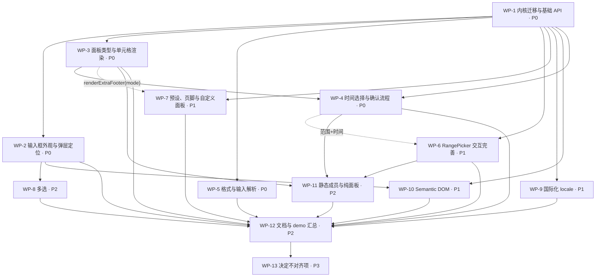

# base-ui DatePicker ↔ antd DatePicker 对齐差距清单

> 范围：`src/base-ui/DatePicker`（`DatePicker.tsx` / `DateRangePicker.tsx` / `CalendarPanel.tsx` / `PickerShell.tsx` / `calendar.ts` / `type.ts` / `style.ts` / `index.ts` / `index.mdx` / `demos/index.tsx` / `demos/range.tsx` / `__tests__/*`）
> 对照基准：antd `master` @ `5a102fe28abc8624eb27c5e1365cdbb0a4dead73`（2026-10-13）— `components/date-picker/index.zh-CN.md`（API 章节、代码演示列表、Semantic DOM、FAQ）、`generatePicker/interface.ts`、`generatePicker/index.tsx`、`index.tsx`、`locale/example.json`、`demo/*.tsx`（33 个文件）；以及 antd 6.6.5 依赖的 `@rc-component/picker@1.12.2`（`lib/interface.d.ts`、`PickerInput/SinglePicker.d.ts`、`PickerInput/RangePicker.d.ts`）。
> 本文为 T-762 调研结论，仅描述差距与计划，不修改任何源码。
> **T-795（WP-12 / WP-13，2026-10-14）回填**：本文所有对照表的「状态」列已按最终实现逐行核对，为当前实际状态；各行「备注」列按时间顺序记录各工作包的进展（早期的「部分完成 / 留 WP-x」字样已被同一行后续的「已完成」记录取代）。第 0 节保留为 T-762 调研时的基线。

状态说明：**已支持** = 类型与行为都与 antd 一致（允许实现差异）；**部分** = 有该字段 / 等价字段，但类型、命名或行为不完整；**缺失** = 无该字段 / 能力。状态列只使用这三个值；决定不对齐的项状态记为「缺失」，备注写明理由并归入 WP-13。

工作包编号（WP-x）定义见第 5 节。每一条「部分 / 缺失」都在备注列中标注所属工作包。

---

## 0. 现状概要（T-762 调研基线，迁移前）

- 规模：源码约 940 行（不含测试 275 行）。自实现，无 `@rc-component/picker`；弹层基于 `base-ui/Popover`（`PickerShell`），外观复用 `base-ui/Input` 的 `rootVariants` 与 `ClearButton`。
- 值类型：原生 `Date`（antd 为 `Dayjs`）；内部计算用 `dayjs`，但对外不暴露 `Dayjs`。
- 组件：`DatePicker`（`mode: 'date' | 'month' | 'year'`，语义相当于 antd 的 `picker`）与独立的 `DateRangePicker`（只支持日期、双月联动面板）。没有 `DatePicker.RangePicker` 等静态成员。
- 触发器是 `<button>`，**没有可输入的 input**：不支持键入/解析日期、mask、`inputReadOnly`、`preserveInvalidOnBlur`。
- 面板：日 / 月 / 年三级（年视图是 12 年一页，非 antd 的 decade / century 结构），只有「上一月 / 下一月」导航，点标题逐级上钻。日网格固定 6 周，周起始日与周名跟随 dayjs locale。键盘：方向键、PageUp/PageDown、Home/End，跳过禁用日。
- 已有字段：`allowClear`(boolean) / `className` / `style` / `disabled`(boolean) / `disabledDate(Date)` / `format`(string | fn，仅展示) / `min` / `max` / `size`(small/middle/large) / `variant`(filled/outlined/borderless) / `shadow`(lobe 独有) / `placeholder` / `value` / `defaultValue` / `onChange(value)` / `footer`(仅单选) / `mode`。
- 缺失大块：时间选择、week/quarter 面板、presets、multiple、needConfirm、受控 `open` / `pickerValue` / `mode`、`cellRender` / `panelRender` / `components`、`locale` prop、`status`、`prefix` / `suffixIcon` / `separator` / 导航图标、`placement` / `getPopupContainer`、Semantic DOM、ref 方法。
- 文档：`index.mdx` 仅 2 个 demo（`index.tsx`、`range.tsx`）+ 「Migrating from antd DatePicker」小节；antd 文档共 33 个 demo 文件（32 个「代码演示」+ Semantic DOM 章节的 `_semantic`）。
- 测试：`DatePicker.test.tsx`（11 例）、`DateRangePicker.test.tsx`（3 例）、`calendar.test.ts`（8 例）。
- 仓库内无其它消费方（`src/DatePicker` 是 antd 包装的经典组件，与本目录无关），改动 API 只影响 `@lobehub/ui/base-ui` 公共导出。

---

## 1. API 对照表

### 1.1 共同的 API（antd 文档「共同的 API」全部字段，DatePicker 与 RangePicker 共享）

| 字段                  | antd 类型                                                                                         | 当前状态 | 备注 / 工作包                                                                                                                                                                                                                                                                                                                                                                                                                                                                   |
| --------------------- | ------------------------------------------------------------------------------------------------- | -------- | ------------------------------------------------------------------------------------------------------------------------------------------------------------------------------------------------------------------------------------------------------------------------------------------------------------------------------------------------------------------------------------------------------------------------------------------------------------------------------- |
| allowClear            | `boolean \| { clearIcon?: ReactNode }`，默认 `true`                                               | 已支持   | 只支持 boolean；对象形式 `clearIcon` 缺失。WP-2 **T-770 已完成**：`true` / `{ clearIcon }`，`null` 清除图标按 antd 处理（测试覆盖）。                                                                                                                                                                                                                                                                                                                                           |
| ~~bordered~~          | `boolean`（deprecated → `variant`）                                                               | 已支持   | 作为 deprecated 别名映射到 `variant="borderless"`。WP-2 **T-770 已完成**：`bordered={false}` → `borderless`，显式 `variant` 优先（测试 + `variant` demo）。                                                                                                                                                                                                                                                                                                                     |
| className             | `string`                                                                                          | 已支持   | 挂在根节点。                                                                                                                                                                                                                                                                                                                                                                                                                                                                    |
| classNames            | `Record<SemanticDOM, string> \| (info: { props }) => …`                                           | 已支持   | 见 1.10。WP-10 **T-792 已完成**：对象 / 函数 `(info: { props }) => …`（`props` 带合并后的 `size`），`popup` 嵌套与字符串形式。                                                                                                                                                                                                                                                                                                                                                  |
| dateRender            | `(currentDate: dayjs, today: dayjs) => ReactNode`（< 5.4.0，deprecated）                          | 已支持   | 作为 `cellRender` 的兼容别名。WP-3 **T-771 已完成**：`dateRender(current, today)` 作用于 date 面板，`cellRender` 优先（测试覆盖）。                                                                                                                                                                                                                                                                                                                                             |
| cellRender            | `(current, info: { originNode, today, range?, type: PanelMode, locale?, subType? }) => ReactNode` | 已支持   | 需覆盖 date/week/month/quarter/year/decade/time 各面板单元格。WP-3（time 的 `subType` 在 WP-4） **T-771 已完成**：覆盖 date / week / month / quarter / year / decade 面板，`info` 含 `originNode` / `today` / `type` / `locale` / `prefixCls`，范围下含 `range`（测试 + `cell-render` demo）；time 的 `subType` 随 WP-4。 **T-783 已完成**：time 单元格 `info.type === "time"` 且带 `subType`（hour / minute / second / millisecond / meridiem）（测试 + `cell-render` demo）。 |
| components            | `Record<Panel \| 'input', ComponentType>`（5.14.0）                                               | 已支持   | 自定义面板（`date`/`week`/`month`/`quarter`/`year`/`decade`/`time`）与 `input`、`button`。WP-7 **T-785 已完成**：透传 rc-picker `components`（`date` / `week` / `month` / `quarter` / `year` / `decade` / `time` 面板与 `input`）；`button` 默认为 base-ui `Button`（small primary），传 `components.button` 即覆盖；导出 `PickerComponents` / `PickerPanelProps`（自定义面板拿到 `value` / `onHover` / `onSelect`）。`components` demo。                                       |
| defaultOpen           | `boolean`                                                                                         | 已支持   | 开关状态目前完全内部。WP-1 **T-765 已完成**：rc-picker 原生，`defaultOpen` 测试覆盖。                                                                                                                                                                                                                                                                                                                                                                                           |
| disabled              | `boolean`（RangePicker 另支持 `[boolean, boolean]`）                                              | 已支持   | 单选已支持；范围的元组形式见 1.5。WP-6 **T-784 已完成**：范围 `disabled: [boolean, boolean]` 分别禁用两端，部分禁用时只置灰被禁用的一端（测试 + `disabled` demo）。                                                                                                                                                                                                                                                                                                             |
| disabledDate          | `(currentDate: dayjs, info: { from?: dayjs, type: Picker }) => boolean`                           | 已支持   | 现为 `(date: Date) => boolean`：参数类型不同、无 `info.from` / `info.type`；且只作用于日网格，月/年 tile 不调用它。WP-1（签名与月/年面板）、WP-6（`info.from`） **T-765 部分完成**：签名改为 `(current: Dayjs, info: { type, from? })`，date / month 面板调用并禁用（测试覆盖 `info.type`）；范围 `info.from` 留 WP-6 验证。 **T-784 已完成**：范围 `info.from` 为本轮先选中的一端（测试 + `select-in-range` demo）。                                                           |
| ~~dropdownClassName~~ | `string`（deprecated → `classNames.popup.root`）                                                  | 已支持   | deprecated 别名。WP-10 **T-792 已完成**：并入 `classNames.popup.root`（同时设置时 `popupClassName` 优先，同 antd）。                                                                                                                                                                                                                                                                                                                                                            |
| format                | `FormatType`（string \| fn \| 数组 \| `{ format, type: 'mask' }`）                                | 已支持   | 仅 string \| `(Date) => string` 用于展示；数组多格式解析、mask、输入解析缺失。见 1.6。WP-5 **T-772 已完成**：string / 函数（`Dayjs` 参数）/ 数组 / `{ format, type: 'mask' }` 均透传 rc-picker，展示、`dateString` 与输入解析与 antd 同源（`__tests__/Format.test.tsx` + `format`、`mask` demo）。                                                                                                                                                                              |
| order                 | `boolean`，默认 `true`（多选、范围自动排序）                                                      | 已支持   | 范围始终排序（`orderRange`），不可关闭；多选不存在。WP-6（范围）、WP-8（多选） **T-784 已完成**：范围 `order` 默认 `true`（结束早于开始时交换），`order={false}` 保留输入顺序（测试 + `range-interaction` demo）；多选仍在 WP-8。 **T-793 已完成**：多选 `order` 默认 `true`（按日期排序），`order={false}` 保留点选顺序（测试 + `multiple-custom` demo）。                                                                                                                     |
| preserveInvalidOnBlur | `boolean`，默认 `false`                                                                           | 已支持   | 依赖可输入 input。WP-1 **T-765 已完成**：输入框可键入，`preserveInvalidOnBlur` 保留非法文本，默认失焦恢复（测试覆盖）。                                                                                                                                                                                                                                                                                                                                                         |
| ~~popupClassName~~    | `string`（deprecated → `classNames.popup.root`）                                                  | 已支持   | deprecated 别名。WP-10 **T-792 已完成**：并入 `classNames.popup.root`。                                                                                                                                                                                                                                                                                                                                                                                                         |
| getPopupContainer     | `(trigger) => HTMLElement`                                                                        | 已支持   | 当前固定 Portal 到 body。WP-2 **T-770 已完成**：透传 rc-trigger；默认挂 `body`，在 base-ui 浮层 / Dialog 内则挂到宿主内（测试 + 浏览器验证 `nested` demo）。                                                                                                                                                                                                                                                                                                                    |
| inputReadOnly         | `boolean`，默认 `false`                                                                           | 已支持   | 当前触发器是 button，等价「永远只读」，无法关闭。WP-1 **T-765 已完成**：透传到 `<input readonly>`（测试覆盖）。                                                                                                                                                                                                                                                                                                                                                                 |
| locale                | `PickerLocale`（`lang` + `timePickerLocale`）                                                     | 已支持   | 文案只能经全局 `@lobehub/ui/i18n`；单组件 locale、格式类 locale 字段缺失。见 1.9。WP-9 **T-791 已完成**：`locale` 接收 antd `PickerLocale`（`lang` + `timePickerLocale`，按字段合并到默认值）；默认 locale 由 i18n `datePicker.*` 生成；导出 `datePickerLocaleEnUS` / `datePickerLocaleZhCN` / `createPickerLocale`（`Locale.test.tsx` + `locale` demo）。                                                                                                                      |
| minDate               | `dayjs`（5.14.0，同时限制面板切换范围）                                                           | 已支持   | 有 lobe 字段 `min: Date`：禁用日/月/年，但导航按钮不受限。需新增 `minDate` 并把 `min` 作为 deprecated 别名。WP-1 **T-765 已完成**：`minDate` 禁用单元格并禁用越界导航按钮，`min` 为 deprecated 别名（测试 + `date-range` demo）。                                                                                                                                                                                                                                               |
| maxDate               | `dayjs`（5.14.0）                                                                                 | 已支持   | 同上，对应 lobe `max`。WP-1 **T-765 已完成**：同 `minDate`，`max` 为别名。                                                                                                                                                                                                                                                                                                                                                                                                      |
| mode                  | `'time' \| 'date' \| 'month' \| 'year' \| 'decade'`（受控面板状态）                               | 已支持   | **语义冲突**：lobe `mode` 表示选择器类型（≈ antd `picker`）。需改为 antd 语义（受控面板），选择器类型迁到 `picker`。WP-1 **T-765 已完成**：`mode` 改为 antd 语义的受控面板模式，选择器类型迁到 `picker`（测试 + `mode` demo）。                                                                                                                                                                                                                                                 |
| needConfirm           | `boolean`（5.14.0，`multiple` 时默认 `false`，`showTime` 时默认 `true`）                          | 已支持   | 当前点选即提交。WP-4 **T-783 已完成**：由 rc-picker 实现；`showTime` / `picker="time"` 时默认 `true`，OK 按钮为 `base-ui/Button`（`size="small" type="primary"`，`components.button` 可替换）（测试 + `needConfirm` demo）。 **T-793 已完成**：`multiple` 时由 rc-picker 默认 `needConfirm=false`：无 OK 按钮，点选触发 `onCalendarChange`，关闭弹层时以整组值触发一次 `onChange`（同 antd）；显式 `needConfirm` 仍出 OK 按钮（测试覆盖）。                                     |
| nextIcon              | `ReactNode`                                                                                       | 已支持   | 固定 `ChevronRight`。WP-2 **T-770 已完成**：`prevIcon` / `nextIcon` / `superPrevIcon` / `superNextIcon` 均可替换，`null` 不渲染（测试覆盖）。                                                                                                                                                                                                                                                                                                                                   |
| open                  | `boolean`                                                                                         | 已支持   | 开关不可受控（`start-end`、`external-panel` demo 依赖）。WP-1 **T-765 已完成**：受控 `open`（测试 + `start-end` / `controlled` demo）。                                                                                                                                                                                                                                                                                                                                         |
| panelRender           | `(panelNode) => ReactNode`                                                                        | 已支持   | WP-7 **T-785 已完成**：包裹 presets + 面板 + 页脚整体，单选 / 范围都支持。`render-panel` demo。                                                                                                                                                                                                                                                                                                                                                                                 |
| picker                | `'date' \| 'week' \| 'month' \| 'quarter' \| 'year'`，默认 `date`                                 | 已支持   | 由 lobe `mode` 提供 date/month/year；`week` / `quarter` 缺失，且字段名不同。WP-1（字段）、WP-3（week/quarter） **T-765 部分完成**：新增 `picker` 字段，date / month / year 已支持（测试 + `basic` demo）；week / quarter 样式与测试留 WP-3。 **T-771 已完成**：week / quarter 已支持（面板样式、默认格式与 placeholder、测试 + `basic` / `switchable` demo）。                                                                                                                  |
| placeholder           | `string \| [string, string]`                                                                      | 已支持   | 单选 string、范围元组；默认文案来自 i18n。按 picker 区分的默认 placeholder（week/quarter）随 WP-3 / WP-9 补齐。 **T-771 已完成**：按 picker 区分的默认 placeholder（单选 `Select week` / `Select quarter`…，范围 `Start month` / `End month`…，en / zh-CN）已补齐。                                                                                                                                                                                                             |
| placement             | `'bottomLeft' \| 'bottomRight' \| 'topLeft' \| 'topRight'`，默认 `bottomLeft`                     | 已支持   | `PickerShell` 写死 `bottomLeft`。WP-2 **T-770 已完成**：4 向 + rc-trigger 自动翻转；`direction="rtl"` 默认 `bottomRight`（测试 + `placement` demo，浏览器验证 8 种组合）。                                                                                                                                                                                                                                                                                                      |
| ~~popupStyle~~        | `CSSProperties`（deprecated → `styles.popup.root`）                                               | 已支持   | deprecated 别名。WP-10 **T-792 已完成**：合并到 `styles.popup.root` 之后（覆盖同名属性，同 antd）。                                                                                                                                                                                                                                                                                                                                                                             |
| prefix                | `ReactNode`（5.22.0）                                                                             | 已支持   | WP-2 **T-770 已完成**：rc-picker 原生，单选 / 范围 / 各 picker（测试 + `suffix` demo）。                                                                                                                                                                                                                                                                                                                                                                                        |
| prevIcon              | `ReactNode`                                                                                       | 已支持   | 固定 `ChevronLeft`。WP-2 **T-770 已完成**：同 `nextIcon`。                                                                                                                                                                                                                                                                                                                                                                                                                      |
| previewValue          | `false \| 'hover'`，默认 `hover`（6.0.0）                                                         | 已支持   | 悬停单元格时输入框临时显示该值；范围触发器只显示 draft，不显示 hover。WP-4 **T-783 已完成**：由 rc-picker 实现，默认 `hover`；单选悬停单元格时输入框以占位色显示该值，`false` 关闭；范围选择器在当前活动端回填 hover 值（与 antd 6 同源行为）（测试 + `preview-value` / `filled-debug` demo）。                                                                                                                                                                                 |
| presets               | `{ label: ReactNode, value: Dayjs \| (() => Dayjs) }[]`（范围为元组）                             | 已支持   | WP-7 **T-785 已完成**：单选 / 范围都有预设侧栏：hover 时在输入框预览，点击即提交（`showTime` 下也无需 OK）；`value` 可为函数，在 hover / 点击时求值；导出 `PresetDate` 类型。`preset-ranges` demo。                                                                                                                                                                                                                                                                             |
| size                  | `'large' \| 'medium' \| 'small'`                                                                  | 已支持   | 现为 `small \| middle \| large`（`base-ui/Input` 的 `InputSize`）；缺 `medium`（保留 `middle` 为别名）。WP-2 **T-770 已完成**：`large` / `medium`（默认）/ `small`，`middle` 为 `medium` 别名；高度 40 / 32 / 24（测试 + `size` demo）。                                                                                                                                                                                                                                        |
| status                | `'error' \| 'warning'`                                                                            | 已支持   | `base-ui/Input` 亦无 status 样式，需在 DatePicker 内实现（或先给 Input 的 `rootVariants` 增加 status）。WP-2 **T-770 已完成**：在 DatePicker 内实现，按 variant 区分（outlined 边框、filled 底色、underlined 下边框、borderless 文字色）（测试 + `status` / `filled-debug` demo）。                                                                                                                                                                                             |
| style                 | `CSSProperties`                                                                                   | 已支持   | 挂在根节点。                                                                                                                                                                                                                                                                                                                                                                                                                                                                    |
| styles                | `Record<SemanticDOM, CSSProperties> \| (info) => …`                                               | 已支持   | 见 1.10。WP-10 **T-792 已完成**：对象 / 函数形式，`popup` 嵌套；`styles.popup.root` 与内部 z-index 合并（用户值优先）。                                                                                                                                                                                                                                                                                                                                                         |
| suffixIcon            | `ReactNode`                                                                                       | 已支持   | 固定 `CalendarIcon`（time picker 应为时钟图标）。WP-2 **T-770 已完成**：自定义 / `null` 隐藏；`picker="time"` 默认时钟图标（测试 + `suffix` / `suffixIcon-debug` demo）。                                                                                                                                                                                                                                                                                                       |
| superNextIcon         | `ReactNode`                                                                                       | 已支持   | 当前面板没有 `>>`（跨年 / 跨十年）按钮。WP-2（随 WP-1 的面板头结构） **T-770 已完成**：面板头 `<<` `>>` 已有（rc-picker），图标可替换（测试覆盖）。                                                                                                                                                                                                                                                                                                                             |
| superPrevIcon         | `ReactNode`                                                                                       | 已支持   | 同上 `<<`。WP-2 **T-770 已完成**：同 `superNextIcon`。                                                                                                                                                                                                                                                                                                                                                                                                                          |
| clearIcon             | `ReactNode`（仅全局配置，6.4.0）                                                                  | 部分     | 组件级以 `allowClear.clearIcon` 提供（WP-2）；全局配置决定不对齐，见 1.12。WP-13 **T-770 部分完成**：组件级 `allowClear.clearIcon` 与 rc-picker 的 `clearIcon` 均生效；全局配置仍属 WP-13。 **T-795 已完成（WP-13 文档化）**：仅全局的 `clearIcon` 不对齐（不读 antd ConfigProvider），替代为组件级 `allowClear={{ clearIcon }}` / `clearIcon`，写入 `index.mdx`「Differences from antd DatePicker / migration」。                                                              |
| variant               | `'outlined' \| 'borderless' \| 'filled' \| 'underlined'`，默认 `outlined`                         | 已支持   | 缺 `underlined`；且暗色模式默认 `filled`（与 antd 不同，保留并写入迁移说明）。WP-2 **T-770 已完成**：新增 `underlined`；暗色默认 `filled` 保留（测试 + `variant` demo）。                                                                                                                                                                                                                                                                                                       |
| onClear               | `() => void`（6.5.0）                                                                             | 已支持   | 清除时只触发 `onChange(null)`。WP-2 **T-770 已完成**：rc-picker 原生，单选 / 范围（测试覆盖）。                                                                                                                                                                                                                                                                                                                                                                                 |
| onOpenChange          | `(open: boolean) => void`                                                                         | 已支持   | WP-1 **T-765 已完成**：测试覆盖打开 / 选择后关闭 / Esc 关闭。                                                                                                                                                                                                                                                                                                                                                                                                                   |
| onPanelChange         | `(value, mode) => void`                                                                           | 已支持   | 面板切换（翻月 / 上钻）不对外通知。WP-1 **T-765 已完成**：`onPanelChange(value, mode)`（测试 + `mode` demo）。                                                                                                                                                                                                                                                                                                                                                                  |
| ~~onSelect~~          | `(value) => void`（deprecated → `onCalendarChange`）                                              | 已支持   | 作为 `onCalendarChange` 的兼容别名。WP-1 **T-765 已完成**：`onSelect` 作为 `onCalendarChange` 的 deprecated 别名（测试覆盖）。                                                                                                                                                                                                                                                                                                                                                  |

### 1.2 共同的方法（ref）

| 成员          | antd 类型                                                                                              | 当前状态 | 备注 / 工作包                                                                                                                                                                                                                                                                                                               |
| ------------- | ------------------------------------------------------------------------------------------------------ | -------- | --------------------------------------------------------------------------------------------------------------------------------------------------------------------------------------------------------------------------------------------------------------------------------------------------------------------------- |
| focus()       | `PickerRef.focus(options?: FocusOptions)`；RangePicker 为 `focus(index? \| FocusOptions & { index? })` | 已支持   | 组件未转发 ref（`memo` 且未接 `ref`）。WP-1（范围的 `index` 参数在 WP-6） **T-765 部分完成**：组件接收 React 19 `ref` 并转发 rc `PickerRef`，单选与范围 `focus()` 测试覆盖；范围 `focus(index)` 留 WP-6。 **T-784 已完成**：范围 `focus(index)` / `focus({ index })` 聚焦起 / 止输入框（测试 + `range-interaction` demo）。 |
| blur()        | `() => void`                                                                                           | 已支持   | WP-1 **T-765 已完成**：测试覆盖（单选 + 范围）。                                                                                                                                                                                                                                                                            |
| nativeElement | `HTMLDivElement`（rc-picker `PickerRef`）                                                              | 已支持   | 任务要求的 ref 字段，antd 文档未列出但类型中存在。WP-1 **T-765 已完成**：`ref.nativeElement` 为 `.lobe-picker` 根节点（测试覆盖）。                                                                                                                                                                                         |

### 1.3 DatePicker（antd 文档「DatePicker」章节）

| 字段                      | antd 类型                                                                                 | 当前状态 | 备注 / 工作包                                                                                                                                                                                                                                                                                                                                                                                                                                                                             |
| ------------------------- | ----------------------------------------------------------------------------------------- | -------- | ----------------------------------------------------------------------------------------------------------------------------------------------------------------------------------------------------------------------------------------------------------------------------------------------------------------------------------------------------------------------------------------------------------------------------------------------------------------------------------------- |
| defaultPickerValue        | `dayjs`（5.14.0，每次打开重置到该日期）                                                   | 已支持   | 打开时固定定位到 `value ?? today`。WP-1 **T-765 已完成**：测试覆盖。                                                                                                                                                                                                                                                                                                                                                                                                                      |
| defaultValue              | `dayjs`                                                                                   | 已支持   | 类型为 `Date \| null`。WP-1（值类型） **T-765 已完成**：`Dayjs \| null`。                                                                                                                                                                                                                                                                                                                                                                                                                 |
| disabledTime              | `(date) => { disabledHours?, disabledMinutes?, disabledSeconds?, disabledMilliseconds? }` | 已支持   | 依赖时间面板。WP-4 **T-783 已完成**：单选 `disabledTime(date)` 返回 `disabledHours` / `disabledMinutes(hour)` / `disabledSeconds(hour, minute)` / `disabledMilliseconds`（测试 + `disabled-date` demo）。                                                                                                                                                                                                                                                                                 |
| format                    | `FormatType`，默认 `YYYY-MM-DD`                                                           | 已支持   | 默认 `MMM D, YYYY`（lobe 风格），需改为 antd 默认或 locale 的 `fieldDateFormat`。WP-5 **T-772 已完成**：默认 `YYYY-MM-DD`，`showTime` 时 `YYYY-MM-DD HH:mm:ss`，取自 locale 的 `fieldDateFormat` / `fieldDateTimeFormat`（测试覆盖）。                                                                                                                                                                                                                                                    |
| multiple                  | `boolean`（5.14.0，不支持 `showTime`）                                                    | 已支持   | WP-8 **T-793 已完成**：透传 rc-picker `multiple`，date / week / month / quarter / year 均可多选（不含 `showTime`）；再次点选已选单元格即移除；类型 `DatePickerProps<ValueType>` = `PickerPropsWithMultiple<Dayjs, DatePickerBaseProps, ValueType>`，组件签名 `<IsMultiple, ValueType>` 使 `<DatePicker multiple>` 自动推断 `Dayjs[]`；tag 为 rc-picker 自绘 + antd-style 按 base-ui Tag filled 外观着色（`Multiple.test.tsx` + `multiple` / `multiple-custom` / `multiple-debug` demo）。 |
| pickerValue               | `dayjs`（5.14.0，受控面板日期，配合 `onPanelChange`）                                     | 已支持   | 当前 `month` 为内部 state。WP-1 **T-765 已完成**：受控面板日期 + `onPickerValueChange`（测试 + `controlled` demo）。                                                                                                                                                                                                                                                                                                                                                                      |
| renderExtraFooter         | `(mode) => ReactNode`                                                                     | 已支持   | lobe `footer: ReactNode`（静态、不接收 mode）。新增 `renderExtraFooter`，`footer` 作为 deprecated 别名。WP-7 **T-785 已完成**：`renderExtraFooter(mode)` 接收当前面板 mode，渲染在 Today / Now / OK 行之上（左对齐）；`footer` 为 deprecated 别名，两者同时传时 `renderExtraFooter` 优先。`extra-footer` demo。                                                                                                                                                                           |
| showNow                   | `boolean`（4.4.0）                                                                        | 已支持   | 当前无「今天 / 此刻」按钮。WP-4（Now）、WP-7（Today 底栏） **T-783 已完成**：Now 按钮（`showNow`，单选默认开启、范围默认关闭；date 面板文案为 Today）；Today 底栏的其余部分仍在 WP-7（测试 + `needConfirm` / `time` demo）。 **T-785 已完成**：Today 底栏补齐：date 面板显示 Today，点击选中今天；今天被 `disabledDate` 禁用时按钮禁用；`showToday` 别名；测试 + `extra-footer` demo。                                                                                                    |
| showTime                  | `boolean \| SharedTimeProps`                                                              | 已支持   | 见 1.7。WP-4 **T-783 已完成**：`boolean` 与对象形式，日期面板右侧接时间面板，默认格式 `YYYY-MM-DD HH:mm:ss`（测试 + `time` demo）。                                                                                                                                                                                                                                                                                                                                                       |
| ~~showTime.defaultValue~~ | `dayjs`（deprecated → `defaultOpenValue`）                                                | 已支持   | 兼容别名。WP-4 **T-783 已完成**：由 rc-picker 映射到 `defaultOpenValue`（测试）。                                                                                                                                                                                                                                                                                                                                                                                                         |
| showTime.defaultOpenValue | `dayjs`，默认 `dayjs()`                                                                   | 已支持   | WP-4 **T-783 已完成**：选中日期时套用该时间（测试 + `disabled-date` demo）。                                                                                                                                                                                                                                                                                                                                                                                                              |
| showWeek                  | `boolean`（5.14.0，日面板显示周数列）                                                     | 已支持   | WP-3 **T-771 已完成**：日面板周数列（`-date-panel-show-week`），范围同样支持（测试 + `show-week` demo）。                                                                                                                                                                                                                                                                                                                                                                                 |
| value                     | `dayjs`                                                                                   | 已支持   | 类型为 `Date \| null`。WP-1 **T-765 已完成**：`Dayjs \| null`。                                                                                                                                                                                                                                                                                                                                                                                                                           |
| onChange                  | `(date: dayjs \| null, dateString: string \| null) => void`                               | 已支持   | 只有一个 `Date \| null` 参数，缺 `dateString`。WP-1 **T-765 已完成**：`onChange(date, dateString)`，清除时为 `(null, null)`（测试覆盖）。                                                                                                                                                                                                                                                                                                                                                 |
| onOk                      | `() => void`（实现为 `(value) => void`）                                                  | 已支持   | 依赖确认按钮。WP-4 **T-783 已完成**：`onOk(value)` 在点 OK 时触发，随后提交 `onChange`（测试 + `time` / `needConfirm` demo）。                                                                                                                                                                                                                                                                                                                                                            |
| onPanelChange             | `(value, mode) => void`                                                                   | 已支持   | 同 1.1。WP-1 **T-765 已完成**：同 1.1。                                                                                                                                                                                                                                                                                                                                                                                                                                                   |

### 1.4 DatePicker[picker=year / quarter / month / week]

| picker  | 字段              | antd 类型 / 默认                                           | 当前状态 | 备注 / 工作包                                                                                                                                                                                          |
| ------- | ----------------- | ---------------------------------------------------------- | -------- | ------------------------------------------------------------------------------------------------------------------------------------------------------------------------------------------------------ |
| year    | （面板）          | 年面板，decade 上钻                                        | 已支持   | lobe `mode="year"`：12 年一页、无 decade/century 层。WP-3 **T-771 已完成**：10 年一屏（含首尾溢出年，共 12 格），头部上钻 decade 面板（世纪内 10 个十年），选十年回到年面板（测试 + 浏览器截图）。     |
| year    | defaultValue      | `dayjs`                                                    | 已支持   | `Date`。WP-1 **T-765 已完成**：`Dayjs`。                                                                                                                                                               |
| year    | format            | 默认 `YYYY`                                                | 已支持   | 默认值一致。WP-5 **T-772 已完成**：数组 / mask / 解析同 1.6（rc-picker 统一处理）。                                                                                                                    |
| year    | multiple          | `boolean`                                                  | 已支持   | WP-8 **T-793 已完成**：该 picker 下 `multiple` 可用（`Multiple.test.tsx` + `multiple-custom` demo）。                                                                                                  |
| year    | renderExtraFooter | `() => ReactNode`                                          | 已支持   | 仅 `footer` 节点。WP-7 **T-785 已完成**：各面板都收到 `renderExtraFooter(mode)`，`footer` 为别名。                                                                                                     |
| year    | tagRender         | `(props) => ReactNode`（6.4.0，multiple 下）               | 已支持   | WP-8 **T-793 已完成**：`tagRender(props: PickerTagProps)`（`label` / `value` / `disabled` / `closable` / `onClose`），各 picker 通用（测试 + `multiple-custom` demo 用 base-ui `Tag`）。               |
| year    | value             | `dayjs`                                                    | 已支持   | `Date`。WP-1 **T-765 已完成**：`Dayjs`。                                                                                                                                                               |
| year    | onChange          | `(date, dateString)`                                       | 已支持   | 缺 `dateString`。WP-1 **T-765 已完成**：`(date, dateString)`，测试覆盖 `"2028"` / `"2026-11"`。                                                                                                        |
| quarter | （面板）          | 季度面板 Q1–Q4                                             | 已支持   | WP-3 **T-771 已完成**：Q1–Q4 面板（测试 + `basic` demo）。                                                                                                                                             |
| quarter | defaultValue      | `dayjs`                                                    | 已支持   | WP-3 **T-771 已完成**：`Dayjs`；`onChange` 的 dateString 形如 `2026-Q3`（测试覆盖）。                                                                                                                  |
| quarter | format            | 默认 `YYYY-\QQ`                                            | 已支持   | WP-3（默认格式）、WP-5 **T-771 已完成**：默认格式 `YYYY-[Q]Q`（输出与 antd 相同，如 `2026-Q4`）。WP-5 **T-772 已完成**：数组 / mask 同 1.6。                                                           |
| quarter | multiple          | `boolean`                                                  | 已支持   | WP-8 **T-793 已完成**：该 picker 下 `multiple` 可用（`Multiple.test.tsx` + `multiple-custom` demo）。                                                                                                  |
| quarter | renderExtraFooter | `() => ReactNode`                                          | 已支持   | WP-7 **T-785 已完成**：各面板都收到 `renderExtraFooter(mode)`，`footer` 为别名。                                                                                                                       |
| quarter | tagRender         | `(props) => ReactNode`                                     | 已支持   | WP-8 **T-793 已完成**：`tagRender(props: PickerTagProps)`（`label` / `value` / `disabled` / `closable` / `onClose`），各 picker 通用（测试 + `multiple-custom` demo 用 base-ui `Tag`）。               |
| quarter | value             | `dayjs`                                                    | 已支持   | WP-3 **T-771 已完成**：`Dayjs`；`onChange` 的 dateString 形如 `2026-Q3`（测试覆盖）。                                                                                                                  |
| quarter | onChange          | `(date, dateString)`                                       | 已支持   | WP-3 **T-771 已完成**：`Dayjs`；`onChange` 的 dateString 形如 `2026-Q3`（测试覆盖）。                                                                                                                  |
| month   | （面板）          | 月面板                                                     | 已支持   | lobe `mode="month"` 已有月 tile；导航与 disabledDate 不完整。WP-3 **T-771 已完成**：3×4 月 tile，`disabledDate` / `cellRender` 作用于月格，支持键盘导航（测试覆盖）。                                  |
| month   | defaultValue      | `dayjs`                                                    | 已支持   | `Date`。WP-1 **T-765 已完成**：`Dayjs`。                                                                                                                                                               |
| month   | format            | 默认 `YYYY-MM`                                             | 已支持   | 默认 `MMMM YYYY`。WP-5 **T-771 已完成**：默认格式已是 `YYYY-MM`（测试覆盖）。WP-5 **T-772 已完成**：自定义 string 格式展示与解析（测试 + `format` demo）、数组 / mask 同 1.6（`mask` demo 含 month）。 |
| month   | multiple          | `boolean`                                                  | 已支持   | WP-8 **T-793 已完成**：该 picker 下 `multiple` 可用（`Multiple.test.tsx` + `multiple-custom` demo）。                                                                                                  |
| month   | renderExtraFooter | `() => ReactNode`                                          | 已支持   | 仅 `footer` 节点。WP-7 **T-785 已完成**：各面板都收到 `renderExtraFooter(mode)`，`footer` 为别名。                                                                                                     |
| month   | tagRender         | `(props) => ReactNode`                                     | 已支持   | WP-8 **T-793 已完成**：`tagRender(props: PickerTagProps)`（`label` / `value` / `disabled` / `closable` / `onClose`），各 picker 通用（测试 + `multiple-custom` demo 用 base-ui `Tag`）。               |
| month   | value             | `dayjs`                                                    | 已支持   | `Date`。WP-1 **T-765 已完成**：`Dayjs`。                                                                                                                                                               |
| month   | onChange          | `(date, dateString)`                                       | 已支持   | 缺 `dateString`。WP-1 **T-765 已完成**：`(date, dateString)`，测试覆盖 `"2028"` / `"2026-11"`。                                                                                                        |
| week    | （面板）          | 周面板（整行选中）                                         | 已支持   | WP-3 **T-771 已完成**：整行选中 / 整行 hover，带周数列（测试 + `basic` demo + 浏览器截图）。                                                                                                           |
| week    | defaultValue      | `dayjs`                                                    | 已支持   | WP-3 **T-771 已完成**：`Dayjs`；`onChange` 的 dateString 形如 `2026-43rd`（测试覆盖）。                                                                                                                |
| week    | format            | 默认 `YYYY-wo`（需 dayjs `weekOfYear` / `advancedFormat`） | 已支持   | WP-3、WP-5 **T-771 已完成**：默认格式 `gggg-wo`（rc-picker / antd 实际默认，输出如 `2026-42nd`）。WP-5 **T-772 已完成**：函数格式展示周起止（测试 + `format` demo）；数组 / mask 同 1.6。              |
| week    | multiple          | `boolean`                                                  | 已支持   | WP-8 **T-793 已完成**：该 picker 下 `multiple` 可用（`Multiple.test.tsx` + `multiple-custom` demo）。                                                                                                  |
| week    | renderExtraFooter | `(mode) => ReactNode`                                      | 已支持   | WP-7 **T-785 已完成**：各面板都收到 `renderExtraFooter(mode)`，`footer` 为别名。                                                                                                                       |
| week    | tagRender         | `(props) => ReactNode`                                     | 已支持   | WP-8 **T-793 已完成**：`tagRender(props: PickerTagProps)`（`label` / `value` / `disabled` / `closable` / `onClose`），各 picker 通用（测试 + `multiple-custom` demo 用 base-ui `Tag`）。               |
| week    | value             | `dayjs`                                                    | 已支持   | WP-3 **T-771 已完成**：`Dayjs`；`onChange` 的 dateString 形如 `2026-43rd`（测试覆盖）。                                                                                                                |
| week    | onChange          | `(date, dateString)`                                       | 已支持   | WP-3 **T-771 已完成**：`Dayjs`；`onChange` 的 dateString 形如 `2026-43rd`（测试覆盖）。                                                                                                                |
| week    | showWeek          | `boolean`，默认 `true`                                     | 已支持   | WP-3 **T-771 已完成**：周面板默认显示周数列，`showWeek={false}` 隐藏（测试覆盖）。                                                                                                                     |

### 1.5 RangePicker（antd 文档「RangePicker」章节；当前对应 `DateRangePicker`）

| 字段                      | antd 类型                                                                        | 当前状态 | 备注 / 工作包                                                                                                                                                                                                                 |
| ------------------------- | -------------------------------------------------------------------------------- | -------- | ----------------------------------------------------------------------------------------------------------------------------------------------------------------------------------------------------------------------------- |
| （组件入口）              | `DatePicker.RangePicker`                                                         | 已支持   | 仅独立导出 `DateRangePicker`；需挂 `DatePicker.RangePicker`，`DateRangePicker` 保留为别名。WP-11 **T-794 已完成**：`DatePicker.RangePicker`，`DateRangePicker === DatePicker.RangePicker`（测试 + `static-members` demo）。   |
| picker（范围）            | `date \| week \| month \| quarter \| year`                                       | 已支持   | 只有日期范围。WP-3 **T-771 已完成**：date / week / month / quarter / year 范围；非 date picker 也是相邻双面板（两年的月 / 季度、两个十年的年、相邻两月的周），范围 placeholder 按 picker 区分（测试 + `range-picker` demo）。 |
| allowEmpty                | `[boolean, boolean]`，默认 `[false, false]`                                      | 已支持   | 必须选满两端才提交。WP-6 **T-784 已完成**：`allowEmpty` 支持 boolean 与 `[boolean, boolean]`，`[start, null]` / `[null, end]` / `[null, null]` 均可提交与回显（测试 + `allow-empty` demo）。                                  |
| cellRender                | 同 1.1（`info.range: 'start' \| 'end'`）                                         | 已支持   | WP-3 **T-771 已完成**：`info.range` 为 `start` / `end`（测试 + `cell-render` demo）。                                                                                                                                         |
| dateRender                | deprecated                                                                       | 已支持   | WP-3 **T-771 已完成**：与单选相同的兼容别名。                                                                                                                                                                                 |
| defaultPickerValue        | `[dayjs, dayjs]`                                                                 | 已支持   | WP-1 **T-765 已完成**：单值或元组（测试覆盖）。                                                                                                                                                                               |
| defaultValue              | `[dayjs, dayjs]`                                                                 | 已支持   | `[Date \| null, Date \| null]`。WP-1 **T-765 已完成**：`[Dayjs, Dayjs]`（测试覆盖）。                                                                                                                                         |
| disabled                  | `[boolean, boolean]`（单独禁用一端）                                             | 已支持   | 只有 boolean。WP-6 **T-784 已完成**：见 1.5 / 1.1 `disabled` 行（测试 + `disabled` demo）。                                                                                                                                   |
| disabledTime              | `(date, partial: 'start' \| 'end', info: { from? }) => DisabledTimes`            | 已支持   | WP-4 **T-783 已完成**：`disabledTime(date, partial, info)`，`partial` 为 `start` / `end`，`info.from` 为已选起点（测试 + `disabled-date` demo）。                                                                             |
| format                    | `FormatType`，默认随 picker / showTime                                           | 已支持   | 同 1.1。WP-5 **T-772 已完成**：string / 数组 / mask 对两端输入均生效（测试 + `format`、`mask` demo）。                                                                                                                        |
| id                        | `{ start?: string, end?: string }`                                               | 已支持   | 依赖两个真实 input。WP-6 **T-784 已完成**：`id: { start, end }` 落到两个 input（测试 + `range-picker` demo）。                                                                                                                |
| pickerValue               | `[dayjs, dayjs]`                                                                 | 已支持   | WP-1 **T-765 已完成**：受控元组 + `onPickerValueChange`（测试覆盖）。                                                                                                                                                         |
| presets                   | `{ label, value: [Dayjs \| () => Dayjs, Dayjs \| () => Dayjs] }[]`               | 已支持   | WP-7 **T-785 已完成**：元组或返回元组的函数；`showTime` 下点击预设直接提交；deprecated `ranges` 映射到 `presets`。                                                                                                            |
| renderExtraFooter         | `() => ReactNode`                                                                | 已支持   | 范围连 `footer` 都没有。WP-7 **T-785 已完成**：范围支持 `renderExtraFooter(mode)` 与 `footer` 别名。                                                                                                                          |
| separator                 | `ReactNode`，默认 `<SwapRightOutlined />`                                        | 已支持   | 固定 `ArrowRight`。WP-2 **T-770 已完成**：默认 `ArrowRight`，可替换（测试 + `rtl` demo）。                                                                                                                                    |
| showTime                  | `boolean \| RangeTimeProps`                                                      | 已支持   | WP-4 **T-783 已完成**：范围 + 时间（测试 + `time` / `range-picker` / `disabled-date` demo）。                                                                                                                                 |
| ~~showTime.defaultValue~~ | `[dayjs, dayjs]`（deprecated）                                                   | 已支持   | WP-4 **T-783 已完成**：映射到 `defaultOpenValue`。                                                                                                                                                                            |
| showTime.defaultOpenValue | `[dayjs, dayjs]`                                                                 | 已支持   | WP-4 **T-783 已完成**：两端各自的默认时间（测试 + `disabled-date` demo）。                                                                                                                                                    |
| value                     | `[dayjs, dayjs]`                                                                 | 已支持   | `[Date \| null, Date \| null]`。WP-1 **T-765 已完成**：`[Dayjs, Dayjs] \| null`（测试覆盖）。                                                                                                                                 |
| onCalendarChange          | `(dates, dateStrings, info: { range: 'start' \| 'end' }) => void`                | 已支持   | 当前 draft 状态不对外暴露。WP-6 **T-784 已完成**：`info.range` 为 `'start'                                                                                                                                                    | 'end'`，先点结束框时首次回调为 `end`（测试 + `range-picker` demo）。 |
| onChange                  | `(dates: [dayjs, dayjs] \| null, dateStrings: [string, string] \| null) => void` | 已支持   | 只传 `[Date, Date]`；清除时传 `[null, null]` 而不是 `null`；缺 `dateStrings`。WP-1 **T-765 已完成**：`(dates, dateStrings)`，清除时为 `(null, null)`（测试覆盖）。                                                            |
| onFocus                   | `(event, { range: 'start' \| 'end' }) => void`                                   | 已支持   | WP-6（单选 `onFocus` / `onBlur` 在 WP-1） **T-784 已完成**：`(event, { range })`（测试 + `range-picker` / `range-interaction` demo）。                                                                                        |
| onBlur                    | `(event, { range }) => void`                                                     | 已支持   | WP-6 **T-784 已完成**：`(event, { range })`（测试 + `range-picker` demo）。                                                                                                                                                   |
| mode（范围）              | `[PanelMode, PanelMode]`                                                         | 已支持   | `mode` demo 用到。WP-1 **T-765 已完成**：受控 `[PanelMode, PanelMode]`（测试 + `mode` demo）。                                                                                                                                |
| onPanelChange（范围）     | `(values, modes: [PanelMode, PanelMode]) => void`                                | 已支持   | WP-1 **T-765 已完成**：`onPanelChange(values, modes)`（测试覆盖）。                                                                                                                                                           |
| onOk（范围）              | `(values) => void`                                                               | 已支持   | WP-4 **T-783 已完成**：`onOk(values)`（`time` demo）。                                                                                                                                                                        |

### 1.6 formatType

| 形式                                | 说明                          | 当前状态 | 备注 / 工作包                                                                                                                                                                                                                                                     |
| ----------------------------------- | ----------------------------- | -------- | ----------------------------------------------------------------------------------------------------------------------------------------------------------------------------------------------------------------------------------------------------------------- |
| `string`                            | dayjs 格式串                  | 已支持   | 仅展示，不用于解析输入。WP-5 **T-772 已完成**：用于展示、`dateString` 与严格模式解析输入（测试覆盖）。                                                                                                                                                            |
| `(value: Dayjs) => string`          | 自定义展示函数                | 已支持   | 参数是 `Date` 而非 `Dayjs`。WP-1（类型）、WP-5 **T-765 部分完成**：类型已改为 `Dayjs`。WP-5 **T-772 已完成**：仅展示，参数为 `Dayjs`，结果作为 `dateString`；不能解析输入（与 antd 相同，测试覆盖）。                                                             |
| `Array<string \| fn>`               | 多格式匹配输入，展示取第一个  | 已支持   | WP-5 **T-772 已完成**：首项用于展示与 `dateString`，键入文本依次尝试每个 string 格式（测试覆盖 4 种格式 + 范围）。函数在首位时，解析后 input 立即按函数重绘，Enter 不再提交（rc-picker / antd 同样行为），值经 `onCalendarChange` 可得。                          |
| `{ format: string; type?: 'mask' }` | 格式对齐（mask 输入，5.14.0） | 已支持   | WP-5 **T-772 已完成**：聚焦显示格式模板、数字按段填充、方向键增减 / 切段、Backspace 清段、粘贴整串、Enter 提交；单选与范围均可（测试 + `mask` demo）。含时间的 mask 输入解析已测，time 面板随 WP-4。 **T-783 已完成**：含时间的 mask 已有 demo，time 面板已落地。 |

### 1.7 showTime（`SharedTimeProps` / TimePicker Options）

| 字段                                                                                 | antd 类型                              | 当前状态 | 备注 / 工作包                                                                                                      |
| ------------------------------------------------------------------------------------ | -------------------------------------- | -------- | ------------------------------------------------------------------------------------------------------------------ |
| format                                                                               | `string`（如 `HH:mm`，决定显示哪些列） | 已支持   | WP-4 **T-783 已完成**：决定显示的列与时间面板标题格式；输入框仍按 `format`（与 antd 一致）（测试 + `time` demo）。 |
| showHour / showMinute / showSecond / showMillisecond                                 | `boolean`                              | 已支持   | WP-4 **T-783 已完成**：由 rc-picker 实现（测试）。                                                                 |
| use12Hours                                                                           | `boolean`                              | 已支持   | WP-4 **T-783 已完成**：meridiem 列（测试 + `time` demo）。                                                         |
| hourStep / minuteStep / secondStep / millisecondStep                                 | `number`                               | 已支持   | WP-4 **T-783 已完成**：（测试 + `time` demo）。                                                                    |
| hideDisabledOptions                                                                  | `boolean`                              | 已支持   | WP-4 **T-783 已完成**：（测试 + `disabled-date` demo）。                                                           |
| defaultOpenValue / ~~defaultValue~~                                                  | `dayjs`                                | 已支持   | WP-4 **T-783 已完成**：`defaultValue` 为 deprecated 别名（测试）。                                                 |
| disabledHours / disabledMinutes / disabledSeconds（deprecated，推荐 `disabledTime`） | `() => number[]` 等                    | 已支持   | WP-4 **T-783 已完成**：由 rc-picker 透传（deprecated）。                                                           |
| changeOnScroll                                                                       | `boolean`                              | 已支持   | WP-4 **T-783 已完成**：滚动停止后选中最近的可用项（测试 + `time` demo）。                                          |
| showNow                                                                              | `boolean`                              | 已支持   | WP-4 **T-783 已完成**：同 1.3 `showNow`。                                                                          |

### 1.8 disabledDate / disabledTime 细节

| 项                                  | antd                                                              | 当前状态 | 备注 / 工作包                                                                                                                                                                                                                                                                                                                                                  |
| ----------------------------------- | ----------------------------------------------------------------- | -------- | -------------------------------------------------------------------------------------------------------------------------------------------------------------------------------------------------------------------------------------------------------------------------------------------------------------------------------------------------------------- |
| disabledDate 作用于所有面板         | 月/年/季度/周/decade 单元格调用 `disabledDate(current, { type })` | 已支持   | 月/年 tile 只看 `min`/`max`，不调用 `disabledDate`。WP-1（date/month/year）、WP-3（其余） **T-765 部分完成**：date / month / year 面板调用 `disabledDate(current, { type })`（测试覆盖 date / month）；其余面板留 WP-3。 **T-771 已完成**：quarter / week / decade 面板同样调用 `disabledDate(current, { type })`（测试覆盖 quarter / week / year / decade）。 |
| disabledDate `info.from`            | 范围选择中已选一端时传入，用于「最多选 N 天」                     | 已支持   | WP-6 **T-784 已完成**：已一端选中后传入 `info.from`，可限制最多 N 天 / N 月（测试 + `select-in-range` demo）。                                                                                                                                                                                                                                                 |
| minDate / maxDate 限制面板切换      | 导航按钮在越界时禁用                                              | 已支持   | WP-1 **T-765 已完成**：越界时 `-prev-btn-disabled` / `-super-prev-btn-disabled`（测试 + 浏览器 `date-range` demo）。                                                                                                                                                                                                                                           |
| 键盘跳过禁用项                      | —                                                                 | 已支持   | 日网格方向键跳过禁用日（`handleDayKey`），迁移内核时需保持。                                                                                                                                                                                                                                                                                                   |
| disabledTime（单选 / 范围 partial） | 见 1.3 / 1.5                                                      | 已支持   | WP-4 **T-783 已完成**：见 1.3 / 1.5（测试 + `disabled-date` demo）。                                                                                                                                                                                                                                                                                           |

### 1.9 locale（`PickerLocale`，`locale/example.json`）

| 字段组                                                                                                                                                                                                                                                                                                | 当前状态 | 备注 / 工作包                                                                                                                                                                                                                                                                                                                                                                                                          |
| ----------------------------------------------------------------------------------------------------------------------------------------------------------------------------------------------------------------------------------------------------------------------------------------------------- | -------- | ---------------------------------------------------------------------------------------------------------------------------------------------------------------------------------------------------------------------------------------------------------------------------------------------------------------------------------------------------------------------------------------------------------------------- |
| `lang.placeholder` / `rangePlaceholder`                                                                                                                                                                                                                                                               | 已支持   | i18n 资源有 `datePicker.placeholder` / `startPlaceholder` / `endPlaceholder`，但不能通过组件 prop 覆盖。WP-9 **T-791 已完成**：`lang.placeholder` / `rangePlaceholder` 可经 `locale` prop 覆盖，`placeholder` prop 仍优先（测试）。                                                                                                                                                                                    |
| `yearPlaceholder` / `monthPlaceholder` / `quarterPlaceholder` / `weekPlaceholder` 及对应 `range*Placeholder`                                                                                                                                                                                          | 已支持   | 仅有 year / month 两个。WP-9 **T-791 已完成**：year / quarter / month / week 及 `range*Placeholder` 均在默认 locale 中，按 antd `getPlaceholder` / `getRangePlaceholder` 取值（测试）。                                                                                                                                                                                                                                |
| `today` / `now` / `ok` / `clear` / `backToToday`                                                                                                                                                                                                                                                      | 已支持   | 依赖底栏按钮（WP-4 / WP-7），文案在 WP-9 **T-783 已完成**：底栏 Now / OK 按钮已落地，英文默认文案来自 rc-picker `en_US`；`locale` 文案与 i18n 仍在 WP-9。 **T-791 已完成**：i18n 新增 `datePicker.today/now/ok/clear/backToToday`（en / zh-CN），底栏按钮随 locale 切换（测试 + `locale` demo）。                                                                                                                      |
| `month` / `year` / `week` / `timeSelect` / `dateSelect` / `monthSelect` / `yearSelect` / `decadeSelect` / `weekSelect`                                                                                                                                                                                | 已支持   | WP-9 **T-791 已完成**：i18n 新增对应 key；`yearSelect` / `monthSelect` 用作表头按钮 aria-label（测试）。                                                                                                                                                                                                                                                                                                               |
| `previousMonth` / `nextMonth` / `previousYear` / `nextYear` / `previousDecade` / `nextDecade` / `previousCentury` / `nextCentury`                                                                                                                                                                     | 已支持   | 只有 `datePicker.previous` / `next` 两个 aria 文案。WP-9 **T-791 已完成**：i18n 新增 8 个 prev/next key，表头导航按钮 aria-label 随 locale 切换（测试）。                                                                                                                                                                                                                                                              |
| `fieldDateFormat` / `fieldDateTimeFormat` / `fieldTimeFormat` / `fieldWeekFormat` / `fieldMonthFormat` / `fieldQuarterFormat` / `fieldYearFormat` / `yearFormat` / `monthFormat` / `cellDateFormat` / `cellYearFormat` / `cellQuarterFormat` / `cellMeridiemFormat` / `dayFormat` / `monthBeforeYear` | 已支持   | 格式写死在 `DEFAULT_FORMAT` 与面板代码里；`buddhist-era` demo 依赖。WP-9 **T-791 已完成**：`lang` 的全部格式字段透传 rc-picker；默认 locale 的 `fieldDate/Week/Month/Quarter/YearFormat`、`yearFormat`、`cellYear/Quarter/DateFormat`、`monthBeforeYear` 由 i18n 生成（zh-CN `YYYY年`、年在前）；`fieldTimeFormat` / `fieldDateTimeFormat` 有意不设，由 `showTime` 推导（与 antd 一致）；`buddhist-era` demo（测试）。 |
| `shortWeekDays` / `shortMonths`                                                                                                                                                                                                                                                                       | 已支持   | 取自 dayjs locale（`format('dd')` / `'MMM'`），不能被 prop 覆盖。WP-9 **T-791 已完成**：可经 `locale.lang` 覆盖 dayjs 名称；导出的 `datePickerLocaleEnUS` / `ZhCN` 自带由 i18n `datePicker.shortWeekDays` / `shortMonths` 生成的名称，未传 `locale` 时仍跟随 dayjs locale（与 antd 一致）（测试）。                                                                                                                    |
| `timePickerLocale.placeholder`                                                                                                                                                                                                                                                                        | 已支持   | WP-9 **T-791 已完成**：`timePickerLocale.placeholder` / `rangePlaceholder` 用于 `picker="time"`（测试）。                                                                                                                                                                                                                                                                                                              |
| 周起始日跟随 dayjs locale                                                                                                                                                                                                                                                                             | 已支持   | `getWeekStart()` 读 `dayjs.Ls[locale].weekStart`。                                                                                                                                                                                                                                                                                                                                                                     |

### 1.10 Semantic DOM（`classNames` / `styles`，DatePicker 5.25.0 / antd 6 嵌套 popup）

| 语义键                            | 说明              | 当前状态 | 备注 / 工作包                                                                         |
| --------------------------------- | ----------------- | -------- | ------------------------------------------------------------------------------------- |
| root                              | 根节点            | 已支持   | WP-10 **T-792**：`.lobe-picker` 根节点                                                |
| prefix                            | 前缀              | 已支持   | WP-10 **T-792**：`.lobe-picker-prefix`                                                |
| input                             | 输入框            | 已支持   | WP-10 **T-792**：`<input>`（范围两个都加）                                            |
| suffix                            | 后缀              | 已支持   | WP-10 **T-792**：后缀图标与清除按钮（同 rc-picker）                                   |
| popup.root（或 `popup: string`）  | 弹出层根节点      | 已支持   | WP-10 **T-792**：`.lobe-picker-dropdown`；字符串形式即 `popup.root`                   |
| popup.container                   | 弹出层容器        | 已支持   | WP-10 **T-792**：`.lobe-picker-<mode>-panel-container`                                |
| popup.header                      | 面板头            | 已支持   | WP-10 **T-792**：面板头（范围两个面板都加）                                           |
| popup.body                        | 面板主体          | 已支持   | WP-10 **T-792**                                                                       |
| popup.content                     | 面板内容（table） | 已支持   | WP-10 **T-792**：`<table>` 或时间列容器                                               |
| popup.item                        | 单元格            | 已支持   | WP-10 **T-792**：日期 / 月 / 年等单元格与时间选项                                     |
| popup.footer                      | 面板页脚          | 已支持   | WP-10 **T-792**                                                                       |
| 函数形式 `(info: { props }) => …` | —                 | 已支持   | WP-10 **T-792**：`classNames` / `styles` 均支持，`props` 为组件 props + 合并后 `size` |
| rootClassName                     | `string`          | 已支持   | WP-10 **T-792**：根节点与弹层根节点都加（同 antd）                                    |

### 1.11 类型中存在但文档未列出的字段（rc-picker 透传 / antd 类型）

| 字段                                            | 来源 / 类型                                                   | 当前状态 | 备注 / 工作包                                                                                                                                                                                                                                                                                                                                                                                                                                   |
| ----------------------------------------------- | ------------------------------------------------------------- | -------- | ----------------------------------------------------------------------------------------------------------------------------------------------------------------------------------------------------------------------------------------------------------------------------------------------------------------------------------------------------------------------------------------------------------------------------------------------- |
| onCalendarChange（单选）                        | `(date, dateString, info) => void`                            | 已支持   | WP-1 **T-765 已完成**：`(date, dateString, info)`，测试覆盖。                                                                                                                                                                                                                                                                                                                                                                                   |
| onPickerValueChange                             | `(date, { source, mode }) => void`                            | 已支持   | WP-1 **T-765 已完成**：`(date, { source, mode })`，测试覆盖。                                                                                                                                                                                                                                                                                                                                                                                   |
| onFocus / onBlur（单选）                        | `(event, info) => void`                                       | 已支持   | WP-1 **T-765 已完成**：`onFocus` / `onBlur` 透传（测试覆盖）。                                                                                                                                                                                                                                                                                                                                                                                  |
| onKeyDown                                       | `(event, preventDefault) => void`                             | 已支持   | WP-1 **T-765 已完成**：`onKeyDown(event, preventDefault)` 透传（测试覆盖）。                                                                                                                                                                                                                                                                                                                                                                    |
| autoFocus / name / tabIndex / aria-* / id       | 透传 input                                                    | 已支持   | WP-1 **T-765 已完成**：`id` / `name` / `aria-*` 透传到 input（测试覆盖）；`autoFocus` / `tabIndex` 由 rc-picker 原生处理。                                                                                                                                                                                                                                                                                                                      |
| maxTagCount / removeIcon                        | `number \| 'responsive'` / `ReactNode`（multiple，demo 用到） | 已支持   | WP-8 **T-793 已完成**：`maxTagCount`（数字与 `'responsive'`，余下折叠为 `+ N ...`）与 `removeIcon`（默认 lucide `X`）（测试 + `multiple` / `multiple-custom` demo）。                                                                                                                                                                                                                                                                           |
| defaultOpenValue（顶层）                        | `dayjs`                                                       | 已支持   | WP-4 **T-783 已完成**：顶层 `defaultOpenValue` 等时间字段可直接写在组件上（测试）。                                                                                                                                                                                                                                                                                                                                                             |
| changeOnBlur                                    | `boolean`                                                     | 已支持   | WP-4 **T-783 已完成**：rc-picker 已移除该字段；lobe 将其作为 deprecated 别名映射为 `needConfirm={false}`（关闭弹层即提交），显式 `needConfirm` 优先（测试）。                                                                                                                                                                                                                                                                                   |
| inputRender                                     | `(props) => ReactNode`                                        | 已支持   | WP-7 **T-785 已完成**：rc-picker 将 `inputRender` 映射为 `components.input`，单选 / 范围都生效。                                                                                                                                                                                                                                                                                                                                                |
| monthCellRender（deprecated）                   | `(date, locale) => ReactNode`                                 | 已支持   | WP-3 **T-771 已完成**：`monthCellRender(current, locale)` 作用于 month 面板，`cellRender` 优先（测试覆盖）。                                                                                                                                                                                                                                                                                                                                    |
| showToday（deprecated → showNow）               | `boolean`                                                     | 已支持   | WP-7 **T-785 已完成**：deprecated 别名，范围默认关闭，`showToday` 可打开；同时传 `showNow` 时以 `showNow` 为准。                                                                                                                                                                                                                                                                                                                                |
| popupAlign / builtinPlacements / transitionName | rc-trigger 定位                                               | 部分     | 只暴露 `placement`（WP-2）；底层定位参数决定不对齐。WP-13 **T-795 已完成（WP-13 文档化）**：不属于 lobe 文档 API（antd 文档同样未列出）；类型继承自 rc-picker，传入时原样交给 `@rc-component/trigger`，但 lobe 不保证、不测试，`transitionName` 默认为 lobe 自有动效 `lobe-picker-slide-up`。替代：`placement`（4 向 + 自动翻转）、`getPopupContainer`、`direction`、`classNames.popup.root` / `styles.popup.root`，写入 `index.mdx` 差异章节。 |
| direction（RTL）                                | `'ltr' \| 'rtl'`                                              | 已支持   | WP-2（随 ConfigProvider direction 或 prop） **T-770 已完成**：prop 形式；输入框与弹层加 `-rtl`，导航箭头与分隔符镜像（测试 + `rtl` demo）。ConfigProvider direction 未接入。                                                                                                                                                                                                                                                                    |

#### 静态成员

| 成员                                                                                          | antd                          | 当前状态 | 备注 / 工作包                                                                                                                                                                                                                                                    |
| --------------------------------------------------------------------------------------------- | ----------------------------- | -------- | ---------------------------------------------------------------------------------------------------------------------------------------------------------------------------------------------------------------------------------------------------------------- |
| `DatePicker.RangePicker`                                                                      | 组件                          | 已支持   | WP-11 **T-794 已完成**：`DateRangePicker` 保留为同一组件的别名（`StaticMembers.test.tsx`）                                                                                                                                                                       |
| `DatePicker.WeekPicker` / `MonthPicker` / `YearPicker` / `QuarterPicker`                      | 预设 picker 的组件            | 已支持   | WP-11 **T-794 已完成**：固定 `picker`（传入的 `picker` 不覆盖），其余 props（含 `multiple`）同 DatePicker；类型 `WeekPickerProps` 等（`basic` / `static-members` demo）                                                                                          |
| `DatePicker.TimePicker`                                                                       | 组件（generatePicker 产物）   | 已支持   | 兼作 `switchable` demo 中 antd `TimePicker` 的替代件。WP-11 **T-794 已完成**：`picker="time"`、时钟后缀图标、无 `showTime`；`switchable` demo 的 time 项改用它                                                                                                   |
| `_InternalPanelDoNotUseOrYouWillBeFired` / `_InternalRangePanelDoNotUseOrYouWillBeFired`      | 纯面板（`render-panel` demo） | 已支持   | WP-11 **T-794 已完成**：`PurePanel.tsx`（antd `genPurePanel`）：弹层常开、渲染在输入框下方文档流内、无动画 / z-index（测试 + `render-panel` demo）                                                                                                               |
| `generatePicker(generateConfig)`（`antd/es/date-picker/generatePicker`，FAQ「自定义日期库」） | 工厂函数                      | 已支持   | WP-11 **T-794 已完成**：`generatePicker` 具名导出 + `DatePicker.generatePicker`；取 rc-picker `GenerateConfig<DateType>`，值 / 键盘导航均走该日期库；`PickerProps<DateType>` / `RangePickerProps<DateType>`（测试用原生 `Date` 适配器 + `generate-picker` demo） |

### 1.12 全局配置 / 主题

| 项                                                                                                                                          | 当前状态 | 备注 / 工作包                                                                                                                                                                                                                                                                                                             |
| ------------------------------------------------------------------------------------------------------------------------------------------- | -------- | ------------------------------------------------------------------------------------------------------------------------------------------------------------------------------------------------------------------------------------------------------------------------------------------------------------------------- |
| ConfigProvider `datePicker` / `rangePicker` 组件配置（className/classNames/style/styles/variant/allowClear/clearIcon/suffixIcon/separator） | 缺失     | 决定不对齐：base-ui 组件不读 antd ConfigProvider；替代为组件级 prop。WP-13 **T-795 已完成（WP-13 文档化）**：`index.mdx` 差异章节与 FAQ 写明替代方案——在组件上传 prop，或封装一层带默认值的应用级组件（示例 `AppDatePicker`）；仅全局的 `clearIcon` 用 `allowClear={{ clearIcon }}`。                                     |
| ConfigProvider `locale.DatePicker`                                                                                                          | 缺失     | 以 `@lobehub/ui/i18n` + 组件 `locale` prop 替代。WP-9（组件 locale）/ WP-13（不读 antd ConfigProvider） **T-795 已完成（WP-13 文档化）**：`index.mdx` 差异章节写明替代为 `locale` prop（antd `PickerLocale`，按字段合并）或 lobe `ConfigProvider` 的 `@lobehub/ui/i18n` 资源；`buddhist-era` demo 以包装组件共享 locale。 |
| Design Token（`ComponentTokenTable component="DatePicker"`）                                                                                | 缺失     | 决定不对齐：样式走 antd-style 全局 token，不提供 DatePicker 组件级 token；`component-token` demo 省略。WP-13 **T-795 已完成（WP-13 文档化）**：`index.mdx`「Component Token」小节写明省略原因，差异章节给出替代（全局 theme token、Semantic DOM `classNames` / `styles`、antd-style `createStyles`）。                    |
| prefixCls                                                                                                                                   | 缺失     | 决定不对齐：使用固定 `lobe-picker-*` 类名 + Semantic DOM。WP-13 **T-795 已完成（WP-13 文档化）**：`prefixCls` 不在类型中，类名前缀固定为 `lobe-picker`；替代为 `className` / `rootClassName`、Semantic DOM 或固定类名上的 CSS，写入 `index.mdx` 差异章节。                                                                |

### 1.13 lobe 独有 / 需迁移的现有字段

| 字段                  | 现状                           | 处理                                                                                                                                                                      |
| --------------------- | ------------------------------ | ------------------------------------------------------------------------------------------------------------------------------------------------------------------------- |
| shadow                | 输入框阴影（`rootVariants`）   | 保留为 lobe 扩展。WP-2 **T-770 已完成**：保留（`variant` demo 的 Shadow 行）。                                                                                            |
| min / max             | `Date`                         | 保留为 `minDate` / `maxDate` 的 deprecated 别名。WP-1 **T-765 已完成**：已作为 deprecated 别名实现。                                                                      |
| footer                | `ReactNode`                    | 保留为 `renderExtraFooter` 的 deprecated 别名。WP-7 **T-785 已完成**：单选与范围都已接入。                                                                                |
| mode（选择器类型）    | `'date' \| 'month' \| 'year'`  | 改为 antd 语义；选择器类型用 `picker`。破坏性变更，写入迁移说明。WP-1 **T-765 已完成**：已改为 antd 语义，迁移说明写入 `index.mdx`。                                      |
| `Date` 值类型         | `Date \| null`                 | 改为 `Dayjs`（与 antd 一致），迁移说明给出 `dayjs(date)` / `.toDate()` 写法。WP-1 **T-765 已完成**：已改为 `Dayjs`，迁移说明写入 `index.mdx`。                            |
| `DateRangeValue` 类型 | `[Date \| null, Date \| null]` | 改为 `[Dayjs \| null, Dayjs \| null] \| null`，旧类型名保留别名。WP-1 **T-765 已完成**：已改为 `[Dayjs \| null, Dayjs \| null]`，`onChange` 清除时为 `null`；类型名保留。 |

---

## 2. 能力对照表

| 能力                          | antd                                                                                                                            | 当前                                                                                                                                                                                                                                   | 状态   | 工作包                                                                                                                                                                                                                                                                                    |
| ----------------------------- | ------------------------------------------------------------------------------------------------------------------------------- | -------------------------------------------------------------------------------------------------------------------------------------------------------------------------------------------------------------------------------------- | ------ | ----------------------------------------------------------------------------------------------------------------------------------------------------------------------------------------------------------------------------------------------------------------------------------------- |
| 面板类型：date                | 日网格 + 头部 `<< < 月 年 > >>` + 今天底栏                                                                                      | rc-picker 日网格 + `<< < 月 年 > >>`（lucide 图标）+ Today 底栏（T-765）                                                                                                                                                               | 已支持 | WP-1、WP-2、WP-7                                                                                                                                                                                                                                                                          |
| 面板类型：week                | 周行高亮选中，周数列                                                                                                            | rc-picker 周面板：整行选中 / hover，周数列（T-771）                                                                                                                                                                                    | 已支持 | WP-3 **T-771 已完成**                                                                                                                                                                                                                                                                     |
| 面板类型：month               | 3×4 月 tile                                                                                                                     | 3×4 月 tile，`disabledDate` / `cellRender` / 键盘导航（T-771）                                                                                                                                                                         | 已支持 | WP-3（disabledDate / cellRender） **T-771 已完成**                                                                                                                                                                                                                                        |
| 面板类型：quarter             | Q1–Q4                                                                                                                           | Q1–Q4（T-771）                                                                                                                                                                                                                         | 已支持 | WP-3 **T-771 已完成**                                                                                                                                                                                                                                                                     |
| 面板类型：year / decade       | 年面板（10 年 + 首尾溢出）+ decade 面板（世纪内 10 个十年）                                                                     | 年面板 10 年 + 首尾溢出，decade 面板（T-771）                                                                                                                                                                                          | 已支持 | WP-3 **T-771 已完成**                                                                                                                                                                                                                                                                     |
| 面板类型：time                | 时 / 分 / 秒 / 毫秒 / meridiem 滚动列                                                                                           | rc-picker time 面板：时 / 分 / 秒 / 毫秒 / meridiem 滚动列（T-783）                                                                                                                                                                    | 已支持 | WP-4 **T-783 已完成**：`picker="time"` / `mode="time"`，时 / 分 / 秒 / 毫秒 / meridiem 滚动列，样式在 `style.ts`（测试 + `time` / `mode` / `switchable` demo）。                                                                                                                          |
| 面板层级切换规则              | 选年后直接回日面板（FAQ）；`mode` 受控时不自动切换                                                                              | rc-picker 原生：选年回到 `picker` 面板；`mode` 受控时不自动切换（T-765，测试覆盖）                                                                                                                                                     | 已支持 | WP-1                                                                                                                                                                                                                                                                                      |
| 日期 + 时间组合               | `showTime` 左日右时，`needConfirm` 默认开启，`Now` / `OK`                                                                       | `showTime` 左日右时，`needConfirm` 默认开启，`Now` / `OK`（T-783）                                                                                                                                                                     | 已支持 | WP-4 **T-783 已完成**：（测试 + `time` / `start-end` demo）。                                                                                                                                                                                                                             |
| 范围选择：双面板联动          | 两个相邻面板（date 为相邻月，month 为相邻年…）                                                                                  | 相邻双面板：date 为相邻月，week 为相邻月，month / quarter 为相邻年，year 为相邻十年（T-771）                                                                                                                                           | 已支持 | WP-3（非 date picker）、WP-6 **T-771**：非 date picker 双面板已完成；活动端切换等留 WP-6 **T-784 已完成**：活动端切换已完成（见下行）。                                                                                                                                                   |
| 范围选择：hover 预览          | 选中起点后 hover 显示区间带，`previewValue` 回填输入框                                                                          | 区间带 + `previewValue="hover"` 回填输入框（T-783）                                                                                                                                                                                    | 已支持 | WP-4 **T-783 已完成**：输入框随 hover 回填（`previewValue`）（测试 + `preview-value` demo）。                                                                                                                                                                                             |
| 范围选择：活动端切换          | 点击起 / 止输入框分别激活，`activeIndex` 指示条，可先选结束端                                                                   | 点击起 / 止输入框分别激活，`active-bar` 指示，可先选结束端，Tab 切端（T-784）                                                                                                                                                          | 已支持 | WP-6 **T-784 已完成**：点击结束框先选结束日期、再选开始；`active-bar` 指示活动端；Tab 切端（测试 + `range-interaction` demo）。与 antd 相同，当前端为空且不允许留空时焦点锁定在当前端。                                                                                                   |
| 范围选择：部分为空            | `allowEmpty` 允许开区间                                                                                                         | `allowEmpty`（T-784）                                                                                                                                                                                                                  | 已支持 | WP-6 **T-784 已完成**：`allowEmpty`（测试 + `allow-empty` demo）。                                                                                                                                                                                                                        |
| 范围选择：端独立禁用          | `disabled: [boolean, boolean]`                                                                                                  | `disabled: [boolean, boolean]`（T-784）                                                                                                                                                                                                | 已支持 | WP-6 **T-784 已完成**：`disabled: [boolean, boolean]`（测试 + `disabled` demo）。                                                                                                                                                                                                         |
| 范围选择：联动限制            | `disabledDate` 的 `info.from`；结束早于开始时自动纠正 / 交换                                                                    | `disabledDate` 的 `info.from`；`order` 自动交换，可关闭（T-784）                                                                                                                                                                       | 已支持 | WP-6 **T-784 已完成**：`disabledDate` 的 `info.from`（`select-in-range` demo）；`order` 可关闭（`range-interaction` demo）。                                                                                                                                                              |
| 范围 + 时间                   | 两端分别选时间，`disabledTime(partial)`                                                                                         | 两端分别选时间，`disabledTime(date, partial, info)`（T-783、T-784）                                                                                                                                                                    | 已支持 | WP-4、WP-6 **T-783 已完成**：两端分别选时间，`disabledTime(partial, info.from)`（测试 + `disabled-date` demo）；其余范围交互（`allowEmpty`、活动端切换等）仍在 WP-6。 **T-784 已完成**：范围 + `showTime`：两端分别选日期与时间，OK 后切到结束端（测试 + `range-picker` / `time` demo）。 |
| 多选                          | `multiple`，tag 展示，`maxTagCount` / `tagRender`                                                                               | `multiple`，tag 展示，`maxTagCount`（含 `responsive`）/ `tagRender` / `removeIcon`（T-793）                                                                                                                                            | 已支持 | WP-8 **T-793 已完成**：`multiple`、tag 展示、`maxTagCount` / `tagRender` / `removeIcon`、多选 `order`；week 面板中每个已选周均以选中样式高亮。                                                                                                                                            |
| 预设                          | `presets` 侧栏（值可为函数）                                                                                                    | `presets` 侧栏（单选 / 范围，函数值，hover 预览）                                                                                                                                                                                      | 已支持 | WP-7 **T-785 已完成**：`preset-ranges` demo。                                                                                                                                                                                                                                             |
| 确认模式                      | `needConfirm` + `onOk`；失焦即提交（`needConfirm=false`）                                                                       | `needConfirm` + `onOk`；`needConfirm={false}` 失焦即提交（T-783）                                                                                                                                                                      | 已支持 | WP-4 **T-783 已完成**：`needConfirm` + `onOk`；`needConfirm={false}` 关闭即提交（测试 + `needConfirm` demo）。                                                                                                                                                                            |
| 输入框键入与解析              | 可直接输入，按 `format`（含数组）解析，非法值失焦恢复 / 保留（`preserveInvalidOnBlur`）                                         | 可输入 input，按 `format`（含数组多格式）解析，Enter 提交，非法值失焦恢复 / `preserveInvalidOnBlur` 保留（T-765、T-772，测试覆盖）                                                                                                     | 已支持 | WP-1、WP-5 **T-772 已完成**                                                                                                                                                                                                                                                               |
| mask 输入                     | `format.type='mask'` 自动补位、按段编辑                                                                                         | `format.type='mask'`：模板、按段填充、方向键、粘贴（T-772，测试 + `mask` demo）                                                                                                                                                        | 已支持 | WP-5 **T-772 已完成**                                                                                                                                                                                                                                                                     |
| 键盘：输入框                  | Enter 提交、Esc 关闭、Tab 在两端切换、上下键打开                                                                                | Enter 提交 / 打开、Esc 关闭、范围 Tab 切端（T-765、T-784，测试覆盖）                                                                                                                                                                   | 已支持 | WP-1、WP-6 **T-784 已完成**：范围 Tab 切端（测试 + `range-interaction` demo）。                                                                                                                                                                                                           |
| 键盘：面板                    | 方向键 / PageUp/PageDown（±月，Ctrl/Shift 时 ±年）/ Home/End，月年面板同样可导航                                                | month / quarter / year / decade 面板：←/→ 一格、↑/↓ 一行、PageUp/PageDown 一页、Home/End 页首尾、Enter 选中，页面跟随高亮格（lobe 增强层 `usePanelKeyboard`，ADR §8 第 6 步，T-771）；date / week 面板保持 antd 行为（方向键移动光标） | 已支持 | WP-1、WP-3 **T-771 已完成**：测试覆盖 month / quarter / year / decade / 范围 month / 受控 `pickerValue`，浏览器实测                                                                                                                                                                       |
| 受控 / 非受控：value          | `value` / `defaultValue`                                                                                                        | `Dayjs` + `dateString`（T-765）                                                                                                                                                                                                        | 已支持 | WP-1（类型改 Dayjs、`dateString`）                                                                                                                                                                                                                                                        |
| 受控 / 非受控：open           | `open` / `defaultOpen` / `onOpenChange`                                                                                         | 受控 / 非受控（T-765）                                                                                                                                                                                                                 | 已支持 | WP-1                                                                                                                                                                                                                                                                                      |
| 受控 / 非受控：面板日期       | `pickerValue` / `defaultPickerValue` / `onPickerValueChange`                                                                    | 受控 / 非受控（T-765）                                                                                                                                                                                                                 | 已支持 | WP-1                                                                                                                                                                                                                                                                                      |
| 受控 / 非受控：面板模式       | `mode` / `onPanelChange`                                                                                                        | 受控 / 非受控（T-765）                                                                                                                                                                                                                 | 已支持 | WP-1                                                                                                                                                                                                                                                                                      |
| 日期库                        | 默认 Dayjs；`generatePicker` 支持 moment / date-fns / Luxon                                                                     | 对外 `Dayjs`（T-765）；`generatePicker(generateConfig)`（T-794）                                                                                                                                                                       | 已支持 | WP-1（Dayjs）、WP-11 **T-794 已完成**（generatePicker）                                                                                                                                                                                                                                   |
| dayjs 插件依赖                | weekday / localeData / weekOfYear / weekYear / advancedFormat / customParseFormat（rc-picker dayjs generateConfig 内部 extend） | `@rc-component/picker/generate/dayjs` 内部 extend（`generateConfig.ts`，T-765）                                                                                                                                                        | 已支持 | WP-1                                                                                                                                                                                                                                                                                      |
| 国际化                        | `locale` prop / ConfigProvider；周起始日跟随语言包                                                                              | `locale` prop（antd `PickerLocale`）+ `@lobehub/ui/i18n` 默认 locale；周起始日跟随 dayjs locale / `lang.locale`（T-791）                                                                                                               | 已支持 | WP-9 **T-791 已完成**：`locale` prop + i18n 默认 locale；`lang.locale` 可让单个 picker 使用指定 dayjs 语言。                                                                                                                                                                              |
| 佛历等自定义显示格式          | 通过 locale 格式字段（`BBBB`）                                                                                                  | `locale.lang` 格式字段 + dayjs `buddhistEra`（`BBBB`）（T-791）                                                                                                                                                                        | 已支持 | WP-9 **T-791 已完成**：`demos/buddhist-era.tsx`。                                                                                                                                                                                                                                         |
| 外观：size / variant / status | 3 档尺寸、4 种变体、error / warning                                                                                             | 3 档（`medium`，`middle` 别名）、4 种变体、error / warning（T-770）                                                                                                                                                                    | 已支持 | WP-2                                                                                                                                                                                                                                                                                      |
| 外观：前后缀 / 分隔符 / 图标  | `prefix` / `suffixIcon` / `separator` / 4 个导航图标 / 自定义清除图标                                                           | `prefix` / `suffixIcon` / `separator` / 4 个导航图标 / `allowClear.clearIcon`（T-770）                                                                                                                                                 | 已支持 | WP-2                                                                                                                                                                                                                                                                                      |
| 弹层定位                      | `placement` 4 向 + 自动翻转、`getPopupContainer`                                                                                | `placement` 4 向 + rc-trigger 翻转、`getPopupContainer`、`direction`；嵌套 base-ui Modal / Popover 时挂在宿主内（T-770）                                                                                                               | 已支持 | WP-2                                                                                                                                                                                                                                                                                      |
| 自定义渲染                    | `cellRender` / `panelRender` / `components` / `renderExtraFooter(mode)` / `inputRender`                                         | `cellRender`（全部 `info` 字段）/ `dateRender` / `monthCellRender`（T-771）；`panelRender` / `components` / `renderExtraFooter(mode)` / `inputRender`（T-785）                                                                         | 已支持 | WP-3、WP-7 **T-771**：`cellRender` 部分已完成；`panelRender` / `components` / `inputRender` 留 WP-7 **T-785 已完成**：`panelRender` / `components`（面板 + `input` + `button`）/ `inputRender` / `renderExtraFooter(mode)` 完成。                                                         |
| Semantic DOM                  | 4 个根级键 + 7 个 popup 键，对象 / 函数                                                                                         | 4 个根级键 + 7 个 popup 键，对象 / 函数，`popup` 字符串，`rootClassName`，deprecated `popupClassName` / `dropdownClassName` / `popupStyle`（T-792）                                                                                    | 已支持 | WP-10 **T-792 已完成**：`style-class`、`_semantic` demo 与 `index.mdx`「Semantic DOM」小节。                                                                                                                                                                                              |
| ref 方法                      | `focus` / `blur` / `nativeElement`                                                                                              | `focus` / `blur` / `nativeElement`（T-765，测试覆盖）                                                                                                                                                                                  | 已支持 | WP-1                                                                                                                                                                                                                                                                                      |
| 无障碍                        | input + 面板 table                                                                                                              | input（`aria-*` 透传）+ rc-picker 面板 table，与 antd 相同（T-765）                                                                                                                                                                    | 已支持 | WP-1（迁移时保留 aria，补 input 语义）                                                                                                                                                                                                                                                    |
| 今天标记 / 溢出日             | today 高亮、上下月日期可点                                                                                                      | 已支持（`data-today` / `data-outside`）                                                                                                                                                                                                | 已支持 | —                                                                                                                                                                                                                                                                                         |
| 暗色主题                      | token 驱动                                                                                                                      | antd-style token，暗色默认 `filled`                                                                                                                                                                                                    | 已支持 | —                                                                                                                                                                                                                                                                                         |
| 纯面板 / 外部面板             | `_InternalPanel…`；`open` + 隐藏 root 嵌入 Dropdown                                                                             | `DatePicker._InternalPanelDoNotUseOrYouWillBeFired` / `_InternalRangePanelDoNotUseOrYouWillBeFired`；`open` + `styles.root` 隐藏（`external-panel` demo）                                                                              | 已支持 | WP-1（`open`）、WP-11 **T-794 已完成**                                                                                                                                                                                                                                                    |

---

## 3. Demo 对照表

antd 文档「代码演示」共 32 个 `<code>` + Semantic DOM 章节 1 个（`_semantic.tsx`）= 33 个 demo 文件（与 `demo/` 目录一致）。计划文件均放在 `src/base-ui/DatePicker/demos/`，旧 `index.tsx`（WP-1 后为页脚操作示例）已并入 `extra-footer.tsx`，`range.tsx`（受控范围值）已并入 `range-picker.tsx`，两个旧文件已删除（T-795）。 最后一列为 T-795 核对后的实际状态：每个 demo 都已挂载到 `index.mdx`，章节顺序与本表一致（lobe 补充 demo 穿插在相关 antd demo 之后，标注 **lobe**；debug demo 标注 **Debug**）。

| #   | antd demo（标题）                                             | 计划 demo 文件               | 依赖能力 / 字段                                                                                       | 依赖的其他 antd 组件 → base-ui / lobe 替代                                                                                                                                                                 | 可做？ / 省略原因                                                                                                                                                                                                                                                                                                                                                                                                                                           |
| --- | ------------------------------------------------------------- | ---------------------------- | ----------------------------------------------------------------------------------------------------- | ---------------------------------------------------------------------------------------------------------------------------------------------------------------------------------------------------------- | ----------------------------------------------------------------------------------------------------------------------------------------------------------------------------------------------------------------------------------------------------------------------------------------------------------------------------------------------------------------------------------------------------------------------------------------------------------- |
| 1   | basic 基本                                                    | `demos/basic.tsx`            | `picker` = date/week/month/quarter/year，`onChange(date, dateString)`                                 | `Flex` → `Flexbox`（`@lobehub/ui`）                                                                                                                                                                        | **已完成，已挂载到 `index.mdx`（T-795 核对）**。可做（WP-1、WP-3） **T-765**：已落地 date / month / year 部分（`basic.tsx`）；week / quarter 留 WP-3。 **T-771**：week / quarter 已补入 `basic.tsx`。                                                                                                                                                                                                                                                       |
| 2   | range-picker 范围选择器                                       | `demos/range-picker.tsx`     | `RangePicker`、`showTime`、`picker` week/month/quarter/year、`id`、`onFocus`/`onBlur` `info.range`    | `Space` → `Flexbox`                                                                                                                                                                                        | **已完成，已挂载到 `index.mdx`（T-795 核对）**。可做（WP-3、WP-4、WP-6、WP-11） **T-771**：已落地 `range-picker.tsx` 的 picker 部分（date / week / month / quarter / year）；`showTime` 留 WP-4，`id` / `onFocus` `info.range` 留 WP-6。 **T-783 已完成**：`showTime` 行已加入 `range-picker.tsx`；`id` / `onFocus` `info.range` 仍在 WP-6。 **T-784 已完成**：`id` / `onFocus` / `onBlur` / `onCalendarChange` 的 `info.range` 已加入 `range-picker.tsx`。 |
| 3   | multiple 多选                                                 | `demos/multiple.tsx`         | `multiple`、`maxTagCount="responsive"`、`size`                                                        | `Flex` → `Flexbox`                                                                                                                                                                                         | **已完成，已挂载到 `index.mdx`（T-795 核对）**。可做（WP-8） **T-793 已完成**：已新增 `multiple.tsx`（三种 `size` + `maxTagCount="responsive"`），另加 lobe 补充 `multiple-custom.tsx`（受控 + `order={false}` + `maxTagCount={2}`、`tagRender` 用 base-ui `Tag`、`removeIcon`、week / month / quarter / year、disabled）。                                                                                                                                 |
| 4   | multiple-debug 多选 Debug（debug）                            | `demos/multiple-debug.tsx`   | `multiple` 多 tag 换行、`placeholder`、`size`                                                         | `Flex` → `Flexbox`                                                                                                                                                                                         | **已完成，已挂载到 `index.mdx`（T-795 核对）**。可做（WP-8） **T-793 已完成**：已新增 `multiple-debug.tsx`（空值 `placeholder`、10 个 tag 换行 × 三种 `size`）。                                                                                                                                                                                                                                                                                            |
| 5   | needConfirm 选择确认                                          | `demos/needConfirm.tsx`      | `needConfirm`、OK 按钮                                                                                | 无（内部 OK 按钮 → `base-ui/Button`）                                                                                                                                                                      | **已完成，已挂载到 `index.mdx`（T-795 核对）**。可做（WP-4） **T-783 已完成**：已新增 `needConfirm.tsx`（`needConfirm` 单选 / 范围、`showTime` + `needConfirm={false}`、`showNow={false}`）。                                                                                                                                                                                                                                                               |
| 6   | switchable 切换不同的选择器                                   | `demos/switchable.tsx`       | 动态 `picker`（含 time）                                                                              | `Select` → `base-ui/Select`；`TimePicker` → `DatePicker.TimePicker` / `picker="time"`（WP-11）；`Space` → `Flexbox`                                                                                        | **已完成，已挂载到 `index.mdx`（T-795 核对）**。可做（WP-3、WP-4、WP-11） **T-771**：week / quarter 的 placeholder 与格式已跟随 `picker`；`time` 留 WP-4。 **T-783 已完成**：`time` 已加入选项。 **T-794 已完成**：`time` 改用 `DatePicker.TimePicker`（同 antd demo）。                                                                                                                                                                                    |
| 7   | format 日期格式                                               | `demos/format.tsx`           | `format` string / 数组 / 函数，`customParseFormat`，week 自定义格式                                   | `Space` → `Flexbox`                                                                                                                                                                                        | **已完成，已挂载到 `index.mdx`（T-795 核对）**。可做（WP-5、WP-3） **T-772 已完成**：已新增 `format.tsx`，string / 数组 / 函数、month 与 week 自定义格式、范围；`customParseFormat` 用法写入 `index.mdx`。                                                                                                                                                                                                                                                  |
| 8   | time 日期时间选择                                             | `demos/time.tsx`             | `showTime`（含 `{ format: 'HH:mm' }`）、`onOk`、范围 + 时间                                           | `Space` → `Flexbox`                                                                                                                                                                                        | **已完成，已挂载到 `index.mdx`（T-795 核对）**。可做（WP-4、WP-6） **T-783 已完成**：已新增 `time.tsx`（`showTime`、`{ format: "HH:mm" }`、`onOk`、范围 + 时间、`picker="time"`、`use12Hours`、steps、`changeOnScroll`）。                                                                                                                                                                                                                                  |
| 9   | mask 格式对齐                                                 | `demos/mask.tsx`             | `format: { format, type: 'mask' }`（含时间）                                                          | `Space` → `Flexbox`                                                                                                                                                                                        | **已完成，已挂载到 `index.mdx`（T-795 核对）**。可做（WP-5、WP-4） **T-772 已完成**：已新增 `mask.tsx`，日期 / DD/MM/YYYY / month / 范围四种 mask；含时间的变体随 WP-4（time 面板）。 **T-783 已完成**：已加入含时间的 mask（`YYYY-MM-DD HH:mm:ss` + `showTime`，`HH:mm` + `picker="time"`）。                                                                                                                                                              |
| 10  | date-range 日期限定范围                                       | `demos/date-range.tsx`       | `minDate` / `maxDate`（限制面板切换）                                                                 | 无                                                                                                                                                                                                         | **已完成，已挂载到 `index.mdx`（T-795 核对）**。可做（WP-1） **T-765**：已落地（`date-range.tsx`）。                                                                                                                                                                                                                                                                                                                                                        |
| 11  | disabled 禁用                                                 | `demos/disabled.tsx`         | `disabled`、范围 `disabled: [false, true]`、`minDate`/`maxDate`、多种 picker                          | `Space` → `Flexbox`                                                                                                                                                                                        | **已完成，已挂载到 `index.mdx`（T-795 核对）**。可做（WP-1、WP-3、WP-6） **T-784 已完成**：已新增 `disabled.tsx`（含范围 `disabled: [false, true]`、`minDate` / `maxDate`）。                                                                                                                                                                                                                                                                               |
| 12  | disabled-date 不可选择日期和时间                              | `demos/disabled-date.tsx`    | `disabledDate`、`disabledTime`（单选 / 范围 partial）、`showTime.defaultOpenValue`、month/year picker | `Space` → `Flexbox`                                                                                                                                                                                        | **已完成，已挂载到 `index.mdx`（T-795 核对）**。可做（WP-4、WP-3） **T-783 已完成**：已新增 `disabled-date.tsx`（`disabledDate`、单选 `disabledTime`、范围 `partial` + `hideDisabledOptions`、`info.from`、`showTime.defaultOpenValue`、month picker）。                                                                                                                                                                                                    |
| 13  | allow-empty 允许留空                                          | `demos/allow-empty.tsx`      | `allowEmpty: [false, true]`                                                                           | 无                                                                                                                                                                                                         | **已完成，已挂载到 `index.mdx`（T-795 核对）**。可做（WP-6） **T-784 已完成**：已新增 `allow-empty.tsx`。                                                                                                                                                                                                                                                                                                                                                   |
| 14  | select-in-range 选择不超过一定的范围                          | `demos/select-in-range.tsx`  | `disabledDate(current, { from, type })`、range month picker                                           | `Typography.Title` → `base-ui/Text`（或 lobe `Text`）；`Space` → `Flexbox`                                                                                                                                 | **已完成，已挂载到 `index.mdx`（T-795 核对）**。可做（WP-6、WP-3） **T-784 已完成**：已新增 `select-in-range.tsx`（7 天 / 6 个月限制，即「select range dates」）。另新增 lobe 补充 demo `range-interaction.tsx`（活动端、Tab、`focus(index)`、`order`）。                                                                                                                                                                                                   |
| 15  | preset-ranges 预设范围                                        | `demos/preset-ranges.tsx`    | `presets`（单选 / 范围 / 函数值）、范围 + `showTime`                                                  | `Space` → `Flexbox`                                                                                                                                                                                        | **已完成，已挂载到 `index.mdx`（T-795 核对）**。已完成（T-785，WP-7、WP-4）                                                                                                                                                                                                                                                                                                                                                                                 |
| 16  | extra-footer 额外的页脚                                       | `demos/extra-footer.tsx`     | `renderExtraFooter`、范围 + `showTime`、month picker                                                  | `Space` → `Flexbox`                                                                                                                                                                                        | **已完成，已挂载到 `index.mdx`（T-795 核对）**。已完成（T-785，WP-7）                                                                                                                                                                                                                                                                                                                                                                                       |
| 17  | size 三种大小                                                 | `demos/size.tsx`             | `size` large/medium/small 作用于所有 picker / 范围                                                    | `Radio.Group` / `Radio.Button` → `base-ui/Segmented`（或 `base-ui/Radio`）；`Space` → `Flexbox`                                                                                                            | **已完成，已挂载到 `index.mdx`（T-795 核对）**。可做（WP-2）                                                                                                                                                                                                                                                                                                                                                                                                |
| 18  | cell-render 定制单元格                                        | `demos/cell-render.tsx`      | `cellRender`（`info.type` / `originNode` / `range`）                                                  | `theme.useToken` → antd-style `useTheme` / `createStyles`；`Space` → `Flexbox`                                                                                                                             | **已完成，已挂载到 `index.mdx`（T-795 核对）**。可做（WP-3） **T-771**：已落地（`cell-render.tsx`：date 面板 `originNode` 替换 + month / quarter / year / decade 与范围 `info.range`）。                                                                                                                                                                                                                                                                    |
| 19  | components 定制面板                                           | `demos/components.tsx`       | `components.date` 自定义面板（`onSelect` / `onHover`）、`showNow={false}`                             | `Slider` → `base-ui/Slider`；`Button` → `base-ui/Button`；`Typography.Title` → `base-ui/Text`；`Flex`/`Space` → `Flexbox`                                                                                  | **已完成，已挂载到 `index.mdx`（T-795 核对）**。已完成（T-785，WP-7）                                                                                                                                                                                                                                                                                                                                                                                       |
| 20  | external-panel 外部使用面板                                   | `demos/external-panel.tsx`   | 受控 `open`、`styles.root` 隐藏输入框、单选 + 范围                                                    | `Dropdown`（`menu.items`）→ `base-ui/DropdownMenu`；`DownOutlined` → lucide `ChevronDown` + `Icon`；`Space` → `Flexbox`                                                                                    | **已完成，已挂载到 `index.mdx`（T-795 核对）**。可做（WP-1、WP-10） **T-794 已完成**：已新增 `external-panel.tsx`（base-ui `DropdownMenu` 的「Customize…」项经受控 `open` 打开 `styles.root` 隐藏的 DatePicker / RangePicker）。                                                                                                                                                                                                                            |
| 21  | buddhist-era 佛历格式                                         | `demos/buddhist-era.tsx`     | `locale.lang.fieldDateFormat` 等格式字段、`showTime`、dayjs `buddhistEra` 插件                        | `ConfigProvider locale` → 组件 `locale` prop（全局层用 lobe `ConfigProvider` / i18n 示意）；`Typography.Title` → `base-ui/Text`；`antd/es/date-picker/locale/en_US` → base-ui DatePicker 导出的默认 locale | **已完成，已挂载到 `index.mdx`（T-795 核对）**。可做（WP-9、WP-4）；「By ConfigProvider」一节改为 lobe 全局 i18n 写法 **T-791 已完成**：`demos/buddhist-era.tsx`（By locale prop + 包装组件共享 locale，含 showTime / RangePicker），另加 `demos/locale.tsx`（en / zh-CN 切换，locale prop 与 i18n ConfigProvider 对照）。                                                                                                                                  |
| 22  | status 自定义状态                                             | `demos/status.tsx`           | `status` error / warning（单选 / 范围）                                                               | `Space` → `Flexbox`                                                                                                                                                                                        | **已完成，已挂载到 `index.mdx`（T-795 核对）**。可做（WP-2）                                                                                                                                                                                                                                                                                                                                                                                                |
| 23  | variant 形态变体                                              | `demos/variant.tsx`          | `variant` outlined / filled / borderless / underlined                                                 | `Flex` → `Flexbox`                                                                                                                                                                                         | **已完成，已挂载到 `index.mdx`（T-795 核对）**。可做（WP-2）                                                                                                                                                                                                                                                                                                                                                                                                |
| 24  | style-class 自定义语义结构的样式和类                          | `demos/style-class.tsx`      | `classNames` / `styles`（对象与函数、popup 嵌套）                                                     | `createStyles`（antd-style，已是依赖）；`Flex` → `Flexbox`                                                                                                                                                 | **已完成，已挂载到 `index.mdx`（T-795 核对）**。可做（WP-10） **T-792**：已落地（`style-class.tsx`：对象 / 函数形式、`popup` 嵌套与字符串形式，单选 + 范围）。                                                                                                                                                                                                                                                                                              |
| 25  | filled-debug Filled Debug（debug）                            | `demos/filled-debug.tsx`     | `variant="filled"` × `disabled` / `status` / `previewValue`、多种 picker                              | `Space` → `Flexbox`                                                                                                                                                                                        | **已完成，已挂载到 `index.mdx`（T-795 核对）**。可做（WP-2、WP-4） **T-783 已完成**：已加入 `previewValue` 行。                                                                                                                                                                                                                                                                                                                                             |
| 26  | placement 弹出位置                                            | `demos/placement.tsx`        | `placement` 4 向                                                                                      | `Radio.Group` → `base-ui/Segmented` / `base-ui/Radio`                                                                                                                                                      | **已完成，已挂载到 `index.mdx`（T-795 核对）**。可做（WP-2）                                                                                                                                                                                                                                                                                                                                                                                                |
| 27  | mode 受控面板（debug）                                        | `demos/mode.tsx`             | 受控 `mode`（含 `time`）、`onPanelChange`、范围 `mode` 元组、`onOpenChange`                           | `Space` → `Flexbox`                                                                                                                                                                                        | **已完成，已挂载到 `index.mdx`（T-795 核对）**。可做（WP-1、WP-4） **T-765**：已落地非 time 部分（`mode.tsx`：单选受控 `mode` + 范围 `mode` 元组）；time 部分留 WP-4。 **T-783 已完成**：已加入 time 部分（`showTime` + 受控 `mode="time"`，打开时回到 time 面板）。                                                                                                                                                                                        |
| 28  | start-end 自定义日期范围选择（debug）                         | `demos/start-end.tsx`        | 两个单选联动、受控 `open` / `onOpenChange`、`showTime`、`disabledDate`                                | `Space` → `Flexbox`                                                                                                                                                                                        | **已完成，已挂载到 `index.mdx`（T-795 核对）**。可做（WP-1、WP-4） **T-765**：已落地非 time 部分（`start-end.tsx`）；`showTime` 留 WP-4。 **T-783 已完成**：两个选择器已加 `showTime`。                                                                                                                                                                                                                                                                     |
| 29  | suffix 前后缀                                                 | `demos/suffix.tsx`           | `prefix` / `suffixIcon`（单选 / 范围 / 多种 picker）                                                  | `SmileOutlined` → lucide `Smile` + `Icon`；`Space` → `Flexbox`                                                                                                                                             | **已完成，已挂载到 `index.mdx`（T-795 核对）**。可做（WP-2）                                                                                                                                                                                                                                                                                                                                                                                                |
| 30  | render-panel \_InternalPanelDoNotUseOrYouWillBeFired（debug） | `demos/render-panel.tsx`     | `DatePicker._InternalPanelDoNotUseOrYouWillBeFired`                                                   | 无                                                                                                                                                                                                         | **已完成，已挂载到 `index.mdx`（T-795 核对）**。可做（WP-11） T-785：`panelRender` 演示（WP-7）已移至 `demos/panel-render.tsx`。 **T-794 已完成**：`render-panel.tsx` 改为 antd 原义：`_InternalPanelDoNotUseOrYouWillBeFired`（date / month）+ `_InternalRangePanelDoNotUseOrYouWillBeFired`                                                                                                                                                               |
| 31  | component-token 组件 Token（debug）                           | —                            | ConfigProvider `theme.components.DatePicker` token、`presets`、`TimePicker`                           | `ConfigProvider`、`Divider`、`TimePicker`                                                                                                                                                                  | **省略**（WP-13）：不提供 DatePicker 组件级 Design Token；样式定制用 `classNames` / `styles`（`style-class` demo）。**T-795**：`index.mdx`「Component Token」小节写明省略原因与替代方案，并列入「Demo coverage」表。                                                                                                                                                                                                                                        |
| 32  | suffixIcon-debug suffixIcon（debug）                          | `demos/suffixIcon-debug.tsx` | `suffixIcon` 自定义 / `null`                                                                          | `Space` → `Flexbox`                                                                                                                                                                                        | **已完成，已挂载到 `index.mdx`（T-795 核对）**。可做（WP-2）                                                                                                                                                                                                                                                                                                                                                                                                |
| 33  | \_semantic（Semantic DOM 章节）                               | `demos/_semantic.tsx`        | 全部语义键高亮预览                                                                                    | `.dumi` 的 `SemanticPreview` / `useLocale` → 自写简易预览（hover 列表 + `classNames` 高亮）；`Segmented` → `base-ui/Segmented`；`SmileOutlined` → lucide `Smile`                                           | **已完成，已挂载到 `index.mdx`（T-795 核对）**。可做（WP-10） **T-792**：已落地（`_semantic.tsx`：单选 / 范围切换，悬停语义键高亮对应节点；`index.mdx`「Semantic DOM」小节含键表）。                                                                                                                                                                                                                                                                        |

> 注：#1–#32 与 antd「代码演示」顺序一一对应，#33 为 Semantic DOM 章节 demo；32 个可做，1 个（#31 component-token）省略。标注「debug」的项在 antd 文档中默认隐藏，lobe 文档同样以 `debug` 标注或放在文末。 **T-795**：32 个 demo 均已实现并挂载；#31 省略原因写在 `index.mdx`。lobe 补充 demo：`static-members`、`range-interaction`、`multiple-custom`、`preview-value`、`panel-render`、`show-week`、`keyboard`、`locale`、`rtl`、`nested`、`controlled`、`generate-picker`，同样已挂载。

---

## 4. antd 组件 → 替代件对照（DatePicker 内部 + demo）

| antd 组件 / 依赖                                                                | 用途                                     | 替代件（只用 base-ui / lobe 自有）                                                                  |
| ------------------------------------------------------------------------------- | ---------------------------------------- | --------------------------------------------------------------------------------------------------- |
| `@rc-component/picker`                                                          | 选择器内核（面板、输入解析、范围、多选） | **允许引入**（任务许可）；版本与 antd 6.6.5 对齐 `~1.12.2`，构建时外部化。见关键决策 D-1            |
| `@rc-component/trigger`（rc-picker 内部）                                       | 弹层定位                                 | 随 rc-picker 引入（非 antd 组件）；或经 `components` / `panelRender` 接入 `base-ui/Popover`，见 D-3 |
| antd `PickerButton`（`Button` small primary）                                   | 面板底部 OK 按钮                         | `base-ui/Button`（经 rc-picker `components.button` 注入）                                           |
| `CloseCircleFilled`                                                             | 清除图标                                 | `base-ui/Input/ClearButton`                                                                         |
| `CalendarOutlined` / `ClockCircleOutlined`                                      | 后缀图标                                 | lucide `CalendarIcon` / `Clock` + `Icon`                                                            |
| `SwapRightOutlined`                                                             | 范围分隔符                               | lucide `ArrowRight`（现有）                                                                         |
| `LeftOutlined` / `RightOutlined` / `DoubleLeftOutlined` / `DoubleRightOutlined` | 面板导航                                 | lucide `ChevronLeft` / `ChevronRight` / `ChevronsLeft` / `ChevronsRight`                            |
| antd `Tag`（multiple 由 rc-picker 自绘）                                        | 多选 tag                                 | rc-picker 自绘 + antd-style；如需一致外观可用 `tagRender` 渲染 `base-ui/Tag`                        |
| antd Form `FormItemInputContext`（status 继承）                                 | 表单状态                                 | `base-ui/Form` 目前无 status 上下文，仅支持显式 `status` prop（WP-2）                               |
| `Flex` / `Space`                                                                | demo 布局                                | `Flexbox`（`@lobehub/ui`）                                                                          |
| `Button`                                                                        | demo                                     | `base-ui/Button`                                                                                    |
| `Slider`                                                                        | demo（components）                       | `base-ui/Slider`                                                                                    |
| `Typography` / `Typography.Title`                                               | demo 标题                                | `base-ui/Text`（或 `@lobehub/ui` `Text`）                                                           |
| `Radio.Group` / `Radio.Button`                                                  | demo（size / placement）                 | `base-ui/Segmented`（或 `base-ui/Radio`）                                                           |
| `Segmented`                                                                     | demo（_semantic）                        | `base-ui/Segmented`                                                                                 |
| `Select`                                                                        | demo（switchable）                       | `base-ui/Select`                                                                                    |
| `Dropdown`                                                                      | demo（external-panel）                   | `base-ui/DropdownMenu`                                                                              |
| `Divider`                                                                       | demo（component-token，已省略）          | `base-ui/Divider`                                                                                   |
| `TimePicker`                                                                    | demo（switchable、component-token）      | `DatePicker.TimePicker`（WP-11，基于 rc-picker `picker="time"`）                                    |
| `ConfigProvider`（locale / theme token）                                        | demo（buddhist-era、component-token）    | 组件 `locale` prop + `@lobehub/ui/i18n`；token 部分省略（WP-13）                                    |
| `theme.useToken`                                                                | demo（cell-render）                      | antd-style `useTheme` / `createStyles`                                                              |
| `@ant-design/icons`（`SmileOutlined`、`DownOutlined`）                          | demo                                     | lucide-react + `@lobehub/ui` `Icon`                                                                 |

---

## 5. 工作包（按优先级与依赖排序）

### 关键技术决策（WP-1 前置，WP-1 第一步以 ADR 落地）

- **D-1 内核：引入 `@rc-component/picker`（推荐）。** 差距覆盖输入解析、mask、多格式、time 面板、week/quarter/decade、范围活动端切换、`allowEmpty`、multiple、presets、`components` / `panelRender`、`onCalendarChange` 等，自实现成本远高于接入 rc-picker；且接入后 API 与行为天然与 antd 同源（与 base-ui Table 采用 `@rc-component/table` 的做法一致）。样式用 antd-style 覆盖 `prefixCls="lobe-picker"` 的类名；现有 `calendar.ts` / `CalendarPanel.tsx` / `PickerShell.tsx` 在迁移完成后删除，测试按新实现改写（保留键盘跳过禁用日、打开聚焦选中日等行为用例）。备选：继续自实现（仅在 rc-picker 样式/弹层无法满足 base-ui 一致性时考虑）。
- **D-2 值类型：`Dayjs`（与 antd 一致）。** 使用 `@rc-component/picker/lib/generate/dayjs`（其内部 extend 所需 dayjs 插件）；`Date` 值不再接受（迁移说明给出转换）。`generatePicker` 工厂可选（WP-11）。
- **D-3 弹层：默认使用 rc-picker 自带 `@rc-component/trigger`**，通过 `getPopupContainer` / `placement` / 统一 z-index（`base-ui/zIndex`）与 base-ui 其它浮层协作；动画与 `panelStyles.popup` 视觉通过 `classNames.popup.root` 对齐。
- **D-4 破坏性变更**：`mode` 语义、`Date` → `Dayjs`、`DateRangePicker` → `DatePicker.RangePicker`（保留别名）、默认 `format` 改为 antd 默认。仓库内无其它消费方；发布说明与 `index.mdx` 迁移章节需写明。

### 工作包列表

| WP    | 名称                                                  | 优先级 | 依赖                                        | 内容（覆盖第 1–3 节的「部分 / 缺失」项）                                                                                                                                                                                                                                                                                                                                                                                                                                                                                                                                                                                                                                                                                                                                                                  | 产出 demo                                                                                                             |
| ----- | ----------------------------------------------------- | ------ | ------------------------------------------- | --------------------------------------------------------------------------------------------------------------------------------------------------------------------------------------------------------------------------------------------------------------------------------------------------------------------------------------------------------------------------------------------------------------------------------------------------------------------------------------------------------------------------------------------------------------------------------------------------------------------------------------------------------------------------------------------------------------------------------------------------------------------------------------------------------- | --------------------------------------------------------------------------------------------------------------------- |
| WP-1  | 内核迁移与基础 API **✅ 已完成（T-765）**             | P0     | —                                           | ADR（D-1~D-4）；引入 `@rc-component/picker` + dayjs generateConfig（含插件）；`Dayjs` 值类型、`onChange(date, dateString)`、清除传 `null`；可输入 input + 解析 + `inputReadOnly` / `preserveInvalidOnBlur`；`picker` 字段（date/month/year）与 antd 语义 `mode` + `onPanelChange`；`open` / `defaultOpen` / `onOpenChange`；`pickerValue` / `defaultPickerValue` / `onPickerValueChange`；`minDate` / `maxDate`（限制导航，`min`/`max` 别名）；`disabledDate(current, info)` 作用于所有面板；`onCalendarChange` / `onSelect` 别名；单选 `onFocus` / `onBlur` / `onKeyDown` / `autoFocus` / `id` / `name` 透传；ref `focus` / `blur` / `nativeElement`；输入框键盘（Enter / Esc / 上下键）；范围 `value` / `defaultValue` / `mode` 元组 / `pickerValue` 元组；面板基础样式；保留 a11y 与「键盘跳过禁用日」 | `basic`（date/month/year 部分）、`date-range`、`mode`、`start-end`（无 time 部分先行）                                |
| WP-2  | 输入框外观与弹层定位 **✅ 已完成（T-770）**           | P0     | WP-1                                        | `size` large/medium/small（`middle` 别名）；`variant` + `underlined`；`bordered` 别名；`status` error/warning；`prefix` / `suffixIcon`；`allowClear` 对象形式 + `clearIcon`；`onClear`；`separator`；`prevIcon` / `nextIcon` / `superPrevIcon` / `superNextIcon`；`placement`；`getPopupContainer`；`direction`；保留 `shadow`                                                                                                                                                                                                                                                                                                                                                                                                                                                                            | `size`、`variant`、`status`、`suffix`、`suffixIcon-debug`、`placement`、`filled-debug`（previewValue 部分随 WP-4）    |
| WP-3  | 面板类型与单元格渲染 **✅ 已完成（T-771）**           | P0     | WP-1                                        | `picker` week / quarter（含范围）、year 面板改 10 年 + decade 面板、month/year/quarter/week 的范围双面板；`showWeek`；`cellRender`（全部 `info` 字段）/ `dateRender` / `monthCellRender` 别名；各 picker 默认 format 与 placeholder；月/年/季度面板键盘导航                                                                                                                                                                                                                                                                                                                                                                                                                                                                                                                                               | `basic`（week/quarter）、`cell-render`、`range-picker`（picker 部分）                                                 |
| WP-4  | 时间选择与确认流程 **✅ 已完成（T-783）**             | P0     | WP-1、WP-3                                  | `showTime`（boolean / 对象：format、showHour…、use12Hours、steps、hideDisabledOptions、defaultOpenValue、`defaultValue` 别名、changeOnScroll）；`disabledTime`（单选 / 范围 partial / `info.from`）；time 面板（`picker="time"`、`mode="time"`）；`showNow` / Now 按钮；`needConfirm` + OK（`base-ui/Button`）+ `onOk`；`changeOnBlur`；`previewValue`；顶层 `defaultOpenValue`；cellRender 的 `subType`                                                                                                                                                                                                                                                                                                                                                                                                  | `time`、`needConfirm`、`disabled-date`、`mode`（time 部分）、`start-end`（time 部分）、`filled-debug`（previewValue） |
| WP-5  | 格式与输入解析 **✅ 已完成（T-772）**                 | P0     | WP-1                                        | `format`：string / 函数（`Dayjs` 参数）/ 数组多格式解析 / `{ format, type: 'mask' }`；默认格式改为 antd 默认；`customParseFormat` 用法文档                                                                                                                                                                                                                                                                                                                                                                                                                                                                                                                                                                                                                                                                | `format`、`mask`                                                                                                      |
| WP-6  | RangePicker 交互完善 **✅ 已完成（T-784）**           | P1     | WP-1（WP-4 用于范围 + 时间）                | `allowEmpty`；`disabled` 元组；`id: { start, end }`；`onFocus` / `onBlur` 的 `info.range`；`onCalendarChange` 的 `info.range`；`disabledDate` 的 `info.from`；活动端切换（点击结束框先选）与 Tab 切端；`order` 可关闭；`focus(index)`；范围 + 时间联动                                                                                                                                                                                                                                                                                                                                                                                                                                                                                                                                                    | `range-picker`、`allow-empty`、`select-in-range`、`disabled`（范围元组）、`time`（范围部分）                          |
| WP-7  | 预设、页脚与自定义面板 **✅ 已完成（T-785）**         | P1     | WP-1（WP-3 用于 `renderExtraFooter(mode)`） | `presets`（单选 / 范围，值可为函数）；`renderExtraFooter(mode)`（`footer` 别名，范围也支持）；Today 底栏 / `showToday` 别名；`panelRender`；`components`（各面板 + `input` + `button`）；`inputRender`                                                                                                                                                                                                                                                                                                                                                                                                                                                                                                                                                                                                    | `preset-ranges`、`extra-footer`、`render-panel`（panelRender）、`components`                                          |
| WP-8  | 多选 **✅ 已完成（T-793）**                           | P2     | WP-1、WP-2                                  | `multiple`（单选所有 picker，不含 `showTime`）、`maxTagCount`（含 `responsive`）、`tagRender`、`removeIcon`、多选 `order`、多选默认 `needConfirm=false`；多值 `value` / `onChange` 类型（`PickerPropsWithMultiple` 泛型）                                                                                                                                                                                                                                                                                                                                                                                                                                                                                                                                                                                 | `multiple`、`multiple-debug`                                                                                          |
| WP-9  | 国际化（locale） **✅ 已完成（T-791）**               | P1     | WP-1                                        | `locale` prop（完整 `PickerLocale`：`lang` 文案、格式字段、`shortWeekDays` / `shortMonths`、`timePickerLocale`）；默认 locale 由 `@lobehub/ui/i18n` 资源生成（补齐 today/now/ok/clear/各 select、各级 prev/next、week/quarter placeholder 等键，en + 现有语言）；导出默认 locale 对象；佛历示例                                                                                                                                                                                                                                                                                                                                                                                                                                                                                                           | `buddhist-era`，可加 lobe 额外 `locale` demo                                                                          |
| WP-10 | Semantic DOM 与样式扩展 **✅ 已完成（T-792）**        | P1     | WP-1、WP-2                                  | `classNames` / `styles`（root/prefix/input/suffix + popup.root/container/header/body/content/item/footer，对象与函数，`popup` 字符串形式）；`rootClassName`；deprecated `dropdownClassName` / `popupClassName` / `popupStyle` 别名                                                                                                                                                                                                                                                                                                                                                                                                                                                                                                                                                                        | `style-class`、`_semantic`、`external-panel`（`styles.root`）                                                         |
| WP-11 | 静态成员与纯面板 **✅ 已完成（T-794）**               | P2     | WP-3、WP-4、WP-6                            | `DatePicker.RangePicker`（`DateRangePicker` 保留别名）、`WeekPicker` / `MonthPicker` / `YearPicker` / `QuarterPicker` / `TimePicker`；`_InternalPanelDoNotUseOrYouWillBeFired` / `_InternalRangePanelDoNotUseOrYouWillBeFired`；可选 `generatePicker(generateConfig)`（P3）                                                                                                                                                                                                                                                                                                                                                                                                                                                                                                                               | `render-panel`、`switchable`、`external-panel`（结构部分）                                                            |
| WP-12 | 文档与 demo 汇总 **✅ 已完成（T-795）**               | P2     | WP-1 ~ WP-11                                | 按第 3 节顺序在 `index.mdx` 挂载全部 demo（debug 项标注）；删除/合并旧 `demos/index.tsx`、`demos/range.tsx`；完整 API 表（共同 API / DatePicker / picker 变体 / RangePicker / formatType / Semantic DOM / ref）；FAQ 要点（mode 不可选年月、选年回日面板、周起始日、panelRender 状态重置）；「Differences from antd DatePicker / migration」章节（D-4 破坏性变更、不对齐项）                                                                                                                                                                                                                                                                                                                                                                                                                              | 汇总全部 demo                                                                                                         |
| WP-13 | 决定不对齐项（文档化） **✅ 已完成（T-795，文档化）** | P3     | WP-12                                       | `prefixCls`；ConfigProvider `datePicker` / `rangePicker` 全局配置（含仅全局的 `clearIcon`）；ConfigProvider `locale.DatePicker`；组件 Design Token（`component-token` demo 省略）；`popupAlign` / `builtinPlacements` / `transitionName`。每项在 `index.mdx` 写明替代方案                                                                                                                                                                                                                                                                                                                                                                                                                                                                                                                                 | —（`component-token` 省略）                                                                                           |

> **WP-1 状态（T-765，2026-10-13）：已完成**，分支 `feat/base-ui-datepicker-antd-align`。内核为 `@rc-component/picker@~1.12.2`；各行备注中标「T-765 部分完成」的项，剩余部分已注明归属的工作包（WP-3 / WP-5 / WP-6 / WP-11）。新增 demo：`basic`、`range`、`date-range`、`mode`、`start-end`、`controlled`（`index.tsx` 改为 extra footer 示例）。面板方向键导航按 ADR §8 第 6 步的备选处理：不实现增强层，在 `index.mdx` 写明与 antd 一致。

> **WP-2 状态（T-770，2026-10-13）：已完成**，分支 `feat/base-ui-datepicker-antd-align`。共同 API 中 WP-2 各行已回填。新增 demo：`switchable`、`size`、`variant`（含 lobe `shadow` 行）、`status`、`suffix`（prefix / suffixIcon）、`placement`、`rtl`、`nested`、`suffixIcon-debug`、`filled-debug`。依赖项：`switchable` 中的 `time` 随 WP-4 补，week / quarter 的 placeholder 与格式随 WP-3 补；`filled-debug` 的 `previewValue` 随 WP-4 补。浏览器验证（`nested` demo）：嵌在 base-ui Modal / Popover 内时，点选日期不会关闭宿主，弹层开着时焦点留在 picker 的 input 上，弹层 z-index 高于宿主（Modal 1221 → 1230/1240，Popover 1120 → 1130/1140），第一次 Escape 只关弹层。此轮修复两处：弹层继承了 Modal viewport 的 `pointer-events: none`（点击会穿透），以及 Escape 冒泡关掉了宿主。已知限制：rc-trigger 会把弹层限制在所有可滚动祖先内，包括 `position: fixed` 宿主之上的祖先，因此宿主 portal 若位于矮的 `overflow: auto` 容器内，弹层可能翻转到不合适的位置（`nested` demo 设了 `minHeight` 以规避）。

> **WP-5 状态（T-772，2026-10-13）：已完成**，分支 `feat/base-ui-datepicker-antd-align`。`format` 的 string / 函数（`Dayjs` 参数）/ 数组 / `{ format, type: 'mask' }` 由 rc-picker 实现（与 antd 同源），无需包装层改动；默认格式为 antd 默认（`YYYY-MM-DD`、`showTime` 时 `YYYY-MM-DD HH:mm:ss`，各 picker 见 1.4）。新增测试 `__tests__/Format.test.tsx`（25 例：默认格式、string、函数、数组多格式解析、mask 输入，含范围）。新增 demo：`format`、`mask`；`index.mdx` 新增「Date format」「Mask input」两节，写明 `customParseFormat` 用法。已知行为（与 antd 相同）：数组首项为函数时，键入文本解析后 input 立即按函数重绘，Enter 不再提交。

> **WP-6 状态（T-784，2026-10-13）：已完成**，分支 `feat/base-ui-datepicker-antd-align`。`allowEmpty`、`disabled` 元组、`id: { start, end }`、`onFocus` / `onBlur` / `onCalendarChange` 的 `info.range`、`disabledDate` 的 `info.from`、`order`、`focus(index)`、活动端切换与 Tab 切端均由 rc-picker 实现，`DateRangePicker` 在 `type.ts` 显式声明并在组件中显式透传；部分禁用时样式只置灰被禁用的一端（base-ui Input 原本对 `:has(input:disabled)` 整体置灰）。测试 `__tests__/RangeInteraction.test.tsx`（13 例）。新增 demo：`disabled`、`allow-empty`、`select-in-range`、`range-interaction`（lobe 补充），完善 `range-picker`。与 antd 一致：当前端为空且不允许留空时，切到另一端（Tab / 点击 / `focus(index)`）会被锁回当前端。

> **WP-11 状态（T-794，2026-10-14）：已完成**，分支 `feat/base-ui-datepicker-antd-align`。`DatePicker` 由 `generatePicker(dayjsGenerateConfig)` 生成（`generatePicker.tsx` → `SinglePicker.tsx` / `RangePicker.tsx`，对应 antd `generateSinglePicker` / `generateRangePicker`），挂 `RangePicker` / `WeekPicker` / `MonthPicker` / `YearPicker` / `QuarterPicker` / `TimePicker`、`_InternalPanelDoNotUseOrYouWillBeFired` / `_InternalRangePanelDoNotUseOrYouWillBeFired`（`PurePanel.tsx`）与 `generatePicker`；`DateRangePicker` 为 `DatePicker.RangePicker` 的别名。`usePanelKeyboard` 的日期运算改走 `GenerateConfig`。类型别名：`PickerProps<DateType>`、`RangePickerProps<DateType>`、`WeekPickerProps` / `MonthPickerProps` / `YearPickerProps` / `QuarterPickerProps` / `TimePickerProps`、`GenericTimePickerProps`、`DatePickerSemanticType`、`GeneratedDatePicker`、`DatePickerType`。测试：`__tests__/StaticMembers.test.tsx`。demo：新增 `static-members`、`generate-picker`、`external-panel`，`render-panel` 改为纯面板（原 `panelRender` 演示移至 `panel-render`），`basic` / `switchable` 补静态成员。

> **WP-12 状态（T-795，2026-10-14）：已完成**，分支 `feat/base-ui-datepicker-antd-align`。`index.mdx` 重写：按第 3 节（antd「代码演示」）顺序挂载全部 44 个 demo（33 个 antd demo 中 32 个 + 12 个 lobe 补充 demo；debug 项标注 **Debug**），`component-token` 写明省略原因；新增完整 API 表（Common API、Common methods（ref）、DatePicker、showTime、DatePicker[picker=year / quarter / month / week]、RangePicker、formatType，外加 TypeScript 生成的 `<Api>` 表）、Semantic DOM 键表、FAQ（mode 受控不能选年月、选年回日面板、周起始日、`dayjs.locale` 不生效、panelRender 状态重置、自定义日期库、全局默认值）、「Differences from antd DatePicker / migration」章节（D-4 破坏性变更表、不对齐项表、Demo coverage 表）。旧 `demos/index.tsx` 并入 `extra-footer.tsx`（「Never expires」页脚按钮），`demos/range.tsx` 并入 `range-picker.tsx`（首个范围选择器改为受控并显示 value），两个旧文件已删除。

> **WP-13 状态（T-795，2026-10-14）：已完成（文档化）**。不对齐项及替代方案均写入 `index.mdx`「What antd does that lobe does not」表并回填 1.1 / 1.11 / 1.12：`prefixCls`（固定 `lobe-picker` 前缀 → `className` / `rootClassName` / Semantic DOM）；ConfigProvider `datePicker` / `rangePicker`（含仅全局 `clearIcon`）→ 组件级 prop 或应用级包装组件、`allowClear={{ clearIcon }}`；ConfigProvider `locale.DatePicker` → `locale` prop / `@lobehub/ui/i18n`；组件 Design Token → 全局 token + Semantic DOM + `createStyles`（`component-token` demo 省略）；`popupAlign` / `builtinPlacements` / `transitionName` → 不属于文档 API（类型透传给 rc-trigger 但不保证），用 `placement` / `getPopupContainer` / `direction` / `classNames.popup.root`。

### 依赖图



ASCII 版：

```
WP-1 ─┬─> WP-2 ─┬─> WP-8 ──────────────┐
      │         └─> WP-10 ─────────────┤
      ├─> WP-3 ─┬─> WP-4 ─┬─> WP-11 ───┤
      │         │         └┈> WP-6     │
      │         └┈> WP-7               │
      ├─> WP-5 ────────────────────────┤
      ├─> WP-6 ───────────> WP-11      ├─> WP-12 ─> WP-13
      ├─> WP-7 ────────────────────────┤
      └─> WP-9 ────────────────────────┘
（实线 = 硬依赖；虚线 = 仅部分子项依赖，可先做其余部分）
```

> **WP-3 状态（T-771，2026-10-13）：已完成**，分支 `feat/base-ui-datepicker-antd-align`。各行已回填。week / quarter / decade 面板、10 年一屏的年面板、`showWeek`、`cellRender` 全部 `info` 字段与 `dateRender` / `monthCellRender` 别名均由 rc-picker 内核提供，lobe 侧补齐了周行 / 周数列 / decade 样式、按 picker 区分的默认 placeholder（单选与范围，en / zh-CN；默认格式沿用 rc-picker 语言包回退值）。月 / 季度 / 年 / decade 面板的键盘导航按 ADR §8 第 6 步实现为可选增强层 `usePanelKeyboard`（capture 阶段读键、`cellRender` 标记高亮格、受控 `pickerValue` 翻页、Enter 等同点击高亮格）；date / week 面板保持 antd 行为。新增 demo：`range-picker`、`cell-render`、`show-week`、`keyboard`；`basic` 补 week / quarter，`switchable` 去掉 WP-3 依赖注释。测试：`__tests__/PanelTypes.test.tsx`（29 个）。已知限制：键盘高亮不触发范围 hover 预览带；高亮格可以落在禁用格上，此时 Enter 不生效（与点击禁用格一致）。

可并行：WP-1 完成后，WP-2 / WP-3 / WP-5 / WP-9 可并行；WP-3 完成后 WP-4；WP-6 / WP-7 / WP-10 在 WP-1（+WP-2）后可并行。

> **WP-4 状态（T-783，2026-10-13）：已完成**，分支 `feat/base-ui-datepicker-antd-align`。`showTime`（boolean / 对象，含 `format`、`showHour…`、`use12Hours`、steps、`hideDisabledOptions`、`defaultOpenValue` / `defaultValue` 别名、`changeOnScroll`）、`disabledTime`（单选 / 范围 `partial` / `info.from`）、time 面板（`picker="time"` / `mode="time"`）、`showNow`、`needConfirm` + `onOk`、`previewValue`、顶层 `defaultOpenValue`、cellRender `subType` 均由 rc-picker 实现（与 antd 同源）；包装层改动：OK 按钮改为 `base-ui/Button`（`size="small" type="primary"`，经 `components.button` 注入，可覆盖）；`changeOnBlur`（rc-picker 已移除）映射为 `needConfirm={false}`；新增 time placeholder（`Select time` / `Start time` / `End time`，en + zhCn）；`style.ts` 新增 datetime / time 面板与 Now / OK 底栏样式。新增测试 `__tests__/Time.test.tsx`（16 例）。新增 demo：`time`、`needConfirm`、`disabled-date`、`preview-value`；补齐 `mode` / `start-end` / `switchable` / `range-picker` / `mask` / `filled-debug` / `cell-render` 的 time 部分。注意：OK 按钮依赖 base-ui Button 的 motion 上下文，与其它 base-ui 组件一样需在 `ConfigProvider`（或 `MotionProvider`）内使用。

### 每个工作包的通用验收

1. 新增 / 修改字段写入 `type.ts`，类型与 antd 签名一致（`Dayjs` 值），通过 `pnpm type-check`（或限定改动文件）。
2. 对应 demo 文件存在于 `demos/` 并挂载到 `index.mdx`，只依赖 base-ui / lobe 组件（不 import `antd` 组件；`antd-style` 允许）。
3. 为新行为补充 `__tests__` 用例（`pnpm vitest run src/base-ui/DatePicker`）。
4. 用 `local-testing` skill 在 dev server 中截图验证 demo（亮 / 暗主题）。
5. 回填本文件对应行的状态列（「部分 / 缺失」→「已支持」，或在 WP-13 中记录不对齐理由）。
